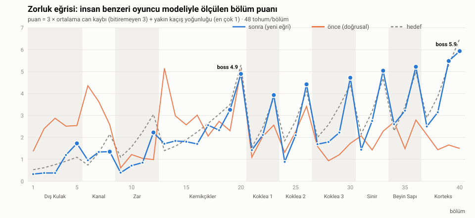
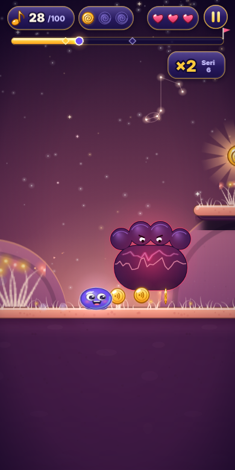
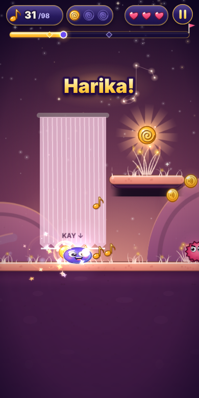
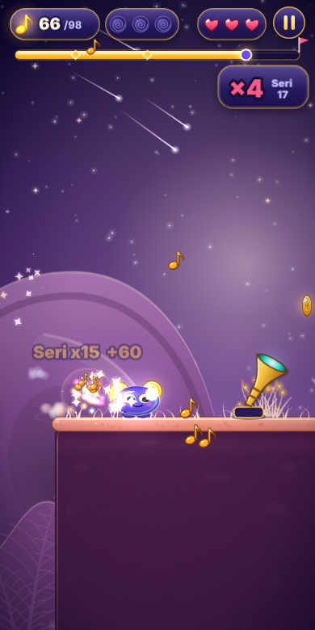
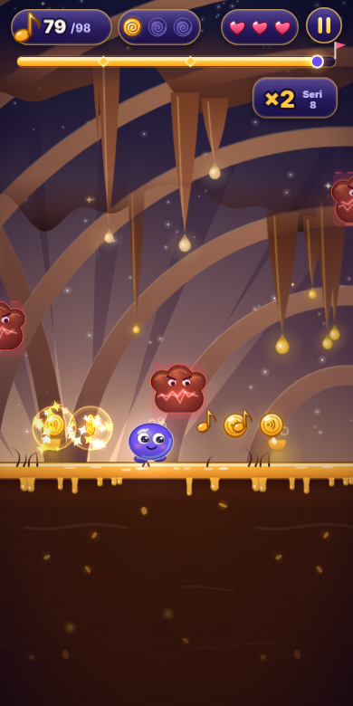

# 12 · Zorluk Eğrisi (ölçülen)

Ürün sahibinin geri bildirimi: "Oyunu genel olarak beğendim ama zorluk seviyelerini beğenmedim. Oyuncuyu alıştırmak için ilk
bölümler kolay olmalı, sonra giderek zorlaşmalı. Her ana bölümün (biyomun) son bölümleri zor olmalı. Her üst kademeye
geçildiğinde zorluk artmalı." Eski üretici zorluğu 1 → 40 arasında **doğrusal** artırıyor, odaları elle verilmiş 1-5 etiketiyle
seçiyor, değiştiricileri (tek can dahil) 15. bölümden sonra rastgele ekliyordu; ölçünce eğri düzensiz çıktı: alıştırma bölümleri 2-3'te
oyuncu başına ~0,6 can gidiyor, 6. bölüm (duvar öğreticisi) ve 13. bölüm (kanca öğreticisiyle birlikte zincir kanca odası) oyuncuların
%25'ini eliyor, 26. bölümde rastgele "tek can" değiştiricisi var, 40. boss ise 39'dan kolay (aşağıdaki "önce" sütunları).

Bu belge yeni eğrinin **hedefini**, **düğmelerini** ve **ölçümünü** anlatır. Kod: `packages/level-gen/src/curve.ts` (eğri ve
düğmeler), `level-gen/src/rooms.ts` (oda ölçüleri), `level-gen/src/generate.ts` (uygulama), `game-core/src/play/human.ts`
(insan benzeri oyuncu modeli), `tools/harness/zorluk.mjs` (ölçüm aracı), `game-core/src/play/zorluk-*.test.ts` (biçim testi).



## 1. Hedef biçim: yükselen testere dişi

- **Bölgeler** haritanın ana bölümleridir (biyom bölgeleri; 17 ve 20 kemikçik bölgesinde kalır): Dış Kulak 1-5, Kanal 6-8,
  Zar 9-12, Kemikçikler 13-20, Koklea Taban 21-23, Orta 24-26, Apeks 27-30, Sinir 31-33, Beyin Sapı 34-36, Korteks 37-40.
- **Alıştırma (1-3):** geniş zemin, kısa çukur (≤ 160 px), alçak diken, geniş iniş (≥ 100 px), **düşman yok** (3'te yalnız öğretici
  odadaki tek devriye), odada en çok iki beceri ailesi, en bağışlayıcı zamanlama; kitlenin her oyuncusu bitirir.
- **Bölge içi rampa:** bölgenin ilk bölümü yeni yeteneği yumuşakça öğretir (kısa bir "nefes" düşüşü), sonra zorluk tırmanır;
  bölgenin **son normal bölümü finaldir** (sınav): en zor gösteri parçası, sınav odaları, en çok oda, en sıkı zamanlama,
  sabit değiştirici (ileri bölgelerde).
- **Bölgeler arası:** her bölgenin girişi bir öncekinin girişinden, finali bir öncekinin finalinden yüksek. **Boss'lar büyük
  doruklardır:** 20 kendinden önceki her bölümden, 40 bütün oyundan zor ama kitlenin yarısından fazlası 3 canla yener.
  Boss'tan sonra (21) kısa bir nefes.

Hedef birimi **beklenen can kaybı (λ)**: insan modelinin bölümde kaybettiği ortalama can (bitiremeyen 3). Bölge girişi `lo`,
finali `hi`; aradaki bölümler `lo + (hi − lo)·u^1,3` (u: bölgedeki konum, 0 giriş … 1 final). Grafikteki hedef puan ≈ 3·λ + 0,5.

| Bölge | Bölümler | Giriş λ | Final λ |
|---|---|---|---|
| Dış Kulak | 1-5 | 0,01 | 0,20 |
| Kanal | 6-8 | 0,08 | 0,55 |
| Zar | 9-12 | 0,20 | 0,85 |
| Kemikçikler | 13-19 (+ boss 20: 1,60) | 0,30 | 1,00 |
| Koklea Taban | 21-23 | 0,35 | 1,10 |
| Koklea Orta | 24-26 | 0,45 | 1,20 |
| Koklea Apeks | 27-30 | 0,50 | 1,30 |
| Sinir | 31-33 | 0,55 | 1,40 |
| Beyin Sapı | 34-36 | 0,60 | 1,50 |
| Korteks | 37-39 (+ boss 40: 2,00) | 0,80 | 1,60 |

**İlk bölümlerin hedefi ilk kez oynayan kademeyle ölçülür** (§2): 1-3'te herkes bitirir ve oyuncu başına en çok 0,1 can
kaybeder, 4-6'da en az %90'ı bitirir (`play/zorluk-ilk.test.ts`). İlk iki bölge bu yüzden bir kademe aşağı çekildi (Dış Kulak
finali 0,30 → 0,20, Kanal 0,15-0,70 → 0,08-0,55); sonraki yapı (bölge rampaları, yükselen finaller, boss'lar) aynı.

**Final zinciri:** finaller 8 → 12 → 19 → 23 → 26 → 30 → 33 → 36 → 39 kesin yükselen bir zincirdir (her kademe bir öncekinden
~0,1 can zor), boss'lar zincirin üstünde iki büyük sıçrayıştır. Üretici finalde λ'yı doğrudan kullanır; tek istisna Kanal
finalidir (`gain: 0,65`: oda puanlarının toplamı orada zorluğu eksik tahmin ediyor, ölçülen değer hedefi aşıyordu).

## 2. Ölçüm: insan benzeri oyuncu modeli (`game-core/src/play/human.ts`)

Planlayıcı botun (`play/planner.ts`) "niyeti" + insan eli, aynı deterministik 1/60 sn adımı üzerinde:

- **Tepki gecikmesi:** yeni karar ancak 200-260 ms sonra uygulanabilir; o ana dek planlanmış girdiler değişmez. Süren basılı
  tutmanın bırakılışı (kanca, süzülme) tepki süresinden sonrası için yeniden zamanlanabilir.
- **Sınırlı ileri bakış:** 1,2-1,4 sn (ekranın sağ kenarı; bot 1,9 sn). Boss arenasında 0,6 sn: saldırının yönü ve türü
  ancak uyarı (telegraf) görünce bilinir — planlayıcı geleceği "bilmesin".
- **Zamanlama sapması:** her girdi N(0, σ) kadar erken/geç (σ 60-100 ms, en çok ±1,5σ); basılı tutma süresi ±%15-25 sapar.
- **Kusurlar:** %4-10 olasılıkla 100-200 ms geç kalma, %1-3 olasılıkla kaçan girdi (fark edilince tepki süresiyle düzeltilir).
- **Kare-mükemmel numara yok:** sapma, dar pencereli her çözümü doğal olarak cezalandırır.
- **Kitle:** her koşu (tohum) bir oyuncudur; beceri dört kademede ustadan (σ 60 ms, tepki 200 ms) acemiye (σ 100 ms, tepki 260 ms)
  döner — ortalama tepki ~230 ms, sapma ~80 ms. Gizli koklealara sapmaz (ana yol oyuncusu), notalara gider.
- **İlk kez oynayan kademe (`firstTimerOf`):** gerçek cihaz geri bildirimi ("ilk bölümler hâlâ çok zor") modelin ilk
  oyuncuyu fazla becerikli saydığını gösterdi. İlk bölümlerin hedefleri artık bu kademeyle ölçülür: tepki 320-450 ms, sapma σ
  120-160 ms, girdilerin %10-15'i 100-250 ms geç, %4-6'sı kaçar, %2-4'ü dokunuş yerine kazara yatay kaydırma olur (zıplama
  yutulur), ileri bakış ~0,9 sn; her oyuncu bu aralıklardan tohumla çekilir.
- **Öğretici ağır çekim:** oyundaki gibi yeni yeteneğin ilk anında oyun ×0,3 yavaşlar (en çok 8 gerçek sn, hareket yapılınca
  biter); model o arada tepki ve sapmayı oyun saatinde ×0,3 alır.
- **Faz:** zamanlamalı öğelerin (hareketli platform, düşman, nabız, ritim) varış anındaki evresi şansın işidir; her koşu saati
  rastgele bir evreden (0-12 sn) başlatır → zorluk evrelere göre beklenen değerdir (boss hariç).
- Tohumlu ve deterministik: aynı bölüm + tohum → aynı sonuç.

Ölçülenler (bölüm × tohum): bitirme (3 canla), kaybedilen can, düşme (yeniden doğma), **yakın kaçış** (tehlikeye/düşmana/mermiye
8 px'ten yakın hasarsız geçiş ve kenara 10 px'ten yakın iniş). **Zorluk puanı** (0-10) = 3 × ortalama can kaybı (bitiremeyen 3) +
yakın kaçış yoğunluğu (dakikada 20 = 1 puan, en çok 1). Tek tanım: `scoreRuns` (`play/human.ts`).

## 3. Düğmeler (`level-gen/src/curve.ts` → `knobsFor`, üretici uygular)

| Düğme | Ne yapar | Alıştırma (1-3) | Bölge girişi | Final / son |
|---|---|---|---|---|
| λ hedefi | beklenen can kaybı; oda seçiminin hedefi | ≤ 0,1 | `lo` | `hi` |
| Oda sayısı | bölüm uzunluğu (öğretici, kontrol noktası, mikro ve gösteri odaları hariç) | 4-5 | 4-7 | +1 (en çok 11) |
| Oda puanı hedefi / tavanı | ölçülen oda puanına (aşağıda) göre seçim; bölüm-içi bölümler ×0,7 / ×1 / ×1,25, her bölüm-içi bölümün son odası +0,5 | tavan 1,5 | hedef + 2,5 | hedef + 3,5 |
| Tek oda tavanı | bir odanın tahmini can kaybı ≤ max(0,07; λ/2): tek odalık ani sıçrama yok | | | |
| Mekanik ailesi | bir odada birleşebilen beceri ailesi (çukur, diken, düşman, zamanlama, duvar, süzülme, zar, kanca, çakılma, geri dönüş, su, kayma, darbe, çevirme, frekans) | 2 | 2-7 | sınırsız |
| Düşman türleri | izinli türler: devriye 3+, uçan 4+, zıplayan 9+, atıcı 13+, kalkanlı 15+ | yok (3: devriye) | | |
| Zemin boşluğu / iniş | odada en geniş çukur ve boşluk üstündeki en dar basamak | ≤ 160 / ≥ 100 px | 4-8: ≤ 230 / ≥ 60 px | serbest |
| Sıkılık | 0 (bağışlayıcı) … 1 (sıkı) = 0,55 × genel ilerleme + 0,45 × bölgedeki konum; aşağıdaki geometri ve zamanlama ondan türer | ~0 | düşük | yüksek |
| Diken genişliği | ×0,75 … ×1,5 (yalnız zemindeki diken, zeminden taşmaz) | dar | | geniş |
| Çukur genişliği | ×0,8 … ×1,2 (yalnız içi boş zemin çukuru, en çok 190 px; duvar odalarında değil) | dar | | geniş |
| Basamak genişliği | hareketli/ritim/ufalanan/yankı basamağı ×1,25 … ×0,8 (en az 60 px) | geniş | | dar |
| Ufalanma gecikmesi | çatlak zemin 0,7 … 0,36 sn sonra düşer (motor varsayılanı 0,4) | 0,7 | | 0,36 |
| Zar penceresi | zara değince dokunma penceresi 0,17 … 0,11 sn (varsayılan 0,12) | | 0,17 | 0,11 |
| Düşman temposu | devriye hızı, uçan salınımı, atıcı ve zıplayan temposu ×0,75 … ×1,15 | | yavaş | hızlı |
| Platform temposu | hareketli platform ve sürüklenen tehlike ×0,8 … ×1,12 | | | |
| Gösteri parçası | bölge girişinde biyomun en kolay, finalde en zor gösterisi (tahmini can kaybı ≤ λ/2) | İlk Ninni Yolu | en kolay | en zor |
| Sınav odası | yalnız bölge finalinde, gösteriden hemen önce: Kanal `kn-damla-asansor`, Zar `zr-ritim-merdiven` + `zr-ritim-koridor`, Kemikçikler `km-disli`, Koklea `k1-sinav-havuz` / `k3-sinav-bas`, Sinir `sn-sinav` + `sn-sinav-kopru`, Beyin Sapı `bs-sinav`, Korteks `kx-sinav-karma` + `kx-sinav-ritim`. Zar, Koklea Orta, Koklea Apeks, Sinir, Beyin Sapı ve Korteks finallerinde iki sınav; Beyin Sapı girişi (34) ve Korteks'in diğer bölümleri (37, 38) birer "prova" sınavı (tahminen en ağırı) alır; yardım kademesi başına bir sınav düşer | – | – | 1-2 oda |
| Kalibrasyon varyantı | aynı düğmelerle üretilebilen bölümlerden, insan modeliyle ölçülünce hedefe en yakın olanı; finalde hedefin altı, girişte üstü ek cezalı (`level-gen/src/kalibrasyon.ts`, üretilmiş). Önceki iki bölümün odalarına bakan çeşitlilik kuralı komşuların varsayılan varyantını kullanır: bir bölümün kalibrasyonu komşusunu değiştirmez | | | |
| Değiştiriciler | yalnızca ileri bölgelerde, çoğunlukla finallerde, sabit tablo (rastgele değil); tek can ve ters yerçekimi yolculukta yok | yok | yok | 19 sis · 23 sis · 26 gece · 29 sis · 30 hız+yankı · 32 gece · 33 hız+yankı · 35 sis · 36 yankı · 38 gece · 39 hız+gece |
| Boss | can, uyarı (telegraf, en az ×0,6) ve saldırı temposu (mermi hızı √tempo) | | | 20: can 14, uyarı ×1,0, tempo ×1,2 · 40: can 32, uyarı ×0,8, tempo ×1,8 |
| Kontrol noktası / güvenli zemin | her bölüm 3 bölüm-içi bölüm, 2. ve 3. kontrol noktası odasıyla başlar; düşen son güvenli zemine döner | | | |

Bölüm başına değerler (varsayılan profil):

<!-- dugmeler:basla -->
| Bölüm | λ hedef | Oda | Oda puanı hedefi / tavan | Aile ≤ | Sıkılık | Diken × | Çukur × | Basamak × | Ufalanma (sn) | Zar penceresi (sn) | Düşman / platform temposu | Değiştirici |
|---|---|---|---|---|---|---|---|---|---|---|---|---|
| 1 | 0.01 | 4 | 0.4 / 1.5 | 2 | 0.00 | 0.75 | 0.8 | 1.25 | 0.7 | 0.17 | 0.75 / 0.8 | – |
| 2 | 0.04 | 5 | 0.6 / 1.5 | 2 | 0.13 | 0.84 | 0.85 | 1.19 | 0.66 | 0.162 | 0.8 / 0.84 | – |
| 3 | 0.09 | 6 | 0.8 / 1.5 | 2 | 0.25 | 0.94 | 0.9 | 1.14 | 0.61 | 0.155 | 0.85 / 0.88 | – |
| 4 | 0.14 | 5 | 1.0 / 3.5 | 3 | 0.38 | 1.03 | 0.95 | 1.08 | 0.57 | 0.147 | 0.9 / 0.92 | – |
| 5 | 0.20 | 6 | 1.3 / 4.8 | 9 | 0.51 | 1.13 | 1 | 1.02 | 0.53 | 0.14 | 0.95 / 0.96 | – |
| 6 | 0.08 | 3 | 0.8 / 3.3 | 2 | 0.07 | 0.8 | 0.83 | 1.22 | 0.68 | 0.166 | 0.78 / 0.82 | – |
| 7 | 0.27 | 7 | 1.6 / 4.1 | 3 | 0.31 | 0.8 | 0.92 | 1.11 | 0.59 | 0.151 | 0.87 / 0.9 | – |
| 8 | 0.36 | 9 | 2.0 / 5.5 | 9 | 0.55 | 0.8 | 1.02 | 1 | 0.51 | 0.137 | 0.97 / 0.98 | – |
| 9 | 0.20 | 6 | 1.3 / 3.8 | 3 | 0.11 | 0.8 | 0.85 | 1.2 | 0.66 | 0.163 | 0.8 / 0.84 | – |
| 10 | 0.36 | 7 | 2.0 / 4.5 | 3 | 0.28 | 0.8 | 0.91 | 1.13 | 0.61 | 0.16 | 0.86 / 0.89 | – |
| 11 | 0.58 | 7 | 3.0 / 5.5 | 4 | 0.44 | 0.8 | 0.98 | 1.05 | 0.55 | 0.16 | 0.93 / 0.94 | – |
| 12 | 0.85 | 9 | 4.1 / 7.6 | 9 | 0.61 | 0.8 | 1.04 | 0.98 | 0.49 | 0.16 | 0.99 / 0.99 | – |
| 13 | 0.30 | 6 | 1.7 / 4.2 | 3 | 0.17 | 0.88 | 0.87 | 1.17 | 0.64 | 0.16 | 0.82 / 0.85 | – |
| 14 | 0.37 | 7 | 2.0 / 4.5 | 4 | 0.26 | 0.94 | 0.9 | 1.13 | 0.61 | 0.155 | 0.85 / 0.88 | – |
| 15 | 0.47 | 7 | 2.5 / 5.0 | 4 | 0.35 | 1.01 | 0.94 | 1.09 | 0.58 | 0.149 | 0.89 / 0.91 | – |
| 16 | 0.58 | 7 | 3.0 / 5.5 | 4 | 0.44 | 1.08 | 0.97 | 1.05 | 0.55 | 0.144 | 0.92 / 0.94 | – |
| 17 | 0.71 | 8 | 3.5 / 6.0 | 5 | 0.53 | 1.14 | 1.01 | 1.01 | 0.52 | 0.138 | 0.96 / 0.97 | – |
| 18 | 0.85 | 8 | 4.2 / 6.7 | 5 | 0.61 | 1.21 | 1.05 | 0.97 | 0.49 | 0.133 | 1 / 1 | – |
| 19 | 1.00 | 10 | 4.8 / 8.3 | 9 | 0.70 | 1.28 | 1.08 | 0.93 | 0.46 | 0.128 | 1.03 / 1.03 | sis |
| 20 | 1.60 | boss | can 14, uyarı ×1, tempo ×1.2 | – | – | – | – | – | – | – | – | – |
| 21 | 0.35 | 7 | 1.9 / 4.4 | 4 | 0.28 | 0.96 | 0.91 | 1.12 | 0.6 | 0.153 | 0.86 / 0.89 | – |
| 22 | 0.65 | 8 | 3.3 / 5.8 | 5 | 0.52 | 1.14 | 1.01 | 1.02 | 0.52 | 0.139 | 0.96 / 0.97 | – |
| 23 | 1.10 | 10 | 5.2 / 8.7 | 9 | 0.76 | 1.32 | 1.1 | 0.91 | 0.44 | 0.124 | 1.05 / 1.04 | sis |
| 24 | 0.45 | 7 | 2.4 / 4.9 | 5 | 0.32 | 0.99 | 0.93 | 1.1 | 0.59 | 0.151 | 0.88 / 0.9 | – |
| 25 | 0.75 | 8 | 3.7 / 6.2 | 6 | 0.56 | 1.17 | 1.03 | 1 | 0.51 | 0.136 | 0.98 / 0.98 | – |
| 26 | 1.20 | 10 | 5.7 / 9.2 | 9 | 0.80 | 1.35 | 1.12 | 0.89 | 0.43 | 0.122 | 1.07 / 1.06 | gece |
| 27 | 0.50 | 8 | 2.6 / 5.1 | 5 | 0.37 | 1.02 | 0.95 | 1.09 | 0.58 | 0.148 | 0.9 / 0.92 | – |
| 28 | 0.69 | 8 | 3.4 / 5.9 | 6 | 0.53 | 1.15 | 1.01 | 1.01 | 0.52 | 0.138 | 0.96 / 0.97 | – |
| 29 | 0.97 | 9 | 4.7 / 7.2 | 6 | 0.69 | 1.27 | 1.08 | 0.94 | 0.46 | 0.128 | 1.03 / 1.02 | sis |
| 30 | 1.30 | 11 | 6.1 / 9.6 | 9 | 0.86 | 1.39 | 1.14 | 0.86 | 0.41 | 0.118 | 1.09 / 1.07 | hiz, yanki |
| 31 | 0.55 | 8 | 2.8 / 5.3 | 6 | 0.42 | 1.07 | 0.97 | 1.06 | 0.56 | 0.145 | 0.92 / 0.94 | – |
| 32 | 0.90 | 9 | 4.3 / 6.8 | 7 | 0.66 | 1.25 | 1.06 | 0.95 | 0.47 | 0.13 | 1.01 / 1.01 | gece |
| 33 | 1.40 | 11 | 6.6 / 10.1 | 9 | 0.90 | 1.43 | 1.16 | 0.84 | 0.39 | 0.116 | 1.11 / 1.09 | hiz, yanki |
| 34 | 0.60 | 9 | 3.0 / 5.5 | 6 | 0.47 | 1.1 | 0.99 | 1.04 | 0.54 | 0.142 | 0.94 / 0.95 | – |
| 35 | 0.97 | 10 | 4.7 / 7.2 | 7 | 0.70 | 1.28 | 1.08 | 0.93 | 0.46 | 0.128 | 1.03 / 1.03 | sis |
| 36 | 1.50 | 11 | 7.0 / 10.5 | 9 | 0.94 | 1.46 | 1.18 | 0.83 | 0.38 | 0.113 | 1.13 / 1.1 | yanki |
| 37 | 0.80 | 9 | 3.9 / 6.4 | 7 | 0.51 | 1.13 | 1 | 1.02 | 0.53 | 0.14 | 0.95 / 0.96 | – |
| 38 | 1.12 | 10 | 5.3 / 7.8 | 8 | 0.75 | 1.31 | 1.1 | 0.91 | 0.45 | 0.125 | 1.05 / 1.04 | gece |
| 39 | 1.60 | 11 | 7.4 / 10.9 | 9 | 0.99 | 1.49 | 1.19 | 0.81 | 0.36 | 0.111 | 1.14 / 1.12 | hiz, gece |
| 40 | 2.00 | boss | can 32, uyarı ×0.8, tempo ×1.8 | – | – | – | – | – | – | – | – | – |
<!-- dugmeler:bitir -->

### Bölüm nasıl kurulur

1. Düğmeler (yukarıdaki tablo) ve uyarlanabilir yardım → λ, oda sayısı, sıkılık, sınav sayısı.
2. Havuz: biyoma uyan, açık yeteneklerle oynanabilen odalar; düğmelere uymayanlar (aile, düşman türü, çukur/iniş, puan tavanı, tek
   oda tavanı) elenir, yetmezse kısıtlar kademeli gevşer.
3. Gösteri ve (finalde) sınav odaları seçilir; kalan **can kaybı bütçesi** = λ − gösteri − sınav − öğretici − mikro payı, bölüm-içi
   bölümlere %27 / %33 / %40 dağıtılır. Her oda, bütçeden ona düşen paya en yakın **tahmini can kaybıyla** (ölçülen) seçilir.
4. Tempo (ölü yol yok), risk yolu, tırmanış, zar kuralları, koklea ve nota sınırları eskisi gibi; en sonda geometri ve zamanlama
   düğmeleri odaların varlıklarına yazılır (oda tanımları değişmez, motor bunları `props` üzerinden okur).

### Oda puanları (hesaplanır, tahmin edilmez)

`packages/content/src/chunks/puanlar.ts` **üretilmiş** dosyadır (`node tools/harness/zorluk.mjs --odalar`): her oda tek başına
(önünde/arkasında düz zemin), rastgele başlangıç evresiyle 16'şar kez oynanır — acemi modelle düğmesiz, oyuncu kitlesiyle en
bağışlayıcı (sıkılık 0) ve en sıkı (sıkılık 1) düğmelerle. `level-gen/src/rooms.ts` bundan ve odanın yapısından (aileler, düşman
türleri, en geniş çukur, en dar iniş, tehlike ve zamanlamalı öğe sayısı) **oda puanını** (0-10) ve verilen sıkılıktaki **tahmini
can kaybını** hesaplar. Ölçüm olmayan (yeni) oda yapısından kaba bir tahmin alır; oda ekleyince ölçümü yenileyin.

Yeni odalar: alıştırma odaları `dk-cimen`, `dk-kucuk-cukur`, `dk-alcak-basamak`, `dk-tuy-yolu`, alıştırma gösterisi `dk-sp-ilk-yol`;
bölge finalleri için **sınav odaları** `k1-sinav-havuz`, `k3-sinav-bas`, `sn-sinav`, `bs-sinav`, `sn-sinav-kopru`, `kx-sinav-ritim`, `kx-sinav-karma`
(öğrenilen her şey bir arada; her tehlike görünür ve telgraflı, gizli koklea ana yolda değil).

## 4. İlk bölümlerin yardımları ve uyarlanabilir yardım

**İlk bölümler (1-12; `curve.ts` → `assistFor`, `LevelSpec.assist`, motor deterministik kalır):**

| Bölüm | Koşu (px/sn) | Coyote / tampon (sn) | Can götürmeyen düşüş | Geri dönüş | İçerik |
|---|---|---|---|---|---|
| 1 | 190 | 0,16 / 0,20 | ilk 2 | açık değil | diken, düşman, tehlike yok (zemindeki diken 60-70 px çukura döner); çukur ≤ 70 px |
| 2 | 205 | 0,16 / 0,20 | ilk 2 | yalnız gerektiği yerde | öğretici odası dışında diken/düşman yok; çukur ≤ 70 px |
| 3 | 220 | 0,16 / 0,20 | ilk 1 | yalnız gerektiği yerde | öğretici odası dışında diken/düşman yok; çukur ≤ 90 px |
| 4-5 | 235 / 242 | 0,13 / 0,15 | ilk 1 | yalnız gerektiği yerde | kontrol noktası odaları güvenli; iki oda kısa |
| 6 | 248 | 0,12 / 0,14 | ilk 1 | serbest | kontrol noktası odası güvenli; iki oda kısa; serumen/perde dar, diken ≤ ×0,8 |
| 7-8 | 255 / 260 | 0,12 / 0,14 | ilk 2 | serbest | serumen yığını dar ve alçak (52 px), perde ×0,7, diken ≤ ×0,8; kontrol noktası odası güvenli |
| 9-12 | 260 | 0,12 / 0,14 | ilk 1 | serbest | zar penceresi ≥ 0,16 sn ("Mükemmel" yalnız ödül); serumen/perde dar, diken ≤ ×0,8; kontrol noktası odası güvenli |
| 13+ | 260 | 0,10 / 0,12 | – | serbest | – |

- **Her odada kontrol noktası** (1-12); 1-3'te hareketli, ritim, ufalanan, yankı ve asansör basamağı yok.
- **Öğretici odasında can gitmez** (1-12): yeni hareketi öğrenirken çarpma yalnız geri iter, düşüş aynı yerden yeniden başlatır
  (en çok 3 kez — boşta oyuncu orada sonsuza dek kalmasın).
- **Kazara kaydırma döndürmez:** geri dönüş 2. bölümde öğretilir (öncesinde hiç yok); 1-5'te yalnız kapısı kapalı bir temas
  anahtarı ya da frekans kapısı yakınken çalışır (ileri yöne dönüş her zaman serbest); yatay kaydırma eşiği 42 yerine 64 px;
  basamağa takılan kahraman geri koşmaz, zıplamayı bekler (kapıda döner). Normal odalarda dönüş bulmacası 6. bölümden itibaren.
- **Öğretici ağır çekim** ×0,35 yerine ×0,3 ve 6 yerine en çok 8 gerçek saniye.
- Yavaş koşuda tempo kuralı aynı süreyi tutar: sessiz yol sınırı koşu hızıyla ölçeklenir, yayın/fırlatıcının uçuşu altında kalan
  diken girdi sayılmaz, odanın kendi sessiz yolları sınırı aşan odalar ilk bölümlerde seçilmez.

**Diken seyrekliği (altıncı geçiş; oyuncu: "yerden çıkan kırmızı dikenler oyunu çok zorlaştırıyor"):** oyuncunun "yerden
çıkan diken" diye gördüğü öğe kırmızı parlayan `spike` (zemin ve platform dikeni, havuz tabanı dikeni); serumen yığını ve
gürültü bulutları gözlü bulut olarak çizilir, nabız (zamanlı) tehlikeler yalnız Sinir/Beyin Sapı/Korteks odalarında var.
Üretici (`generate.ts` → `capSpikes`) tempo kuralından önce uygular, sonradan eklenen mikro odalara ikinci kez:

| Bölümler | Önce: diken (1000 px başına) | Sonra | Kural |
|---|---|---|---|
| 1-5 | 34 (0,59) | 0 | hiç diken yok: zemindeki diken 60-110 px'lik çukura döner, yükseltideki kalkar |
| 6-12 | 93 (0,94) | 18 (0,18) | bölüm-içi bölüm başına en çok bir, yalnız zeminde; kontrol noktası ve geri dönüş odasında, inişten sonraki 160 px'te hiç |
| 13-19 | 137 (1,31) | 56 (0,54) | her beş dikenden ikisi kalır (kontrol noktası odasında hiç); havuz tabanı dikeni kalır |
| 21-30 | 225 (1,26) | 98 (0,56) | 〃 |
| 31-39 | 181 (0,95) | 75 (0,39) | 〃 |

Kalkan zemin dikeni, iki yanda en az 100 px zemin kalıyorsa çukura döner (zıplama ritmi ve tempo kuralı korunur; anahtar ve
kapının 200 px yakınında çukur açılmaz); dönüşemeyen diken, kalkınca odada zorunlu engeller arasında 480 px'ten uzun boşluk
bırakacaksa kalır. Kalan dikenler daha bağışlayıcı: vuruş kutusu görselin ortadaki %60'ı ve uç bandı (eskiden genişliğin
tamamı), 6-12'de her odada dikene ilk değiş yalnız geri iter ("Dikkat, diken!"). Nabız tehlikesi açılmadan 0,65 sn önce
parlar ve titrer (eskiden 0,45 sn, görsel uyarı yoktu). Denetim: `level-gen/src/diken.test.ts`.

**Kıl perdesi okunur hâle geldi (oyuncu: "5. bölümdeki içinde şimşek olan bulut ne, nasıl geçilir?"):** altından kayılan
asılı tehlike (`curtain`: G-170'ten G-24'e) genel gürültü bulutuyla (şimşek, kızgın gözler) aynı çiziliyordu. Artık
`props.curtain` ile işaretlenir ve ayrı çizilir (`render/items.ts` → `buildCurtain`): tutturma çubuğundan sarkan tül, net
beyaz alt kenar, altında aydınlık açıklık ve aşağı oklar, "KAY ↓" yazısı. Geometri belirsiz değil: üstünde yer varsa perde
G-290'a uzar (tam zıplama 163 px: aşılamaz), 1-12'de alt kenar G-27 (kayan kahramanla 17 px pay; ayaktaki kahraman değer).
3-8'de bölümün ilk üç perdesinden ~320 px önce el işaretli "Aşağı kaydır: altından kay" ipucu çıkar. **5. bölümde kayma
tazelenir:** ilk perdeden 260 px önce (önünde kontrol noktası, en az 300 px koşu payı) 3. bölümdeki dersin aynısı —
ağır çekim, büyük aşağı kaydırma eli, "Aşağı kaydır: perdenin altından kay!". Ders önceden tamamlanmış olsa da gösterilir,
bir koşuda bir kez (yeniden doğunca tekrar açılmaz); oyuncu 5. bölümde iki perdeyi hasarsız geçince kalıcı olarak kapanır
(`tazele-kayma` anahtarı). Öncesi / sonrası:

 

**Uyarlanabilir yardım (profil):**

Profil artık yalnızca **yumuşak bir yardım**dır (`generateLevel` → `levelKnobs`):
- aynı bölümde üst üste **3 başarısızlık → bir kademe** kolaylaştırır (λ ×0,72, bir oda eksik, oda tavanı ×0,75, sıkılık −0,15;
  finalden bir sınav odası düşer, yalnız görsel değiştiriciler kalır), **5 başarısızlık → iki kademe**;
- usta oyuncu (son 5 bölüm ortalaması ≥ 2,8 yıldız) yalnızca 6. bölümden sonra, final ve boss olmayan bölümlerde çok küçük bir
  ek alır (λ +0,06). **İlk bölümler asla zorlaşmaz.**

## 5. Dürüstlük kuralları

- Fizik 13. bölümden itibaren sabittir (koşu 260 px/sn, coyote 0,1 sn, tampon 0,12 sn); ilk on iki bölümün yardımları (§4) bölüm
  düğmesidir ve motor deterministik kalır: zorluk hissi değil, içerik ve pencere genişliği değişir.
- Bağışlayıcı vuruş kutuları korunur (tehlike görselin 8 px içi, nota yarıçapı geniş). Her tehlike görünür ve uyarılıdır:
  nabız tehlikesi 0,65 sn (parlama + titreme), atıcı 0,55 sn önce titrer; boss uyarıları en az ×0,6 (≥ 0,45 sn, tepki süresinin iki katı).
- Kör zıplama yok: çukur en çok 190 px (tam zıplama 221 px), geometri düğmeleri duvar odalarına ve içinde etkin öğe olan
  çukurlara dokunmaz; tek oda bölümün can bütçesinin yarısını aşamaz.
- Mükemmel planlayıcı bot 40 bölümün hepsini bitirir; dokunmayan oyuncu hiçbirini bitiremez (kabul ölçütü değişmedi).
- Boss arenası kapalıdır: saplanan yumruk kahramanın üstüne inerse kahraman yumruğun en yakın kenarına (arena içinde) alınır;
  eskiden çarpışma onu sağ duvarın ötesine itip "düşme" ile can kaybettirebiliyordu (`play/boss.test.ts` → arena sınırı).
- Gizli koklea rafları ana yolda değildir ama ulaşılabilir: duvar odalarının, raflı gösterilerin ve `gn-geri-anahtar`'ın
  koklealarına hedefe yönelik planlayıcı ulaşır (`play/rooms.test.ts` → koklea rafları). Kuyu odalarında (`gn-kuyu`,
  `kn-kuyu-dusman`, `kx-kuyu-cevir`) koklea kuyunun tepesinden sol yan rafa alındı (tırmanan ana yol oyuncusu artık istemeden
  almıyordu); `gn-geri-anahtar`'da raf anahtarın sağına, kapıya dönüş yoluna alındı (soldaki raf botu anahtarı kaçırıp geri
  koşmaya sürüklüyordu).

## 6. Sonuç: önce / sonra

**İlk kez oynayan oyuncu (1-12):**

<!-- ilk:basla -->
_İlk kez oynayan kademe (§2), 48 oyuncu × bölüm; önce: aynı kademe eski oyunda (48 oyuncu)._

| Bölüm | Hedef | Önce: bitirme | Önce: can kaybı | Sonra: bitirme | Sonra: can kaybı ± SE |
|---|---|---|---|---|---|
| 1 | 100%, ≤ 0,1 can | 94% | 0.67 | 100% | 0.00 ± 0.00 |
| 2 | 100%, ≤ 0,1 can | 90% | 0.88 | 100% | 0.00 ± 0.00 |
| 3 | 100%, ≤ 0,1 can | 88% | 1.10 | 100% | 0.04 ± 0.04 |
| 4 | ≥ %90 | 71% | 1.52 | 100% | 0.65 ± 0.10 |
| 5 | ≥ %90 | 44% | 2.44 | 98% | 0.58 ± 0.11 |
| 6 | ≥ %90 | 60% | 2.00 | 100% | 0.29 ± 0.08 |
| 7 | ≥ %80 | 46% | 2.23 | 85% | 1.21 ± 0.15 |
| 8 | ≥ %70 | 38% | 2.46 | 79% | 1.50 ± 0.15 |
| 9 | ≥ %65 | 94% | 0.81 | 100% | 0.10 ± 0.05 |
| 10 | ≥ %65 | 90% | 1.00 | 94% | 0.44 ± 0.13 |
| 11 | ≥ %65 | 46% | 2.15 | 92% | 0.60 ± 0.14 |
| 12 | ≥ %65 | 40% | 2.40 | 73% | 1.50 ± 0.17 |
<!-- ilk:bitir -->

**Oyuncu kitlesi (40 bölüm):**

<!-- tablo:basla -->
_Ölçüm: 48 oyuncu (tohum) × 40 bölüm (bölüm tuzu 0 — oyuncunun gördüğü bölüm), varsayılan profil; önce: 24 tohum, eski eğri. 23 sekizinci geçişte (§6, MK-003) v4 → v17 ile yeniden ölçüldü; diğer satırlar bu geçişin denetiminde aynen tekrarlandı (ölçüm deterministik)._

| Bölüm | Bölge | Rol | Hedef | Önce: bitirme | Önce: can kaybı | Önce: puan | Sonra: bitirme | Sonra: can kaybı ± SE | Sonra: yakın/dk | Sonra: puan ± SE |
|---|---|---|---|---|---|---|---|---|---|---|
| 1 | Dış Kulak | giriş (nefes) | 0.5 | 100% | 0.21 | 1.4 | 100% | 0.00 ± 0.00 | 6.6 | 0.3 ± 0.0 |
| 2 | Dış Kulak |  | 0.6 | 100% | 0.54 | 2.4 | 100% | 0.00 ± 0.00 | 8.3 | 0.4 ± 0.0 |
| 3 | Dış Kulak |  | 0.8 | 100% | 0.63 | 2.9 | 100% | 0.00 ± 0.00 | 7.6 | 0.4 ± 0.0 |
| 4 | Dış Kulak |  | 0.9 | 96% | 0.58 | 2.5 | 100% | 0.06 ± 0.04 | 11.5 | 0.8 ± 0.1 |
| 5 | Dış Kulak | **final** | 1.1 | 96% | 0.54 | 2.5 | 100% | 0.19 ± 0.06 | 14.7 | 1.3 ± 0.2 |
| 6 | Kulak Kanalı | giriş (nefes) | 0.7 | 75% | 1.21 | 4.4 | 100% | 0.06 ± 0.04 | 8.7 | 0.6 ± 0.1 |
| 7 | Kulak Kanalı |  | 1.3 | 88% | 1.00 | 3.6 | 100% | 0.15 ± 0.06 | 9.7 | 0.9 ± 0.2 |
| 8 | Kulak Kanalı | **final** | 2.1 | 100% | 0.63 | 2.6 | 100% | 0.25 ± 0.08 | 15.6 | 1.5 ± 0.2 |
| 9 | Kulak Zarı | giriş (nefes) | 1.1 | 100% | 0.08 | 0.6 | 100% | 0.00 ± 0.00 | 5.4 | 0.3 ± 0.0 |
| 10 | Kulak Zarı |  | 1.6 | 100% | 0.29 | 1.2 | 100% | 0.00 ± 0.00 | 5.0 | 0.2 ± 0.0 |
| 11 | Kulak Zarı |  | 2.3 | 100% | 0.21 | 1.0 | 100% | 0.04 ± 0.03 | 6.8 | 0.5 ± 0.1 |
| 12 | Kulak Zarı | **final** | 3.0 | 100% | 0.21 | 1.0 | 100% | 0.21 ± 0.07 | 6.7 | 1.0 ± 0.2 |
| 13 | Kemikçikler | giriş (nefes) | 1.4 | 75% | 1.54 | 5.2 | 100% | 0.29 ± 0.08 | 7.0 | 1.2 ± 0.2 |
| 14 | Kemikçikler |  | 1.6 | 88% | 0.83 | 3.0 | 94% | 0.60 ± 0.13 | 7.7 | 2.2 ± 0.4 |
| 15 | Kemikçikler |  | 1.9 | 100% | 0.75 | 2.6 | 98% | 0.31 ± 0.09 | 6.4 | 1.3 ± 0.3 |
| 16 | Kemikçikler |  | 2.3 | 96% | 0.79 | 3.0 | 94% | 0.42 ± 0.11 | 7.8 | 1.6 ± 0.3 |
| 17 | Kemikçikler |  | 2.6 | 96% | 0.54 | 2.1 | 94% | 0.77 ± 0.13 | 9.2 | 2.8 ± 0.4 |
| 18 | Kemikçikler |  | 3.1 | 96% | 0.79 | 2.7 | 92% | 0.73 ± 0.13 | 10.2 | 2.7 ± 0.4 |
| 19 | Kemikçikler | **final** | 3.5 | 100% | 0.63 | 2.3 | 88% | 0.98 ± 0.15 | 10.3 | 3.5 ± 0.4 |
| 20 | Kemikçikler | **boss** | 5.3 | 63% | 1.67 | 5.1 | 77% | 1.60 ± 0.15 | 1.7 | 4.9 ± 0.5 |
| 21 | Koklea · Taban | giriş (nefes) | 1.6 | 100% | 0.21 | 1.1 | 100% | 0.25 ± 0.07 | 6.5 | 1.1 ± 0.2 |
| 22 | Koklea · Taban |  | 2.5 | 100% | 0.50 | 2.1 | 100% | 0.42 ± 0.08 | 6.7 | 1.6 ± 0.2 |
| 23 | Koklea · Taban | **final** | 3.8 | 92% | 0.58 | 2.6 | 81% | 1.27 ± 0.16 | 9.6 | 4.3 ± 0.5 |
| 24 | Koklea · Orta | giriş (nefes) | 1.9 | 100% | 0.29 | 1.3 | 98% | 0.38 ± 0.10 | 6.5 | 1.5 ± 0.3 |
| 25 | Koklea · Orta |  | 2.8 | 92% | 0.54 | 2.3 | 90% | 0.65 ± 0.15 | 7.2 | 2.3 ± 0.4 |
| 26 | Koklea · Orta | **final** | 4.1 | 67% | 1.00 | 3.4 | 77% | 1.23 ± 0.17 | 9.9 | 4.2 ± 0.5 |
| 27 | Koklea · Apeks | giriş (nefes) | 2.0 | 100% | 0.38 | 1.6 | 100% | 0.17 ± 0.06 | 6.0 | 0.8 ± 0.2 |
| 28 | Koklea · Apeks |  | 2.6 | 100% | 0.13 | 0.9 | 98% | 0.31 ± 0.09 | 9.6 | 1.4 ± 0.3 |
| 29 | Koklea · Apeks |  | 3.4 | 100% | 0.21 | 1.2 | 94% | 0.63 ± 0.13 | 8.6 | 2.3 ± 0.4 |
| 30 | Koklea · Apeks | **final** | 4.4 | 100% | 0.38 | 1.7 | 75% | 1.35 ± 0.17 | 10.0 | 4.6 ± 0.5 |
| 31 | İşitme Siniri | giriş (nefes) | 2.1 | 92% | 0.54 | 2.1 | 100% | 0.31 ± 0.09 | 8.0 | 1.3 ± 0.3 |
| 32 | İşitme Siniri |  | 3.2 | 100% | 0.25 | 1.4 | 98% | 0.33 ± 0.10 | 10.0 | 1.5 ± 0.3 |
| 33 | İşitme Siniri | **final** | 4.7 | 92% | 0.58 | 2.3 | 71% | 1.42 ± 0.18 | 13.0 | 4.9 ± 0.5 |
| 34 | Beyin Sapı | giriş (nefes) | 2.3 | 96% | 0.67 | 2.7 | 96% | 0.44 ± 0.11 | 12.3 | 1.9 ± 0.3 |
| 35 | Beyin Sapı |  | 3.4 | 100% | 0.33 | 1.5 | 90% | 0.90 ± 0.15 | 8.8 | 3.1 ± 0.4 |
| 36 | Beyin Sapı | **final** | 5.0 | 100% | 0.67 | 2.8 | 67% | 1.58 ± 0.17 | 12.0 | 5.4 ± 0.5 |
| 37 | İşitme Korteksi | giriş (nefes) | 2.9 | 96% | 0.54 | 2.1 | 96% | 0.50 ± 0.12 | 7.9 | 1.9 ± 0.4 |
| 38 | İşitme Korteksi |  | 3.9 | 100% | 0.33 | 1.4 | 90% | 0.75 ± 0.14 | 8.9 | 2.7 ± 0.4 |
| 39 | İşitme Korteksi | **final** | 5.3 | 92% | 0.38 | 1.7 | 63% | 1.65 ± 0.18 | 8.6 | 5.4 ± 0.5 |
| 40 | İşitme Korteksi | **boss** | 6.5 | 96% | 0.50 | 1.5 | 60% | 1.98 ± 0.15 | 0.0 | 5.9 ± 0.4 |
<!-- tablo:bitir -->

### Bölge finalleri denetimi ve süreli bölümlerin yıldızları (sekizinci geçiş; MK-003, MK-004)

Gözlem: planlayıcı bot 20. bölümün boss'unu 21 sn'de hasarsız ⭐3 bitirdi (19: 77,8 sn); "bölge finali en zor yer değil mi?"
Bot kusursuz oyuncudur (her bölümü hasarsız bitirmesi kabul ölçütüdür), zorluğu insan modeli ölçer. Bütün bölge finalleri ve
boss'lar kitle modeliyle (48 oyuncu) şu ölçülerle denetlendi: bitirme (3 canla), can kaybı, düşme (yeniden doğma), deneme
(beklenen deneme sayısı = 1 / bitirme), süre (bitirenler ve bitiremeyenler, oyun saati). Rakip: bölgenin finali dışındaki en zor
bölümü. Ölçüm aracı: `zorluk.mjs --bolumler --k 48` ile aynı oyuncular.

| Bölge | Final | Bitirme | Can kaybı | Düşme | Deneme | Süre (sn) | Bölgenin en zor diğer bölümü (bitirme · can · düşme · süre) | Sonuç |
|---|---|---|---|---|---|---|---|---|
| Dış Kulak | 5 | %100 | 0,19 | 0,19 | 1,00 | 45 | 4: %100 · 0,06 · 0,08 · 47 | doruk (süre hariç) |
| Kanal | 8 | %100 | 0,25 | 0,27 | 1,00 | 84 | 7: %100 · 0,15 · 0,02 · 63 | doruk |
| Zar | 12 | %100 | 0,21 | 0,48 | 1,00 | 80 | 11: %100 · 0,04 · 0,17 · 62 | doruk |
| Kemikçikler | 19 | %88 | 0,98 | 0,71 | 1,14 | 91 | 17: %94 · 0,77 · 0,48 · 69 | doruk |
| ↳ boss | 20 | %77 | 1,60 | 0,02 | 1,30 | 22 | 19: %88 · 0,98 · 0,71 · 91 | doruk (düşme ve süre hariç: tek ekran arena, çukur yok) |
| Koklea Taban | 23 önce (v4) | %92 | 1,10 | 0,67 | 1,09 | 90 | 22: %100 · 0,42 · 0,17 · 85 | bölgede doruk; **kademe adımında 19'dan kolay** (bitirme, düşme, deneme) |
| Koklea Taban | **23 sonra (v17)** | **%81** | **1,27** | **0,92** | **1,23** | 83 | 〃 | doruk; bitirme ve denemede zorluk 19 < 23 < 26 |
| Koklea Orta | 26 | %77 | 1,23 | 0,81 | 1,30 | 95 | 25: %90 · 0,65 · 0,48 · 68 | doruk |
| Koklea Apeks | 30 | %75 | 1,35 | 0,92 | 1,33 | 80 | 29: %94 · 0,63 · 0,46 · 64 | doruk (27: 89 sn daha uzun) |
| Sinir | 33 | %71 | 1,42 | 0,81 | 1,41 | 72 | 32: %98 · 0,33 · 0,21 · 64 | doruk (31: 77 sn daha uzun) |
| Beyin Sapı | 36 | %67 | 1,58 | 1,06 | 1,50 | 94 | 35: %90 · 0,90 · 0,54 · 81 | doruk |
| Korteks | 39 | %63 | 1,65 | 1,15 | 1,60 | 85 | 38: %90 · 0,75 · 0,54 · 103 | doruk (süre hariç) |
| ↳ boss | 40 | %60 | 1,98 | 0,00 | 1,66 | 52 | 39: %63 · 1,65 · 1,15 · 85 | doruk (düşme ve süre hariç) |

- **Her final bölgesinin doruğudur** bitirme, can kaybı, deneme ve (boss dışında) düşmede; boss'lar finalden zor. **Süre** zorluk
  ölçüsü sayılmadı: süreli finaller (23, 30, 33, 39) hız bölümüdür, 38 ve 31 gibi uzun keşif bölümleri daha uzun sürer; boss tek
  ekranda biter. 20'nin 22 sn sürmesi kolaylık değil, biçimdir: insan modelinde 20 bütün kemikçik bölümlerinden zordur
  (%77 bitirme, 1,60 can, 1,30 deneme).
- **Boss 20 denendi, değiştirilmedi:** golemin canı 14 → 16-20 ve temposu ×0,9-1,2 (96 oyuncu, iki tohum kümesi) savaşı 25-34 sn'ye
  uzatıyor ama can kaybını 1,7-2,0'a çıkarıyor (bitirme %58-72): 20 bu durumda 33-39 finallerinden, hatta 40'tan zor olur ("üst
  kademe daha zor" bozulur). Can 16 / tempo ×1,1 bile 1,75 can (39: 1,65). Ölçüm gürültüsü yüksek (tempo saldırı sırasını da değiştirir).
- **Kademe adımı (finalden finale):** 13+ zinciri 19 → 23 → 26 → 30 → 33 → 36 → 39 can kaybında yükseliyordu, ama 23 bitirmede ve
  denemede 19'dan kolaydı (%92 / %88). 23'ün varyantı 14 aday arasından (24 + 24 oyuncu, adaylar ek 48 oyuncuyla) **v4 → v17**:
  %81 bitirme, 1,27 can, 0,92 düşme, 1,23 deneme. 96 oyuncuda 19 %86 · 1,07 · 0,73, 26 %79 · 1,20 · 0,83, 23 (v17) %82 · 1,36 ·
  0,95: bitirme ve denemede zorluk zinciri 19 < 23 < 26 kesin; can kaybında 23 artık 26 ile başa baş (fark ~1 SE). Tempo kuralını
  (en çok 4 sn girdisiz, tuz 0-3) yalnız v4, v8, v14 ve v17 geçiyor: ölçümde daha dengeli görünen v9 (%83 · 1,13) ve v13 tuz 1/3'te
  4,1-4,4 sn ölü yol bırakıyordu; v14 (%77 · 1,30) 26'dan bitirmede de zor, v8 eskisinden kolay.
  1-12 kademesi ilk kez oynayanla ölçülür (§2): 5 → 8 → 12 bitirme %98 → %79 → %73 (48 oyuncu); kitlede 8 ile 12'nin can kaybı (0,25 / 0,21)
  gürültü düzeyinde, düşmede 12 (0,48) 8'den (0,27) zor — ilk bölümlerin yardımlarına dokunulmadı.
- **Sahibe bilgi (değiştirilmedi):** bölge girişleri "nefes"tir ve kademe kademe yükselmez (24: 0,38 → 27: 0,17 → 31: 0,31); bölge
  ortalamaları Koklea Orta (0,75) → Apeks (0,62) iner. 27/28 için daha zor varyantlar ölçüldü (27 v3: 0,65 · 28 v5: 0,62) ama Apeks
  rampasını düzleştiriyor ve Sinir'in (ortalama 0,69) üstüne çıkarıyor — giriş zincirini istiyorsak bu bir tasarım kararı.
- **İlk kez oynayan (24 oyuncu, 1-12):** 5 → 8 → 12 bitirme %96 → %92 → %67, puan 2,5 → 4,7 → 5,3; her final bölgesinde en düşük
  bitirme. Dış Kulak'ta 4 (Rüzgâr Bayrak Yarışı) can kaybında 5'e eşit (0,67 / 0,58 ± 0,15) — gürültü düzeyi, yardımlara dokunulmadı.
- Testler: `play/zorluk-final.test.ts` (12 oyuncu: her final ve boss bölgesinin en zor diğer bölümünden puanda zor, bitirmede
  kolay değil; 23 > 19 puanda ve bitirmede — diğer final adımları tek tek 48 oyuncuda ayrışır, grupları `zorluk-4.test.ts`),
  `play/zorluk-ilk.test.ts` (5 → 8 → 12 ve bölge dorukları ilk kez oynayanla).

**Süreli bölümlerin yıldızları (MK-004).** Yıldız kuralı (docs/11 §5): 1★ bitir, 2★ %60 nota, 3★ %90 nota ya da hedef (2★
üstüne). Süreli bölümde hedef "par × 0,95 saniyede bitir" idi: ölçünce **süre her bitirene yetiyordu** (23'te hedef 121 sn, bitirenlerin
en yavaş çeyreği 93 sn), asıl kapı nota oranıydı ve yüzmede bitirenlerin yarısı ancak %48-50 nota topluyor → 23'te bitirenlerin
%9'u, 30'da %3'ü 2★ alabiliyordu (bot da %59 notayla ⭐1). Otomatik koşuda süreler birkaç saniyelik bir bantta toplanır, uzatan
düşüş ve geri dönüştür; yeni kural süreyi doğrudan ödüllendirir (`economy.ts → scoreRun`, eşikler `level-gen/src/sure.ts`, ölçülen):

- **1★:** bitir (süre şartı yok). **2★:** %60 nota **ya da** temiz koşu × 1,2 saniyede bitir (birkaç düşüşle). **3★:** %90 nota
  **ya da** hedef: temiz koşu × 1,06 saniyede bitir (düşmeden ya da bir takılmayla; artık %60 nota şartı yok).
- **Temiz koşu** = kitlenin bitirenlerinin en hızlı %10'unun süresi; eşikler par'a oran olarak saklanır (yardım kademesi bölümü
  kısaltınca süre de kısalır). `node tools/harness/zorluk.mjs --sure --k 48` yeniden ölçer.
- Sonuç ekranındaki "sıradaki yıldız" metni 1★'da süreyi de söyler ("2. yıldız için 8 nota daha ya da 104 saniyede bitir").

| Bölüm | Eski hedef (3★) | Yeni 3★ / 2★ | Bot (sn, ⭐) | Kitle önce: ★≥2 / ★3 | Kitle sonra: bitirme / ★≥2 / ★3 | ★3 usta → acemi (sonra, dört kademe) | İlk kez oynayan sonra: bitirme / ★≥1 / ★≥2 / ★3 |
|---|---|---|---|---|---|---|---|
| **23 Akıntı (yüzme)** | 121 sn | **88 / 100 sn** | 85,6 · ⭐1 → 83,1 · ⭐3 | %8 / %8 | %81 / %81 / %44 | %83 → %50 → %25 → %17 | %29 / %29 / %27 / %8 |
| **30 Son Kıvrım (yüzme)** | 117 sn | **86 / 97 sn** | 75,9 · ⭐1 → ⭐3 | %2 / %2 | %75 / %67 / %40 | %75 → %58 → %25 → %0 | %4 / %4 / %0 / %0 |
| 4 Rüzgârla Yarış | 70 sn | 50 / 56 sn | 47,2 · ⭐3 | %100 / %100 | %100 / %100 / %100 | %100 → %100 → %100 → %100 | %100 / %100 / %100 / %98 |
| 11 Rezonans | 84 sn | 64 / 72 sn | 60,4 · ⭐3 | %17 / %17 | %100 / %100 / %85 | %83 → %92 → %100 → %67 | %92 / %92 / %60 / %25 |
| 18 Kemik Trambolini | 89 sn | 64 / 72 sn | 58,4 · ⭐3 | %90 / %90 | %92 / %92 / %48 | %75 → %42 → %42 → %33 | – |
| 33 Işık Hızı | 113 sn | 76 / 87 sn | 71,8 · ⭐3 | %71 / %71 | %71 / %71 / %35 | %75 → %42 → %25 → %0 | – |
| 39 Son Koşu | 115 sn | 85 / 96 sn | 78,4 · ⭐3 | %35 / %35 | %63 / %60 / %29 | %42 → %42 → %33 → %0 | – |

_Yüzdeler bütün oyunculara göredir (bitiremeyen 0★); 48 kitle oyuncusu, 48 ilk kez oynayan. 23'ün "önce"si v4, "sonra"sı v17._

- **1★ ilk kez oynayana açık:** bitiren her ilk kez oynayan en az 1★ alır (23'te bitiren 14 kişiden 13'ü 2★). Bitirme oranları
  düşüktür (23: %29, 30: %4) çünkü bu kademe 1-12 için tasarlandı; 20. bölüme gelen oyuncu artık ilk kez oynayan değildir.
- **Model düzeltmesi (ölçüm, oyun değil):** ilk kez oynayan kademe 0,9 sn ileri bakışla 21'in yüzme öğreticisinde bile boğuluyordu
  (%0 bitirme; planlayıcının ufku su yüzeyini göremiyor, insan ise ekranda görür). Sulu bölümlerde ileri bakış en az 1,2 sn
  (`human.ts → SWIM_LOOK_MS`; kitle zaten 1,2-1,4 sn, 1-12'de su yok → önceki ölçümler değişmez): 21 → %69, 23 → %29, 30 → %4.
- **3★ iyi oyun ister, ulaşılır:** yüzme finallerinde bitirenlerin %53-54'ü (ustaların %75-83'ü, acemilerin %0-17'si). 33 ve 39'da eskiden süre
  her bitirene 3★ veriyordu (%71 / %35 → %35 / %29); 4 ve 11 ilk bölümler olarak kolay kalır (11'de ilk kez oynayanın %25'i 3★).
- Testler: `play/zorluk-sure.test.ts` (eşikler eski hedefin altında, bitiren herkese ≥ 1★ ve ilk kez oynayan yüzme finalini
  bitirebilir, 3★ ustalara ulaşılır ama herkese değil, 2★ bitirenlerin çoğuna), `shared/economy.test.ts`, `meta/meta.test.ts`.

**Süresiz yüzme bölümlerinin yıldızları (MK-008).** Ölçüm: 21, 22, 27, 28'de herkes ya da neredeyse herkes bitiriyor (%98-100),
ama bitirenlerin nota medyanı %46-56: su altındaki ve kabarcıklı odalardaki notalar zor toplanıyor (21'de `k1-kabarcik`'in 10
notasından 8'ini 24 oyuncunun hiçbiri alamadı). Notaları kovalayan planlayıcı %73-87 topluyor — notalar ulaşılmaz değil, zor.
%60 eşiğiyle bitirenlerin yalnız %2-27'si 2★ alıyordu. Seçenekler ölçüldü (bitirenlerin ★≥2 oranı, eşik → 21 / 22 / 27 / 28):
%50 → 31 / 69 / 85 / 40 (21 hedefin altında), %48 → 48 / 77 / 88 / 62 (21'de pay 48 oyuncuda ~1 SE), **%45 → 56 / 90 / 96 / 91**.
Süreyle 2★ (b) süresiz bölümde hedef olarak görünmüyor ve 23'te bitirenlerin hepsine 2★ veriyordu; nota yerleşimini değiştirmek (c)
paylaşılan odaları, oda puanlarını ve bölüm seçimlerini değiştirir (bütün ölçümler yeniden). En küçük değişiklik (a) seçildi:

- **Yüzme bölümünde (mekanik `yuzme`: 21-24, 26-28, 30) 2★ notaların %45'i.** 3★ değişmez: %90 nota **ya da** %60 nota + bölüm
  hedefi (hedefle 3★ yine %60 nota ister; eşik düşünce eskort/melodi/gizli hedefi 3★'ı kolaylaştırmasın). Süreli yüzme
  bölümlerinde (23, 30) süre kuralı aynen; nota yolu %45. Kural tek yerde: `shared/economy.ts → noteThresholds` (`scoreRun` ve
  sonuç ekranının ipucu `meta/progress.ts → nextGoal` aynı eşikleri kullanır). İpucu: "2. yıldız için 4 nota daha"; %60'ın
  altında 2★ alan eskort oyuncusuna "3. yıldız için 3 nota daha ve: Fısıltıyı sağ salim kapıya götür".
- Ölçüm: `node tools/harness/zorluk.mjs --yildiz --levels 21-30 --k 48 --tag yildiz-sonra --once yildiz-once` (48 kitle oyuncusu,
  oyundaki gibi `scoreRun`; yüzdeler bitirenlere göre). 3★ sütunu hiçbir bölümde değişmedi; 25 ve 29 yüzme değil (kontrol).

| Bölüm | Bitirme | Bitirenlerin nota medyanı | Önce: ★≥2 / ★3 | Sonra: ★≥2 / ★3 |
|---|---|---|---|---|
| **21 Suya Dalış** | %100 | %46 | %2 / %0 | **%56** / %0 |
| **22 İnce Sesler** | %100 | %53 | %23 / %0 | **%90** / %0 |
| 23 Akıntı (süreli) | %81 | %53 | %100 / %54 | %100 / %54 |
| 24 Konuşma Kıvrımı | %98 | %63 | %64 / %0 | %100 / %0 |
| 25 Tüy Hücresi Tarlası (koşu) | %90 | %61 | %60 / %47 | %60 / %47 |
| 26 Derin Kıvrım | %77 | %63 | %65 / %0 | %100 / %0 |
| **27 Bas Diyarı** | %100 | %56 | %27 / %0 | **%96** / %0 |
| **28 Ninni Derinlerde** | %98 | %50 | %9 / %0 | **%91** / %0 |
| 29 Apeks Sıçrayışı (trambolin) | %94 | %76 | %100 / %0 | %100 / %0 |
| 30 Son Kıvrım (süreli) | %75 | %50 | %89 / %53 | %100 / %53 |

- Kitle modeli notaya az değer verir (planlayıcıda nota başına 40, kovalayan botta 160); notaya çabalayan oyuncu daha çok toplar.
  Süresiz yüzme bölümlerinde 3★ %0: model eskortu/melodiyi `playHumanStars`'ta saymaz ve %90 notaya ulaşmaz — 3★ hâlâ iyi oyun ister.
- 24 ve 26 (melodi, gizli) zaten %64-65'teydi; aynı kuralla 2★ bitirenlerin hepsine çıktı (bitirme %77-98; yüzme kuralı mekaniğe
  bağlı, oyuncuya tutarlı). Bölüm üretimi, zorluk ve bitirme ölçümleri değişmedi (yalnız yıldız kuralı).
- Test: `play/zorluk-yuzme.test.ts` (8 oyuncu: 21/22/27/28'de bitirenlerin ≥ %40'ı 2★, herkes değil; 3★ ≤ %25 ve 3★ alan ≥ %60 nota),
  `shared/economy.test.ts`, `meta/meta.test.ts`.

## 7. Komutlar

```bash
node tools/harness/zorluk.mjs --odalar --k 16            # oda ölçümü → packages/content/src/chunks/puanlar.ts (~12 dk, 4 çekirdek; --ids a,b yalnız yeni odalar)
node tools/harness/zorluk.mjs --kalibre --k 16 --v 10    # bölüm başına varyant → packages/level-gen/src/kalibrasyon.ts (~40 dk; --levels 8,12 kısmi)
node tools/harness/zorluk.mjs --sure --k 48              # süreli bölümlerin 3★/2★ süreleri → packages/level-gen/src/sure.ts (varyant/oda değişince yenileyin)
node tools/harness/zorluk.mjs --bolumler --k 48 --tag sonra   # 40 bölüm × 48 oyuncu (~30 dk)
node tools/harness/zorluk.mjs --bolumler --levels 1-12 --k 48 --ilk 1 --tag ilk   # ilk kez oynayan kademe (1-12)
node tools/harness/zorluk.mjs --yildiz --levels 21-30 --k 48 --tag yildiz-sonra --once yildiz-once   # bitirenlerin nota oranı ve yıldızları (oyundaki scoreRun; ~8 dk)
node tools/harness/zorluk.mjs --belge --once once --sonra sonra   # bu belgedeki tablolar + docs/img/zorluk-egrisi.svg (ilk.json varsa ilk kez oynayan tablosu da)
```
`npm test` içindeki `play/zorluk-*.test.ts`, eğrinin biçimini (alıştırma kolay, bölge finali > bölge girişi, girişler ve finaller
yükselir, final grupları zinciri (8,12) < (19,23) < (26,30) < (33,36,39), boss'lar doruk, 40 en zor ama ≥ %50 bitirilir) sabit tohumlarla ve alt örneklemle denetler.

## 8. Sonuç özeti ve bilinen sınırlar

Sayılar 48 oyuncuyla ölçülen ortalama can kaybıdır (± standart hata); bölgeler arası farkları okurken SE ~0,1-0,17'dir.

- **Diken ve perde geçişi (altıncı geçiş, oyuncu geri bildirimi: "yerden çıkan kırmızı dikenler çok zorlaştırıyor"; "5. bölümdeki
  şimşekli bulut nedir, nasıl geçilir?"):** diken sayısı 1-5'te 34 → 0, 6-12'de 93 → 18 (bölüm-içi bölüm başına en çok bir,
  kontrol noktası odasında ve inişin/dönüşün hemen ardında hiç), 13+'da 1000 px başına ~1,2 → ~0,5 (§4 tablosu); kalkan dikenin
  yerini çoğunlukla aynı yerde dar bir çukur alır. Kalan dikenin vuruş kutusu her yandan %20 içeride; 6-12'de her odadaki ilk
  diken teması can götürmez, geri iter ("Dikkat, diken!"). Nabızlı (zamanlı) tehlike ilk iki bölgede (1-8) yok, uyarısı 0,65 sn.
  Kıl perdesi artık "altından kay" diye okunur: asılı tül, aydınlık boşluk, aşağı oklar, "KAY ↓"; 3-12'de alt kenarı kahramanın
  ayakta geçemeyeceği, kayarak rahat geçeceği yükseklikte ve üstünden atlanamayacak kadar uzun (ya da tavana değer); 3-8'de ilk
  üç perdeden önce aşağı kaydırma ipucu. 5. bölümün ilk perdesinden önce uzun koşu yolu ve kayma tazeleme dersi (yavaşlama + el +
  "Aşağı kaydır: perdenin altından kay!"; koşu başına bir kez, 5'te iki başarılı kaymadan sonra bir daha yok).
  `level-gen/src/diken.test.ts` diken üst sınırlarını, `play/ilk-bolumler.test.ts` diken affını, vuruş kutusunu, perde boşluğunu
  ve 5'teki tazeleme dersini denetler.
- **İmza odaları ve bölge patolojisi odaları (yedinci geçiş, oyuncu: "eksikleri gider"):** 4 "Rüzgârla Yarış" kendi doruğunu
  aldı (`dk-sp-ruzgar-yarisi`: üç rüzgâr kapısıyla bayrak yarışı, geniş iniş zeminlerinde birer alçak basamak); 8 (Kanal finali)
  kendi sınavını aldı (`kn-sp-damla-sinavi`: kir yığını → perde → dalga gibi inip kalkan dört serumen damlası → damlalı kısa
  kuyu). İkisi de `level-gen → SIGNATURE` ile yalnız kendi bölümünün havuzundadır (öteki bölümlerin odaları değişmez). Bölge
  patolojisi odaları (`patoloji.ts → PATHOLOGY_ROOMS`) yalnız 10 (plaklı zar), 11 (çöken zar cebi) ve 14 (orta kulak sıvısı)
  bölümlerinde gelişim bölüm-içi bölümüne eklenir. Varyantlar yeniden seçildi: 4 → 3, 5 → 7, 8 → 1, 10 → 3, 11 → 6 (11'in
  varsayılanı bir tuzda planlayıcıyı dar çukurda düşürüyordu; 10'un eskisinde gösterinin gizli kokleası ana yola düşüyordu).

  | 4: Rüzgâr Bayrak Yarışı | 8: Damla Sınavı |
  |---|---|
  |  |  |

- **İlk kez oynayan oyuncu:** 1-6'da herkes bitirir (%98-100, can kaybı 0,00-0,65; eski oyunda %44-94 bitirip 0,67-2,44 can);
  7 → %85 (1,21 can), 8 (Kanal finali, sınavlı) → %79 (1,50 can; eskisi %38), 9-12 → %73-100 (Zar finali 12: %40 → %73). Kanal/Zar için: serumen yığını
  dar ve alçak, perde dar, diken seyrek ve affedici, zar penceresi en az 0,16 sn ("Mükemmel" ödül olarak kalır), kontrol noktası
  odaları güvenli, her odada kontrol noktası, 7-8'de iki bedava düşüş, 9-12'de bir.
  Ne değişti: §4'teki yardımlar (yavaş koşu, uzun coyote/tampon, bedava ilk düşüşler, öğretici odasında can kaybı yok,
  kazara dönüşün kilidi, basamakta geri koşmama, her odada kontrol noktası), 1-5'te diken yok, 1-3'te küçük çukurlar;
  ilk iki bölge bir kademe aşağı, 4-6 iki oda kısa. Eski oyunda ilk kez oynayanın en büyük kaybı açılış çukurlarıydı: 2.
  bölümde anahtara dönen kahraman geri koşup başlangıç çukuruna düşüyordu (ileri dönüş artık her zaman serbest).
- **Alıştırma (kitle):** 1-3'te herkes bitirir, can kaybı 0; 4 → 0,06 · 5 → 0,19 (Dış Kulak finali) · Kanal 6 → 0,06 ·
  7 → 0,15 · 8 → 0,25 ± 0,08 (Kanal finali; önce 0,13 ile 7'ye eşitti) · Zar 9 → 0,00 · 10 → 0,00 · 11 → 0,04 · 12 → 0,21 ± 0,07
  (Zar finali). Kanal artık iki kitle için de 8'de doruk yapar (kitle 0,15 → 0,25; ilk kez oynayan 1,21 → 1,50 can).
- **Final zinciri (diken geçişinden sonra yeniden ayarlandı; 23 sekizinci geçişte v17):** her üst kademenin finali bir öncekinden zor — 8 → 0,25 ± 0,08 ·
  12 → 0,21 ± 0,07 · 19 → 0,98 ± 0,15 · [boss 20 → 1,60 ± 0,15, %77 bitirme] · 23 → 1,27 ± 0,16 (%81 bitirme) · 26 → 1,23 ± 0,17 ·
  30 → 1,35 ± 0,17 · 33 → 1,42 ± 0,18 · 36 → 1,58 ± 0,17 · 39 → 1,65 ± 0,18 · [boss 40 → 1,98 ± 0,15, %60 bitirme]. Diken
  seyrekleşince 13+'nın zorluğunu taşıyan dikenler değil sınav odaları ve hareketli engellerdi; finallerin çoğu yerinde kaldı,
  zincirdeki dalgalar (23 ≈ 26, 30 < 26, 39 < 36) bölüm varyantlarıyla düzeltildi. Ardışık finaller arası adım 0,07-0,77 can;
  48 oyuncuda tek bir ardışık çiftin farkı gürültü düzeyindedir. Dört grup ortalaması (8,12) 0,23 → (19,23) 1,13 → (26,30) 1,29
  → (33,36,39) 1,55 kesin yükselir (`play/zorluk-4.test.ts`, sabit 16 oyunculuk alt örneklemle).
- **Bölge içi rampa:** her bölgede giriş < … < final: Kanal 0,06 → 0,15 → 0,25 · Kemikçikler 0,29 → 0,60 → … → 0,98 · Koklea Taban
  0,25 → 0,42 → 1,27 · Orta 0,38 → 0,65 → 1,23 · Apeks 0,17 → 0,31 → 0,63 → 1,35 · Sinir 0,31 → 0,33 → 1,42 · Beyin Sapı
  0,44 → 0,90 → 1,58 · Korteks 0,50 → 0,75 → 1,65 → boss 1,98. Bölge girişleri (13, 27, 37) artık ardından gelen bölümden
  kolaydır (önce 13 = 0,56, 27 = 0,67, 37 = 0,85 idi).
- **Bölge içinde gürültü düzeyinde kalan dalgalar:** Kemikçikler 14 (0,60; orta kulak sıvısı odası) > 15 (0,31) ve 17 (0,77) ≈ 18 (0,73).
- **Nasıl ayarlandı:** final hedefleri (λ, §1) yükseltildi; Koklea Orta ve Beyin Sapı finalleri ikinci sınav odasını aldı;
  Sinir finali (33) `hız + yankı` aldı (`sis`/`gece` insan modelinin ölçümünü değiştirmez: model konumu kusursuz görür); Kanal
  finali `gain 0,65` ile hafifletildi; bölüm varyantları 48 oyunculuk taramayla seçildi (`kalibrasyon.ts`: 8, 11-13, 18, 19,
  22-27, 30, 32-34, 36, 37, 39). Kalibrasyon aracının 32 oyunculuk seçimi farklı tohumlarla ölçtüğünden tek başına yetmedi.
- **Üretici düzeltmeleri (ikinci geçiş):** zarlı çukurla başlayan bölümde boşta oyuncu sonsuza dek sekiyordu (11, 39) — zarlı çukur
  artık "ölüm çukuru" sayılmaz ve başa giriş çukuru konur; ilk odanın engeli ilk 200 px'teyse giriş çukurunun iniş zemini uzar
  (12'de planlayıcı ve insan modeli çukurdan inip hemen gelen dikene yetişemiyordu — eski 12 ölçümündeki fazla zorluğun bir kısmı
  buydu).
- **Boss arenası:** yere inen yumruk kahramanla çakışınca çarpışma kahramanı yumruğun kenarından sağ duvarın ötesine
  itiyordu (x > 390'da düşme). `bossStep` artık kahramanı en yakın kenara itip `[RUN_L, RUN_R]` içine sıkıştırır; `boss.test.ts`
  "arena sınırı" 20 ve 40'ta 6 oyuncuyla denetler.
- **Gizli koklea rafları:** `kn-sp-baca`, `sn-kuyu-bariyer`, `sn-sp-sinaps-firtinasi` kokleaları yan raflarda; `rooms.test.ts`
  "gizli koklea rafları ulaşılabilir" hedefe yönelik planlayıcıyla (`reachSecret`) her duvar odasının gizlisine ulaşıldığını denetler.
- Model, oyunu insanlardan daha iyi "görür" (konum algısı kusursuz; yalnız el ve tepki kusurlu): mutlak sayılar gerçek oyunculardan
  iyimserdir, biçim (sıralama) anlamlıdır.
- Biçim testleri (4-8 oyuncu; final zinciri 16 oyuncu) tek tek bölümleri değil, girişlerin ve finallerin ortalamalarını, final
  gruplarını, boss'ları ve alıştırmayı denetler; aynı denetimler 48 oyuncunun tamamında da geçer.
- Kalibrasyon varyantları gürültülü ölçümle seçildi (32-48 oyuncu): içerik değişince `--kalibre` ile yenilenmeli; varyant
  değişince bölümün odaları değişir (oyuncunun kayıtlı ilerlemesi etkilenmez).
- Oda puanı tek başına ölçülür; odalar arka arkaya gelince geçişlerden doğan ek zorluk bölüm ölçümünde görünür. Düzeltilen beş
  odanın (`kn-sp-baca`, `sn-kuyu-bariyer`, `sn-sp-sinaps-firtinasi`, `dk-sp-ilk-yol`, `ogret-cevir`) puanları yeniden ölçüldü.
  Yalnız gizli koklea rafı taşınan dört oda (`gn-kuyu`, `kn-kuyu-dusman`, `kx-kuyu-cevir`, `gn-geri-anahtar`) da yeniden ölçüldü;
  farklar 16 oyunculuk gürültü içindeydi (en çok 0,19 can) ve ana yolları değişmediği için eski puanlar tutuldu (yenileri seçimi
  oynatıp kalibre edilmiş bölümlerin odalarını değiştiriyordu).
