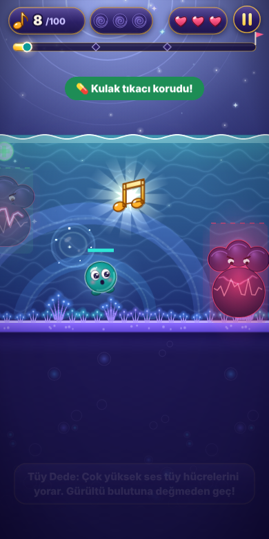

# Odyoloji içeriği (uzman incelemesi için)

> Bu belge `node tools/odyoloji/docs.mjs` ile üretilir; kaynak dosyalar: `packages/content/src/odyoloji.ts`, `cards.ts`, `quiz.ts`, `kamp.ts`, `remedies.ts`, `patolojiler.ts`, `kamp-gorev-vakalar.ts`.
> Elle düzenlemeyin; düzeltmeyi kaynakta yapıp belgeyi yeniden üretin.

**İlke:** yalnızca ders kitabı düzeyinde yerleşik bilgiler (Gelfand, *Hearing: An Introduction to Psychological and Physiological
Acoustics*; Katz, *Handbook of Clinical Audiology*; Pickles, *An Introduction to the Physiology of Hearing*; NIOSH 1998; JCIH).
Sayılar yaklaşık ve aralık olarak verilir. Emin olunmayan bilgi eklenmez. Her madde iki derinliktedir: herkes için sade cümle +
isteğe bağlı teknik ayrıntı ("Daha fazla").

**Sayılar:** 39 sözlük terimi · 33 Tüy Dede notu · 50 Kulak Kartı ·
128 quiz sorusu (66 Meraklı, 62 Odyoloji) · Kulak Kampı: 12 bina,
21 kamp terimi, 11 Tedavi Odası malzemesi, 10 bölge anıtı ·
18 bölge patolojisi (18 tanesi bölümlerde) · 32 kurgusal hasta vakası (Kamp Kliniği).

## Kulak Sözlüğü (39)

| bölge | terim | sade | teknik | kaynak |
|---|---|---|---|---|
| Dış kulak | **Kulak kepçesi (aurikula, pinna)** | Kulağın dışta görünen, kıkırdaktan yapılmış kıvrımlı kısmı; sesi toplayıp kanala yönlendirir. | Elastik kıkırdak iskeletlidir (heliks, antiheliks, tragus, konka). Kıvrımları özellikle yüksek frekanslarda yöne bağlı spektral ipuçları üretir; sesin yukarıdan mı aşağıdan mı geldiğini anlamaya yardım eder. | Gelfand, Hearing: An Introduction to Psychological and Physiological Acoustics, dış kulak bölümü |
| Dış kulak | **Dış kulak yolu (meatus acusticus externus)** | Kepçeden kulak zarına uzanan, yetişkinde yaklaşık 2,5 cm uzunluğundaki kanal. | Hafif S biçimlidir; dış üçte biri kıkırdak, iç üçte ikisi kemiktir. Bir ucu kapalı tüp gibi rezonans yapar ve yaklaşık 2,5–3 kHz bölgesindeki sesleri güçlendirir. | Gelfand, Hearing: An Introduction to Psychological and Physiological Acoustics, dış kulak bölümü |
| Dış kulak | **Frekans (hertz, Hz)** | Sesin saniyedeki titreşim sayısı; frekans arttıkça ses incelir. | Perde algısı frekansla ilişkilidir ama doğrusal değildir. Genç ve sağlıklı kulak yaklaşık 20 Hz–20 kHz arasını duyar; saf ses odyometrisinde genellikle 250–8000 Hz arası test edilir. | Gelfand, Hearing: An Introduction to Psychological and Physiological Acoustics, fiziksel akustik ve mutlak eşikler |
| Dış kulak | **Desibel (dB)** | Sesin şiddetini anlatan logaritmik birim. | dB SPL, 20 µPa referanslı ses basıncı düzeyidir; odyogramda kullanılan dB HL ise her frekansta normal işitenlerin ortalama eşiğine göre ayarlanır. 10 dB artış ses şiddetini (enerjiyi) on katına çıkarır. | Gelfand, Hearing: An Introduction to Psychological and Physiological Acoustics, fiziksel akustik; Katz, Handbook of Clinical Audiology, saf ses odyometrisi |
| Dış kulak | **Odyogram** | İşitme testinin sonucunu gösteren grafik: her frekansta duyulabilen en hafif ses. | Yatay eksende frekans (Hz), dikey eksende işitme düzeyi (dB HL) yer alır. Hava yolu ve kemik yolu eşikleri ayrı simgelerle işaretlenir; yaygın gösterimde sağ kulak kırmızı daire, sol kulak mavi çarpıdır. | Katz, Handbook of Clinical Audiology, saf ses odyometrisi (ASHA simgeleri) |
| Dış kulak | **Odyolog** | İşitme ve dengeyi değerlendiren, işitme cihazı ve implant uygulamalarında görev alan sağlık profesyoneli. | Odyoloji; işitme ve dengenin değerlendirilmesi, rehabilitasyonu ve korunmasıyla ilgilenen bilim dalıdır. Türkiye’de lisans düzeyinde odyoloji eğitimi verilmektedir. | Katz, Handbook of Clinical Audiology, giriş bölümü |
| Dış kulak yolu | **Kulak kiri (serumen)** | Kanalı nemli tutan, toza ve mikroplara karşı koruyan doğal salgı. | Kanalın dış, kıkırdak bölümündeki seruminöz ve yağ bezlerinin salgısı ile dökülen deri hücrelerinden oluşur. Kanal derisinin dışa doğru göçüyle kendiliğinden dışarı taşınır; tıkayıcı birikimi iletim tipi işitme kaybı yapabilir. | Katz, Handbook of Clinical Audiology, dış kulak ve otoskopi bölümü |
| Dış kulak yolu | **Kulak kanalı rezonansı** | Kulak kanalı, şişe ağzına üflemek gibi bazı sesleri kendiliğinden güçlendirir. | Bir ucu kapalı yaklaşık 2,5 cm’lik tüp gibi davranır; rezonansı yaklaşık 2,5–3 kHz civarındadır ve bu bölgede sesi yaklaşık 10–15 dB artırır. Kepçe ve baş ile birlikte konuşma için önemli bir bölgeyi öne çıkarır. | Gelfand, Hearing: An Introduction to Psychological and Physiological Acoustics, dış kulak aktarım işlevi |
| Kulak zarı ve orta kulak | **Kulak zarı (timpanik membran)** | Dış kulakla orta kulağı ayıran ince zar; gelen sesle titreşir. | Yaklaşık 8–10 mm çapında, yaklaşık 0,1 mm kalınlığındadır ve üç katmanlıdır (dış epitel, orta fibröz, iç mukoza). Gergin kısım (pars tensa) ve gevşek kısım (pars flaccida) olarak ikiye ayrılır; çekiç sapı zara yapışıktır (umbo). | Gelfand, Hearing: An Introduction to Psychological and Physiological Acoustics, orta kulak bölümü |
| Kulak zarı ve orta kulak | **Östaki borusu (tuba auditiva)** | Orta kulağı burun-boğaz bölgesine bağlayan ve basıncı eşitleyen kanal. | Normalde kapalıdır; yutkunma ve esneme sırasında açılarak orta kulak basıncını dış basınçla eşitler ve havalandırır. Çocuklarda daha kısa ve daha yataydır; orta kulak iltihabına yatkınlığın nedenlerinden biridir. | Katz, Handbook of Clinical Audiology, orta kulak ve immitans bölümü |
| Kulak zarı ve orta kulak | **Timpanometri** | Kulak zarının ne kadar rahat hareket ettiğini ölçen kısa ve ağrısız test. | Kanaldaki basınç değiştirilirken orta kulak sisteminin kabul ettiği enerji (admitans) ölçülür. Jerger sınıflaması: A normal; As sertleşmiş sistem; Ad aşırı hareketli sistem; B düz eğri (ör. orta kulakta sıvı ya da zar delinmesi; kanal hacmine bakılır); C negatif orta kulak basıncı. | Katz, Handbook of Clinical Audiology, timpanometri bölümü (Jerger sınıflaması) |
| Kemikçikler | **Çekiç (malleus)** | Kulak zarına yapışık ilk kemikçik. | Sapı (manubrium) kulak zarına gömülüdür; başı örsle eklem yapar. Zarın titreşimini kemikçik zincirine aktarır. | Gelfand, Hearing: An Introduction to Psychological and Physiological Acoustics, orta kulak bölümü |
| Kemikçikler | **Örs (inkus)** | Çekiçle üzengi arasındaki orta kemikçik. | Gövdesi çekiç başıyla, uzun kolu (lentiküler çıkıntı) üzengi başıyla eklem yapar. Çekiçle birlikte bir kaldıraç gibi çalışır. | Gelfand, Hearing: An Introduction to Psychological and Physiological Acoustics, orta kulak bölümü |
| Kemikçikler | **Üzengi (stapes)** | Vücudun en küçük kemiği; tabanı iç kulağın oval penceresine oturur. | Tabanı (footplate) oval pencereye anüler ligamanla tutunur ve titreşimi koklea sıvısına aktarır. Stapedius kası üzengiye bağlanır. | Gelfand, Hearing: An Introduction to Psychological and Physiological Acoustics, orta kulak bölümü |
| Kemikçikler | **Oval pencere** | Üzengi tabanının oturduğu, iç kulağa açılan pencere. | Üzengi tabanının itmesiyle skala vestibulideki perilenfte basınç dalgası başlar. Orta kulak, havadaki sesi sıvıya bu küçük pencereden yükselterek aktarır. | Gelfand, Hearing: An Introduction to Psychological and Physiological Acoustics, orta kulak aktarımı |
| Kemikçikler | **Akustik refleks (stapedius refleksi)** | Çok yüksek seste orta kulaktaki minik bir kasın kasılarak iletimi azaltması. | Yüksek şiddetli uyaranla stapedius kası iki taraflı kasılır; normal işitenlerde tipik refleks eşikleri yaklaşık 70–100 dB HL arasındadır. İletimi özellikle düşük frekanslarda azaltır; klinikte immitans ölçümüyle değerlendirilir. | Katz, Handbook of Clinical Audiology, akustik refleks bölümü |
| Koklea (giriş) | **Koklea** | İç kulaktaki sarmal işitme organı; titreşimi sinir sinyaline çevirir. | Kemik bir eksen (modiolus) çevresinde yaklaşık 2,5–2,75 tur kıvrılır. İçinde üç sıvı dolu bölme bulunur: skala vestibuli, skala media (koklear kanal) ve skala timpani. | Pickles, An Introduction to the Physiology of Hearing, koklea anatomisi |
| Koklea (giriş) | **Yuvarlak pencere** | Kokleadaki ikinci pencere; sıvının hareket edebilmesine izin verir. | Skala timpaninin tabanındaki zarlı açıklıktır. Oval pencere içe itildiğinde dışa doğru esneyerek sıkıştırılamayan perilenfin yer değiştirmesini sağlar. | Gelfand, Hearing: An Introduction to Psychological and Physiological Acoustics, iç kulak bölümü |
| Koklea (giriş) | **Koklear bölmeler (skala vestibuli, media, timpani)** | Kokleanın içindeki, üst üste duran üç sıvı dolu kanal. | Skala vestibuli ile skala timpani perilenf içerir ve kokleanın tepesindeki helikotremada birleşir. Aradaki skala media endolenf içerir; Reissner zarı ve baziler membran onu diğer iki bölmeden ayırır. | Pickles, An Introduction to the Physiology of Hearing, koklea anatomisi |
| Koklea (giriş) | **Perilenf ve endolenf** | İç kulağın birbirinden farklı iki sıvısı. | Perilenf hücre dışı sıvıya benzer ve sodyumdan zengindir; endolenf ise potasyumdan zengindir. Skala medianın yaklaşık +80 mV’luk endokoklear potansiyeli tüy hücrelerinin uyarılmasını kolaylaştırır. | Pickles, An Introduction to the Physiology of Hearing, koklear sıvılar ve endokoklear potansiyel |
| Koklea (Corti organı) | **Corti organı** | Baziler zarın üstünde duran ve tüy hücrelerini taşıyan asıl işitme duyu organı. | Bir sıra iç tüy hücresi, üç sıra dış tüy hücresi, destek hücreleri ve üstünü örten tektoryal membrandan oluşur. | Pickles, An Introduction to the Physiology of Hearing, Corti organı |
| Koklea (Corti organı) | **İç tüy hücreleri** | Sesi işitme sinirine ileten asıl algılayıcı hücreler. | Bir kulakta yaklaşık 3.500 tane, tek sıra hâlindedir. İşitme siniri afferent liflerinin büyük çoğunluğu (yaklaşık %90–95) iç tüy hücrelerinden bilgi taşır. | Pickles, An Introduction to the Physiology of Hearing, koklear innervasyon |
| Koklea (Corti organı) | **Dış tüy hücreleri** | Hafif sesleri güçlendiren, sesle birlikte boyu uzayıp kısalan hücreler. | Bir kulakta yaklaşık 12.000 tane, üç sıra hâlindedir. Prestin proteiniyle elektromotilite gösterirler ve koklear amplifikatör olarak duyarlılığı ve frekans seçiciliğini artırırlar; otoakustik emisyonların kaynağıdırlar. | Pickles, An Introduction to the Physiology of Hearing, dış tüy hücresi elektromotilitesi |
| Koklea (Corti organı) | **Stereosilya** | Tüy hücrelerinin üstündeki minik tüy demetleri; eğilince sinyal başlar. | Basamaklı sıralar hâlinde dizilirler. Demet uzun sıraya doğru eğildiğinde uç bağlantıları (tip link) mekanoelektrik iletim kanallarını açar; endolenften K+ girişiyle hücre depolarize olur. | Pickles, An Introduction to the Physiology of Hearing, mekanoelektrik iletim |
| Koklea (Corti organı) | **Otoakustik emisyon (OAE)** | Sağlıklı iç kulağın ürettiği, kulak kanalında ölçülebilen çok hafif ses. | Dış tüy hücrelerinin etkin işleminin yan ürünüdür; kanala yerleştirilen hassas bir prob mikrofonla kaydedilir. Hızlı ve ağrısız olduğu için yenidoğan işitme taramasında yaygın kullanılır. | Katz, Handbook of Clinical Audiology, otoakustik emisyonlar bölümü |
| Koklea (tonotopi) | **Baziler membran** | Kokleanın tabanından tepesine uzanan ve her sese göre farklı yerinde en çok titreşen zar. | Tabanda (baz) dar ve sert, tepede (apeks) geniş ve esnektir. İlerleyen dalga tabandan tepeye yayılır ve her frekans için belirli bir noktada en büyük genliğe ulaşır. | Gelfand, Hearing: An Introduction to Psychological and Physiological Acoustics, koklear mekanik (ilerleyen dalga) |
| Koklea (tonotopi) | **Tonotopi** | Her frekansın kokleada ve işitme yolunda kendi yerinin olması. | Koklea tabanı yüksek, tepesi alçak frekansları kodlar. Bu frekans haritası işitme siniri, beyin sapı çekirdekleri ve işitsel kortekste de korunur. | Gelfand, Hearing: An Introduction to Psychological and Physiological Acoustics, tonotopik düzen |
| Koklea (tonotopi) | **Stria vaskülaris** | Kokleanın yan duvarında, iç kulağın “pili” gibi çalışan doku. | Endolenfin potasyumdan zengin bileşimini ve endokoklear potansiyeli üretir. Yaşa bağlı işitme kaybının striyal (metabolik) tipinde etkilendiği düşünülür. | Pickles, An Introduction to the Physiology of Hearing, stria vaskülaris |
| Koklea (tonotopi) | **Helikotrema** | Kokleanın tepesinde iki sıvı kanalını birleştiren küçük açıklık. | Skala vestibuli ile skala timpaniyi apekste birleştirir; çok düşük frekanslarda basınç farkının dengelenmesine katkıda bulunur. | Gelfand, Hearing: An Introduction to Psychological and Physiological Acoustics, iç kulak bölümü |
| İşitme siniri | **İşitme siniri (VIII. kafa sinirinin koklear dalı)** | Kokleadan beyin sapına sinyal taşıyan sinir. | Yaklaşık 30.000 lif içerir; hücre gövdeleri spiral gangliondadır. Vestibüler dalla birlikte vestibülokoklear siniri (VIII. kafa siniri) oluşturur ve iç kulak yolundan geçerek beyin sapına girer. | Pickles, An Introduction to the Physiology of Hearing, işitme siniri |
| İşitme siniri | **Spiral ganglion** | İşitme siniri hücrelerinin gövdelerinin toplandığı yer. | Modiolus içinde yer alır. Tip I nöronlar iç tüy hücrelerini, daha az sayıdaki tip II nöronlar dış tüy hücrelerini innerve eder. | Pickles, An Introduction to the Physiology of Hearing, koklear innervasyon |
| İşitme siniri | **İşitsel beyin sapı yanıtı (ABR)** | Sese karşı işitme siniri ve beyin sapından kaydedilen küçük elektrik dalgaları. | Uyarandan sonraki ilk yaklaşık 10 ms içinde I–V dalgaları görülür. I. dalga işitme sinirinin distal kısmından, V. dalga lateral lemniskus ve inferior kollikulus bölgesinden kaynaklanır; V. dalga eşik tahmininde en çok izlenen dalgadır. | Katz, Handbook of Clinical Audiology, ABR bölümü |
| Beyin sapı | **Koklear çekirdek** | İşitme sinirinin beyin sapındaki ilk durağı. | Ponsla medulla oblongatanın birleştiği bölgededir; ventral ve dorsal bölümleri vardır. İşitme siniri lifleri burada aynı taraftaki nöronlarla sinaps yapar. | Pickles, An Introduction to the Physiology of Hearing, merkezî işitme yolları |
| Beyin sapı | **Superior oliver kompleks** | İki kulaktan gelen bilgiyi ilk kez birleştiren merkez. | Medial superior olive çoğunlukla iki kulak arasındaki zaman farkını (ITD), lateral superior olive şiddet farkını (ILD) işler. Akustik refleks yolunda da yer alır. | Pickles, An Introduction to the Physiology of Hearing, iki kulakla işitme |
| Beyin sapı | **Lateral lemniskus** | Beyin sapında yukarı doğru uzanan işitme yolu demeti. | Koklear çekirdek ve superior oliver kompleksten gelen yükselen lifleri inferior kollikulusa taşır; yol boyunca kendi çekirdekleri de vardır. | Pickles, An Introduction to the Physiology of Hearing, merkezî işitme yolları |
| Beyin sapı | **İnferior kollikulus** | Orta beyindeki büyük işitme kavşağı. | Yükselen işitme yollarının neredeyse tamamı burada sinaps yapar; farklı çekirdeklerden gelen bilgi burada bütünleşir ve talamusa iletilir. | Pickles, An Introduction to the Physiology of Hearing, merkezî işitme yolları |
| İşitsel korteks | **Medial genikulat cisim** | Talamustaki işitme istasyonu; sinyali beyin kabuğuna aktarır. | Talamusun işitsel çekirdeğidir; inferior kollikulustan gelen lifleri alır ve işitsel radyasyonla işitsel kortekse iletir. | Pickles, An Introduction to the Physiology of Hearing, talamus ve işitsel korteks |
| İşitsel korteks | **İşitsel korteks (Heschl girusu)** | Beynin sesleri algılayıp anlamlandıran bölgesi. | Birincil işitsel korteks, temporal lobun üst yüzündeki transvers temporal girusta (Heschl girusu) yer alır ve tonotopik düzenlidir. Çevresindeki işitsel ilişkilendirme alanları konuşma ve müzik gibi karmaşık seslerin işlenmesine katılır. | Pickles, An Introduction to the Physiology of Hearing, işitsel korteks |
| İşitsel korteks | **Wernicke alanı** | Konuşmayı anlamada önemli rol oynayan dil bölgesi. | Çoğu kişide sol hemisferde, üst temporal girusun arka kısmında yer alır; işitsel kortekse komşudur. | Pickles, An Introduction to the Physiology of Hearing, işitsel korteks ve dil |

## Tüy Dede'nin Notu (33)

| bölge | sade (seslendirilir) | Daha fazla | kaynak |
|---|---|---|---|
| Dış kulak | Kulak kepçesinin kıvrımları, sesin yukarıdan mı aşağıdan mı geldiğini anlamamıza yardım eder. | Kepçe, sesin geliş açısına göre yüksek frekanslarda farklı tepe ve çentikler oluşturur; beyin bu spektral ipuçlarını dikey yön ve ön-arka ayrımı için kullanır. | Gelfand, Hearing: An Introduction to Psychological and Physiological Acoustics, ses kaynağının yerini belirleme |
| Dış kulak | Hertz, sesin saniyedeki titreşim sayısıdır; çok titreşen ses ince duyulur. | Genç ve sağlıklı insan kulağı yaklaşık 20 Hz–20 kHz arasını duyar ve yaklaşık 1–4 kHz arasında en duyarlıdır. Perde algısı frekansla ilişkilidir ama doğrusal değildir. | Gelfand, Hearing: An Introduction to Psychological and Physiological Acoustics, mutlak eşikler |
| Dış kulak | Desibel ölçeği logaritmiktir: küçük bir sayı artışı büyük bir enerji artışı demektir. | Ses basıncı düzeyi = 20·log10(p/p0), p0 = 20 µPa. 6 dB artış ses basıncını yaklaşık iki katına, 20 dB artış on katına çıkarır; 10 dB artış ses şiddetini (enerjiyi) on katına çıkarır. | Gelfand, Hearing: An Introduction to Psychological and Physiological Acoustics, fiziksel akustik |
| Dış kulak yolu | Kulak kanalı, şişe ağzına üflemek gibi bazı sesleri kendiliğinden güçlendirir. | Bir ucu kapalı yaklaşık 2,5 cm’lik tüp gibi davranır; rezonansı yaklaşık 2,5–3 kHz civarındadır ve bu bölgede sesi yaklaşık 10–15 dB artırır. | Gelfand, Hearing: An Introduction to Psychological and Physiological Acoustics, dış kulak aktarım işlevi |
| Dış kulak yolu | Kulak kendi kendini temizler; pamuklu çubuk kiri çoğu zaman daha derine iter. | Kanal derisi epitel göçüyle kiri dışa taşır. Tıkayıcı serumen iletim tipi kayba yol açabilir; çıkarılması gerektiğinde bu işlem sağlık profesyonelince yapılmalıdır. | Katz, Handbook of Clinical Audiology, otoskopi ve serumen yönetimi |
| Dış kulak yolu | Ses ne kadar yüksekse, güvenle dinleyebileceğimiz süre o kadar kısalır. | NIOSH önerisine göre 85 dB(A)’de 8 saatlik maruziyet sınırdır ve her 3 dB artış güvenli süreyi yarıya indirir (eşit enerji ilkesi): 88 dB(A)’de yaklaşık 4 saat. | NIOSH, Occupational Noise Exposure (1998) |
| Kulak zarı ve orta kulak | Orta kulak, havadaki sesi iç kulak sıvısına aktarırken onu güçlendiren bir yükseltici gibi çalışır. | Hava ile sıvı arasındaki empedans farkı yüzünden enerjinin çoğu yansırdı. Kulak zarı ile üzengi tabanı arasındaki alan oranı (yaklaşık 17:1) ve kemikçik kaldıracı (yaklaşık 1,3:1) basıncı yaklaşık 20 kat, yani yaklaşık 25–30 dB artırır. | Gelfand, Hearing: An Introduction to Psychological and Physiological Acoustics, orta kulak empedans uyumu |
| Kulak zarı ve orta kulak | Timpanometri, kulak zarının ne kadar rahat hareket ettiğini ölçen kısa ve ağrısız bir testtir. | Jerger sınıflaması: A normal; As sertleşmiş sistem (ör. otoskleroz); Ad aşırı hareketli sistem (ör. kemikçik zinciri kopukluğu); B düz eğri (ör. orta kulakta sıvı ya da zar delinmesi; kanal hacmi ayırt ettirir); C negatif orta kulak basıncı. | Katz, Handbook of Clinical Audiology, timpanometri bölümü |
| Kulak zarı ve orta kulak | Çocuklarda orta kulakta sıvı birikmesi sık görülür ve işitmeyi geçici olarak azaltabilir. | Efüzyonlu otitis mediada timpanogram tipik olarak B tipidir ve hafif-orta derecede iletim tipi işitme kaybı görülebilir; çoğu kendiliğinden düzelir, uzun sürenler izlenir. | Katz, Handbook of Clinical Audiology, orta kulak bozuklukları |
| Kemikçikler | Çok yüksek seste orta kulaktaki minik bir kas kasılır ve kulağı biraz korur. | Stapedius refleksi iki taraflıdır; normal işitenlerde tipik eşikler yaklaşık 70–100 dB HL arasındadır. Belli bir gecikmeyle devreye girdiği için ani darbe seslerine karşı koruması sınırlıdır. | Katz, Handbook of Clinical Audiology, akustik refleks bölümü |
| Kemikçikler | Bazı kişilerde üzengi kemiği sertleşip hareketini kaybedebilir; buna otoskleroz denir. | Üzengi tabanının fiksasyonu ilerleyici iletim tipi kayba yol açar. Odyogramda yaklaşık 2 kHz’te kemik yolunda Carhart çentiği görülebilir; timpanogram çoğunlukla As tipidir ve akustik refleks alınamayabilir. | Katz, Handbook of Clinical Audiology, otoskleroz |
| Kemikçikler | Sesi kafatası kemikleri yoluyla da duyarız; kendi sesimizi kayıtta farklı bulmamızın bir nedeni budur. | Kemik yolu testinde vibratör mastoide konur ve doğrudan kokleayı uyarır. Hava ve kemik yolu eşikleri arasındaki fark (hava-kemik aralığı) iletim tipi işitme kaybını gösterir. | Katz, Handbook of Clinical Audiology, kemik yolu odyometrisi |
| Koklea (giriş) | Kokleadaki dalga tabandan tepeye doğru ilerler; her ses kendi noktasında en büyük olur. | Georg von Békésy, ilerleyen dalgayı gözlemlediği çalışmalarıyla 1961 Nobel Fizyoloji veya Tıp Ödülü’nü aldı. Canlı kulakta dış tüy hücrelerinin katkısıyla tepe çok daha keskindir. | Gelfand, Hearing: An Introduction to Psychological and Physiological Acoustics, koklear mekanik |
| Koklea (giriş) | Kokleanın içinde, küçük bir pil gibi bir elektrik gerilimi vardır. | Skala medianın yaklaşık +80 mV’luk endokoklear potansiyeli stria vaskülaris tarafından korunur ve tüy hücrelerine K+ girişini kolaylaştırır. | Pickles, An Introduction to the Physiology of Hearing, endokoklear potansiyel |
| Koklea (giriş) | İç kulak yalnızca işitmez, dengemizi de sağlar. | Üç yarım daire kanalı açısal ivmeyi, utrikül ve sakkül (otolit organları) doğrusal ivmeyi ve yerçekimini algılar; bilgi VIII. kafa sinirinin vestibüler dalıyla taşınır. | Katz, Handbook of Clinical Audiology, vestibüler sistem |
| Koklea (Corti organı) | Sağlıklı bir kulak kendi çok hafif sesini üretir; bebeklerin işitmesi bununla taranabilir. | Otoakustik emisyonlar dış tüy hücrelerinin etkin işleminin yan ürünüdür ve kanalda prob mikrofonla ölçülür. Dış tüy hücresi işlevi bozulduğunda genellikle kaydedilemez. | Katz, Handbook of Clinical Audiology, otoakustik emisyonlar |
| Koklea (Corti organı) | Dış tüy hücreleri sesle birlikte dans eder ve hafif sesleri güçlendirir. | Prestin proteini sayesinde dış tüy hücreleri elektriksel uyarıyla boy değiştirir (elektromotilite). Bu koklear amplifikatör, hafif seslere duyarlılığı ve frekans seçiciliğini artırır. | Pickles, An Introduction to the Physiology of Hearing, dış tüy hücresi elektromotilitesi |
| Koklea (Corti organı) | İç kulak kaynaklı işitme kaybında sesler bir noktadan sonra hızla fazla yüksek gelebilir. | Gürlük toplanması (rekrütman): koklear kayıpta eşik yükselirken rahatsız edici gürlük düzeyi pek değişmez, dinamik aralık daralır. İşitme cihazlarında sıkıştırma (kompresyon) bu yüzden kullanılır. | Katz, Handbook of Clinical Audiology, koklear kayıp ve gürlük |
| Koklea (tonotopi) | Yaşla birlikte genellikle önce ince seslerin duyulması azalır. | Presbiakuzi çoğunlukla iki taraflı, simetrik ve yüksek frekanslardan başlayan sensörinöral işitme kaybıdır; konuşmayı özellikle gürültüde anlamakta güçlük yaygındır. | Katz, Handbook of Clinical Audiology, presbiakuzi |
| Koklea (tonotopi) | Uzun süre yüksek sese maruz kalmak tüy hücrelerine kalıcı zarar verebilir. | Gürültüye bağlı işitme kaybında odyogramda tipik olarak 3–6 kHz bölgesinde, sıklıkla 4 kHz civarında bir çentik görülür ve 8 kHz’te kısmi düzelme olur. | Katz, Handbook of Clinical Audiology, gürültüye bağlı işitme kaybı |
| Koklea (tonotopi) | Koklear implant, sesi elektrik sinyaline çevirip işitme sinirini doğrudan uyarır. | Elektrot dizisi genellikle skala timpaniye yerleştirilir; tonotopiye uygun olarak bazal elektrotlar yüksek, apikal elektrotlar alçak frekansları temsil eder. | Katz, Handbook of Clinical Audiology, koklear implantlar |
| Koklea (tonotopi) | Bazı ilaçlar iç kulağa zarar verebilir; bu yüzden hekim kontrolünde kullanılırlar. | Aminoglikozid antibiyotikler ve sisplatin gibi ilaçlar ototoksik olabilir; hasar genellikle yüksek frekanslardan başlar. İzlemde yüksek frekans odyometrisi ve OAE kullanılabilir. | Katz, Handbook of Clinical Audiology, ototoksisite izlemi |
| İşitme siniri | Uyuyan bir bebeğin bile işitmesi, beyin sapından gelen minik elektrik dalgalarıyla değerlendirilebilir. | ABR’de ilk yaklaşık 10 ms içinde I–V dalgaları görülür: I. dalga işitme sinirinin distal kısmından, V. dalga lateral lemniskus/inferior kollikulus bölgesinden kaynaklanır. V. dalga eşik tahmininde en çok izlenen dalgadır. | Katz, Handbook of Clinical Audiology, ABR bölümü |
| İşitme siniri | İşitme kaybı, sorunun kulağın hangi bölümünde olduğuna göre adlandırılır. | İletim tipi: dış ya da orta kulak; sensörinöral: koklea ya da işitme siniri; mikst: ikisi birlikte. Odyogramda hava ve kemik yolu eşikleri karşılaştırılarak ayrılır. | Katz, Handbook of Clinical Audiology, odyogram yorumu |
| İşitme siniri | Odyogramdaki 0 dB “hiç ses yok” demek değildir; genç ve sağlıklı kulakların ortalama duyma eşiğidir. | dB HL, her frekansta normal işitenlerin ortalama eşiğine göre kalibre edilir; dB SPL ise mutlak ses basıncıdır (20 µPa referans). Bu yüzden 0 dB HL farklı frekanslarda farklı dB SPL değerlerine karşılık gelir. | Katz, Handbook of Clinical Audiology, saf ses odyometrisi |
| İşitme siniri | Yenidoğan işitme taraması, işitme kaybını erken fark edip erken desteklemeyi sağlar. | Taramada OAE ve/veya otomatik ABR kullanılır. Uluslararası 1-3-6 ilkesi (JCIH): bir ayda tarama, üç ayda tanı, altı ayda müdahale. | Joint Committee on Infant Hearing (JCIH), Position Statement |
| Beyin sapı | İki kulağımız sayesinde sesin nereden geldiğini buluruz. | Düşük frekanslarda iki kulak arasındaki zaman farkı (ITD), yüksek frekanslarda kafa gölgesinin yarattığı şiddet farkı (ILD) daha baskındır (dupleks kuramı). İlk karşılaştırma superior oliver komplekste yapılır. | Gelfand, Hearing: An Introduction to Psychological and Physiological Acoustics, iki kulakla işitme ve yön bulma |
| Beyin sapı | Bir ses başka bir sesi bastırabilir; buna maskeleme denir. | Klinikte test edilmeyen kulağın teste karışmasını (çapraz işitme) önlemek için o kulağa maskeleme gürültüsü verilir. Supra-aural kulaklıkla hava yolunda interaural attenüasyon en az yaklaşık 40 dB, kemik yolunda yaklaşık 0 dB kabul edilir. | Katz, Handbook of Clinical Audiology, klinik maskeleme |
| Beyin sapı | Diyapazon testleri, basit bir çatalla işitme kaybının türü hakkında ipucu verir. | Rinne testinde normalde hava yolu kemik yolundan daha uzun duyulur (pozitif); iletim tipi kayıpta bu tersine döner. Weber testinde ses, tek taraflı iletim kaybında etkilenen kulağa, sensörinöral kayıpta sağlam kulağa lateralize olur. | Katz, Handbook of Clinical Audiology, diyapazon testleri |
| İşitsel korteks | Konuşma seslerinin odyogramda kapladığı alan muza benzediği için “konuşma muzu” denir. | Ünlüler daha alçak frekanslarda ve daha güçlüdür; /s/, /ş/, /f/ gibi sessizler yüksek frekanslarda ve daha zayıftır. Yüksek frekans kaybında bu sessizler ilk kaçırılanlardır. | Katz, Handbook of Clinical Audiology, konuşma odyometrisi |
| İşitsel korteks | Beyin, kalabalık bir odada tek bir konuşmaya odaklanabilir. | “Kokteyl parti etkisi”: iki kulakla işitme, ses kaynaklarının uzamsal ayrımı ve dikkat, gürültüde konuşmayı anlamaya katkıda bulunur; işitme kaybında ilk zorlaşan durumlardan biridir. | Gelfand, Hearing: An Introduction to Psychological and Physiological Acoustics, iki kulakla işitme |
| İşitsel korteks | İşitme cihazları sesi her frekans için ayrı ayrı ayarlayarak yükseltir. | Cihaz kazancı odyograma göre reçete formülleriyle (ör. NAL-NL2, DSL v5) belirlenir ve gerçek kulak ölçümüyle doğrulanır. | Katz, Handbook of Clinical Audiology, işitme cihazı uygulaması |
| İşitsel korteks | Kulak çınlaması, dışarıda bir ses yokken ses duyma hissidir ve oldukça yaygındır. | Tinnitus sıklıkla işitme kaybıyla birliktedir. Değerlendirmede odyolojik testler ve rahatsızlık ölçekleri kullanılır; danışmanlık ve ses terapisi yaygın yaklaşımlardır. | Katz, Handbook of Clinical Audiology, tinnitus |

## Kulak Kartları (50)

| kart | başlık | sade | teknik |
|---|---|---|---|
| `dis-kulak:ilk` | Kıvrımlı Pusula | Kulak kepçesinin kıvrımları, sesin yukarıdan mı aşağıdan mı geldiğini anlamamıza yardım eder. | Aurikula (pinna) elastik kıkırdaktandır; yüksek frekanslarda geliş açısına bağlı spektral tepe ve çentikler oluşturarak dikey yön ve ön-arka ayrımına ipucu verir. |
| `dis-kulak:yildiz` | Doğal Megafon | Kepçe ve kulak kanalı birlikte, konuşma için önemli olan orta-tiz sesleri güçlendirir. | Baş, kepçe ve kanalın birleşik aktarım işlevi yaklaşık 2–4 kHz bölgesinde belirgin kazanç sağlar; kanal rezonansı tek başına yaklaşık 2,5–3 kHz civarındadır. |
| `dis-kulak:ozel` | Milisaniye Yarışı | Yandan gelen ses bir kulağa diğerinden biraz önce varır; beyin bu farkla yön bulur. | En büyük iki kulak arası zaman farkı (ITD) yetişkin başında yaklaşık 0,6–0,7 ms’dir; düşük frekanslarda yön bulmanın baskın ipucudur. |
| `dis-kulak:sandik` | Hertz Nedir? | Hertz, sesin saniyedeki titreşim sayısıdır; çok titreşen ses ince duyulur. | Genç ve sağlıklı kulak yaklaşık 20 Hz–20 kHz arasını duyar ve yaklaşık 1–4 kHz arasında en duyarlıdır (mutlak eşik eğrisi). |
| `dis-kulak:usta` | Desibel Merdiveni | Desibel ölçeği logaritmiktir: küçük bir sayı artışı büyük bir enerji artışıdır. | SPL = 20·log10(p/p0), p0 = 20 µPa. Ses basıncı iki katına çıkınca yaklaşık 6 dB, on katına çıkınca 20 dB artış olur. |
| `kanal:ilk` | 2,5 Santimlik Tünel | Yetişkinde dış kulak yolu yaklaşık 2,5 cm uzunluğundadır ve hafif S biçiminde kıvrılır. | Dış üçte biri kıkırdak, iç üçte ikisi kemiktir; bir ucu kapalı tüp gibi yaklaşık 2,5–3 kHz civarında rezonans yapar (yaklaşık 10–15 dB kazanç). |
| `kanal:yildiz` | Kulak Kiri Kahramandır | Kulak kiri (serumen) kanalı nemli tutar, toza ve mikroplara karşı korur. | Serumen, kanalın kıkırdak bölümündeki seruminöz ve yağ bezlerinin salgısı ile dökülen deri hücrelerinden oluşur; hafif asidiktir ve koruyucu özellik taşır. |
| `kanal:ozel` | Çubuk Yok! | Pamuklu çubuk kiri çoğu zaman daha derine iter; kulağın dışını silmek yeterlidir. | Tıkayıcı serumen iletim tipi işitme kaybına yol açabilir; çıkarılması gerektiğinde işlem sağlık profesyonelince yapılmalıdır. |
| `kanal:sandik` | Yürüyen Bant | Kanal derisi içten dışa doğru çok yavaş kayar ve kiri kendiliğinden dışarı taşır. | Kanal epitelinin kulak zarından dışa doğru göçü (epitel migrasyonu) kanalın kendini temizlemesini sağlar. |
| `kanal:usta` | Süre ile Şiddet | Ses ne kadar yüksekse güvenle dinleyebileceğimiz süre o kadar kısalır. | NIOSH önerisi: 85 dB(A)’de 8 saat; 3 dB değiş tokuş oranıyla 88 dB(A)’de yaklaşık 4 saat, 91 dB(A)’de yaklaşık 2 saat. |
| `zar:ilk` | İncecik Davul | Kulak zarı, bir kâğıt yaprağı kadar ince ve yaklaşık bir tırnak büyüklüğündedir. | Timpanik membran yaklaşık 8–10 mm çapında, yaklaşık 0,1 mm kalınlığında ve üç katmanlıdır; pars tensa ve pars flaccida bölümleri vardır. |
| `zar:yildiz` | Atomdan Küçük Titreşim | Duyabildiğimiz en hafif seslerde kulak zarı, bir atomun çapından da küçük bir mesafe kadar titreşir. | Eşik düzeyindeki seslerde zar yer değiştirmesi nanometrenin altındadır; bu, işitme sisteminin olağanüstü duyarlılığını gösterir. |
| `zar:ozel` | Kendini Onaran Zar | Küçük kulak zarı yırtıkları çoğu zaman birkaç hafta içinde kendiliğinden iyileşir. | Travmatik küçük perforasyonların çoğu kendiliğinden kapanır; kapanmayanlarda cerrahi onarım (timpanoplasti) seçeneği vardır. |
| `zar:sandik` | Uçak Kulağı | Östaki borusu orta kulağı boğaza bağlar; yutkunmak ya da esnemek basıncı eşitler. | Tuba normalde kapalıdır ve yutkunmada açılır; çocuklarda daha kısa ve yataydır. İşlev bozukluğunda timpanogram C tipi (negatif basınç) olabilir. |
| `zar:usta` | Zarın Hareket Testi | Timpanometri, kulak zarının ne kadar rahat hareket ettiğini ölçen kısa ve ağrısız bir testtir. | Jerger tipleri: A normal; As sertleşmiş; Ad aşırı hareketli; B düz (sıvı ya da perforasyon, kanal hacmine bakılır); C negatif orta kulak basıncı. |
| `kemikcikler:ilk` | Üçlü Makine | Çekiç, örs ve üzengi vücudun en küçük üç kemiğidir ve sesi zardan iç kulağa taşır. | Malleus, inkus ve stapes bir kaldıraç zinciri kurar; stapes tabanı oval pencereye anüler ligamanla tutunur. |
| `kemikcikler:yildiz` | En Küçük Kemik | Üzengi, yaklaşık 3 mm boyuyla vücuttaki en küçük kemiktir. | Stapes başı, iki kolu (krus) ve tabandan (footplate) oluşur; tabanın titreşimi skala vestibulideki perilenfe aktarılır. |
| `kemikcikler:ozel` | Basınç Yükseltici | Orta kulak, havadaki sesi iç kulak sıvısına aktarırken onu yaklaşık 20 kat güçlendirir. | Empedans uyumu: zar/stapes tabanı alan oranı yaklaşık 17:1, kemikçik kaldıracı yaklaşık 1,3:1; toplam kazanç yaklaşık 25–30 dB. |
| `kemikcikler:sandik` | Minik Koruyucu Kas | Üzengiye bağlı stapedius, vücudun en küçük iskelet kasıdır; çok yüksek seste kasılır. | Akustik (stapedius) refleks iki taraflıdır; normal işitenlerde tipik eşikler yaklaşık 70–100 dB HL. Stapedius fasiyal sinirden, tensor timpani trigeminal sinirden dal alır. |
| `kemikcikler:usta` | Sertleşen Kemik | Bazı kişilerde üzengi kemiği sertleşip hareketini kaybedebilir; buna otoskleroz denir. | Stapes fiksasyonu ilerleyici iletim tipi kayba yol açar; yaklaşık 2 kHz’te kemik yolunda Carhart çentiği ve As tipi timpanogram görülebilir. |
| `koklea-1:ilk` | Koklea Kıvrımı | Koklea yaklaşık iki buçuk tur kıvrılan sarmal bir kanaldır; adı Latincede “salyangoz kabuğu” anlamına gelir. | Kemik eksen (modiolus) çevresinde yaklaşık 2,5–2,75 tur kıvrılır; içinde skala vestibuli, skala media ve skala timpani bulunur. |
| `koklea-1:yildiz` | Sıvı Dalgası | Üzengi oval pencereyi ittiğinde koklea sıvısında bir dalga yayılır. | Sıvı sıkıştırılamadığı için yuvarlak pencere dışa doğru esner; basınç farkı baziler membranda tabandan tepeye ilerleyen dalgayı başlatır. |
| `koklea-1:ozel` | Kulaktaki Pil | Kokleanın içinde küçük bir pil gibi elektrik gerilimi vardır. | Skala media potasyumdan zengin endolenf içerir; stria vaskülarisin ürettiği yaklaşık +80 mV endokoklear potansiyel tüy hücresi uyarımını kolaylaştırır. |
| `koklea-1:sandik` | Denge de Burada | İç kulak yalnızca işitmez, dengemizi de sağlar. | Yarım daire kanalları açısal ivmeyi, utrikül ve sakkül doğrusal ivmeyi ve yerçekimini algılar; bilgi VIII. kafa sinirinin vestibüler dalıyla taşınır. |
| `koklea-1:usta` | Bezelye Boyunda | Koklea bir bezelye tanesi kadardır; ama içindeki kanal açılsa yaklaşık 3,5 cm uzunluğunda olurdu. | Baziler membranın uzunluğu insanda yaklaşık 3–3,5 cm’dir; bu uzunluk boyunca frekanslar tonotopik olarak dizilir. |
| `koklea-2:ilk` | Binlerce Tüy Hücresi | Bir kulakta yaklaşık 3.500 iç ve 12.000 dış tüy hücresi bulunur. | Corti organında bir sıra iç, üç sıra dış tüy hücresi vardır; afferent liflerin yaklaşık %90–95’i iç tüy hücrelerinden bilgi taşır. |
| `koklea-2:yildiz` | Dans Eden Hücreler | Dış tüy hücreleri sesle birlikte boyca uzayıp kısalır ve hafif sesleri güçlendirir. | Prestin proteinine dayalı elektromotilite koklear amplifikatörü oluşturur; duyarlılığı ve frekans seçiciliğini artırır. |
| `koklea-2:ozel` | Kulağın Yankısı | Sağlıklı bir kulak kendi çok hafif seslerini üretir; bebeklerin işitmesi bununla taranabilir. | Otoakustik emisyonlar dış tüy hücresi işlevinin yan ürünüdür; prob mikrofonla ölçülür ve yenidoğan taramasında otomatik ABR ile birlikte kullanılır. |
| `koklea-2:sandik` | Stereosilya | Tüy hücrelerinin üstünde minik tüy demetleri vardır; eğildiklerinde sinir sinyali başlar. | Basamaklı stereosilyaları bağlayan uç bağlantıları (tip link) gerilince mekanoelektrik iletim kanalları açılır ve endolenften K+ girer. |
| `koklea-2:usta` | Hızla Yükselen Sesler | İç kulak kaynaklı kayıpta sesler bir noktadan sonra hızla fazla yüksek gelebilir. | Gürlük toplanması (rekrütman): koklear kayıpta eşik yükselir ama rahatsız edici gürlük düzeyi pek değişmez; dinamik aralık daralır. |
| `koklea-3:ilk` | Bas Diyarı | Kokleanın tepesinde baziler zar geniş ve esnektir; kalın sesler burada en çok titreşim yaratır. | Baziler membran bazda dar ve sert, apekste geniş ve esnektir; ilerleyen dalga her frekansta belirli bir yerde en büyük genliğe ulaşır. |
| `koklea-3:yildiz` | Tonotopi | Her frekansın kokleada kendi adresi vardır; tıpkı piyano tuşları gibi. | Baz yüksek, apeks alçak frekansları kodlar; tonotopik düzen işitme siniri, beyin sapı çekirdekleri ve işitsel kortekste korunur. |
| `koklea-3:ozel` | Geri Gelmeyen Hücreler | İnsanda hasar gören tüy hücreleri yeniden çoğalmaz; bu yüzden yüksek sesten korunmak çok değerlidir. | Memelilerde koklear tüy hücresi kaybı kalıcıdır; gürültüye bağlı kayıpta odyogramda sıklıkla 4 kHz civarında (3–6 kHz) çentik görülür. |
| `koklea-3:sandik` | Yaşla Gelen | Yaşla birlikte genellikle önce ince seslerin duyulması azalır. | Presbiakuzi çoğunlukla iki taraflı, simetrik ve yüksek frekanslardan başlayan sensörinöral kayıptır; gürültüde konuşmayı anlamak zorlaşır. |
| `koklea-3:usta` | Koklear İmplant | Koklear implant, sesi elektrik sinyaline çevirip işitme sinirini doğrudan uyarır. | Elektrot dizisi genellikle skala timpaniye yerleştirilir; bazal elektrotlar yüksek, apikal elektrotlar alçak frekansları temsil eder. |
| `sinir:ilk` | 30.000 Lif | İşitme siniri yaklaşık 30.000 sinir lifinden oluşur. | Hücre gövdeleri spiral gangliondadır; tip I nöronlar iç, tip II nöronlar dış tüy hücrelerini innerve eder. |
| `sinir:yildiz` | Sekizinci Sinir | İşitme siniri, denge siniriyle birlikte sekizinci kafa sinirini oluşturur. | Vestibülokoklear sinir (VIII) iç kulak yolundan geçerek ponto-medüller bileşkede beyin sapına girer. |
| `sinir:ozel` | Şiddetin Kodu | Sesin şiddeti, liflerin ne kadar sık sinyal gönderdiği ve kaç lifin birlikte çalıştığıyla kodlanır. | Ateşleme hızı ve yayılım (komşu frekans liflerinin katılımı) şiddet kodlamasına katkıda bulunur; lifler farklı eşik ve dinamik aralıklara sahiptir. |
| `sinir:sandik` | Uyurken Test | İşitme siniri ve beyin sapının sese yanıtı, bebek uyurken bile ölçülebilir. | ABR’de ilk yaklaşık 10 ms içinde I–V dalgaları görülür; I. dalga işitme sinirinin distalinden, V. dalga lateral lemniskus/inferior kollikulus bölgesinden kaynaklanır. |
| `sinir:usta` | Odyogramdaki Sıfır | Odyogramdaki 0 dB “hiç ses yok” demek değildir; sağlıklı gençlerin ortalama duyma eşiğidir. | dB HL her frekansta normal işitenlerin ortalama eşiğine göre kalibre edilir; dB SPL ise 20 µPa referanslı mutlak ses basıncıdır. |
| `beyin-sapi:ilk` | Mikrosaniye Hakemi | Beyin sapı, sesin iki kulağa varış zamanı arasındaki çok küçük farkları karşılaştırır. | Medial superior olive çoğunlukla iki kulak arası zaman farkını (ITD) işler; insanlar yaklaşık 10–20 mikrosaniyelik farkları bile ayırt edebilir. |
| `beyin-sapi:yildiz` | Kafanın Gölgesi | İnce seslerde kafanın yarattığı “ses gölgesi”, sesin yönünü bulmaya yardım eder. | Dupleks kuramı: düşük frekanslarda ITD, yüksek frekanslarda kafa gölgesine bağlı iki kulak arası şiddet farkı (ILD) baskındır; ILD lateral superior olivede işlenir. |
| `beyin-sapi:ozel` | İlk Durak | İşitme sinirinin beyin sapındaki ilk durağı koklear çekirdektir. | İşitme siniri lifleri aynı taraftaki koklear çekirdekte sinaps yapar; buradan superior oliver kompleks ve lateral lemniskus yoluyla inferior kollikulusa ulaşılır. |
| `beyin-sapi:sandik` | Diyapazon İpuçları | Basit bir diyapazon, işitme kaybının türü hakkında ipucu verebilir. | Rinne: normalde hava yolu kemik yolundan uzun duyulur; iletim tipi kayıpta tersine döner. Weber: iletim tipi kayıpta etkilenen, sensörinöral kayıpta sağlam kulağa lateralize olur. |
| `beyin-sapi:usta` | İki Kulak Bir Takım | İki kulakla duymak, gürültülü ortamda konuşmayı anlamayı kolaylaştırır. | Binoral avantajlar: baş gölgesi etkisi, binoral toplanma ve sıkışmayı açma (squelch); gürültüde konuşmayı anlamaya katkıda bulunur. |
| `korteks:ilk` | Şakaktaki Merkez | İşitme korteksi, beynin şakak lobunda, kulaklarımıza yakın bir yerde bulunur. | Birincil işitsel korteks temporal lobun üst yüzündeki transvers temporal girusta (Heschl girusu) yer alır; talamustaki medial genikulat cisimden girdi alır. |
| `korteks:yildiz` | Beyindeki Piyano | İşitme korteksinin de frekans haritası vardır: farklı frekanslar farklı bölgeleri uyarır. | Birincil işitsel korteks tonotopik düzenlidir; çevresindeki ilişkilendirme alanları konuşma ve müzik gibi karmaşık seslerin işlenmesine katılır. |
| `korteks:ozel` | Kokteyl Parti Etkisi | Beyin, kalabalık bir odada tek bir konuşmaya odaklanabilir. | Uzamsal ayrım, iki kulakla işitme ve dikkat gürültüde konuşmayı anlamaya katkıda bulunur; işitme kaybında ilk zorlaşan durumlardan biridir. |
| `korteks:sandik` | Konuşma Muzu | Konuşma seslerinin odyogramda kapladığı alan muza benzediği için “konuşma muzu” denir. | Ünlüler alçak frekanslı ve güçlü, /s/, /ş/, /f/ gibi sessizler yüksek frekanslı ve zayıftır; yüksek frekans kaybında ilk kaçırılanlar bu sessizlerdir. |
| `korteks:usta` | Kulak Çınlaması | Kulak çınlaması (tinnitus), dışarıda bir ses yokken ses duyma hissidir ve oldukça yaygındır. | Tinnitus sıklıkla işitme kaybıyla birliktedir; değerlendirmede odyolojik testler ve rahatsızlık ölçekleri, yönetimde danışmanlık ve ses terapisi kullanılır. |

## Kulak Kampı (docs/14-kamp.md)

Ek kaynaklar: Katz, *Handbook of Clinical Audiology* (test bataryası, saf ses ve konuşma odyometrisi, timpanometri, işitme cihazı,
tinnitus, işitsel işlemleme ve nöropati bölümleri); Gelfand, *Essentials of Audiology*; standart KBB kitapları (Cummings
*Otolaryngology*; Scott-Brown's *Otorhinolaryngology*: dış kulak hastalıkları, otitis media, otoskleroz, timpanoplasti, osikuloplasti);
Jerger ve Hayes (1976) çapraz kontrol ilkesi; Clark (1981) işitme kaybı dereceleri. Malzemeler öğretmek içindir, tıbbi öneri değildir.

### Binalar (12)

| bina | sade | Daha fazla | kaynak |
|---|---|---|---|
| **Odyoloji Merkezi** | Odyoloji; işitme ve dengenin değerlendirilmesi, rehabilitasyonu ve korunmasıyla ilgilenir. Merkez, diğer bütün odaları yönetir. | Tek bir test tanı koydurmaz: öykü, otoskopi, saf ses ve konuşma odyometrisi, timpanometri, akustik refleks, OAE ve gerekirse ABR bir test bataryası olarak birlikte yorumlanır (çapraz kontrol ilkesi, Jerger ve Hayes, 1976). | Katz, Handbook of Clinical Audiology, giriş ve test bataryası bölümleri |
| **Odyometri Odası** | Odyometri odasında ses geçirmez kabinde, her frekansta duyabildiğin en hafif ses ölçülür. | Saf ses odyometrisinde 250–8000 Hz arasında hava yolu (kulaklık) ve kemik yolu (kemik vibratörü) eşikleri dB HL olarak bulunur; ikisi arasındaki fark (hava–kemik aralığı) iletim tipi kaybı düşündürür. Konuşma odyometrisi (SRT, konuşmayı ayırt etme) testi tamamlar. | Katz, Handbook of Clinical Audiology, saf ses ve konuşma odyometrisi |
| **İşitme Cihazı Atölyesi** | İşitme cihazları burada ayarlanır: ses, her frekansta kaybın derecesine göre güçlendirilir. | Cihaz kazancı odyograma göre bir uyum reçetesiyle (NAL-NL2, DSL v5) hesaplanır, gerçek kulak ölçümüyle (REM) doğrulanır. Kulak kalıbı ve havalandırma deliği (vent) sesi ve geri beslemeyi etkiler; düzenli ayar ve danışmanlık başarının parçasıdır. | Katz, Handbook of Clinical Audiology, işitme cihazı seçimi ve uygulaması |
| **Kulak Deposu** | Kulak kiri (serumen) kanalı korur ve kendiliğinden birikip kendiliğinden dışarı taşınır; depo da jetonu kendiliğinden biriktirir. | Serumen, kanalın dış kıkırdak bölümündeki seruminöz ve yağ bezlerinin salgısı ile dökülen epitelden oluşur. Kanal derisi zarın merkezinden dışa doğru göç ederek (epitel göçü) kiri dışarı taşır; bu yüzden kulak çoğu zaman kendini temizler. | Katz, Handbook of Clinical Audiology, dış kulak ve otoskopi; standart KBB kitapları (Cummings Otolaryngology; Scott-Brown’s Otorhinolaryngology) |
| **Timpanometri Kulesi** | Timpanometri, kanaldaki basıncı değiştirip kulak zarının ne kadar rahat hareket ettiğini ölçer. | Prob, 226 Hz’lik bir ton verirken kanal basıncını yaklaşık +200 ile −400 daPa arasında değiştirir; admitansın basınçla değişimi timpanogramı çizer. Tip A normal, Tip B düz (olası nedenler sıvı, delik ya da tıkaç; kanal hacmi ve otoskopiyle ayırt edilir), Tip C negatif basınç (çoğu zaman Östaki borusu yetersizliğiyle ilişkili). Aynı cihazla akustik refleks de ölçülür. | Katz, Handbook of Clinical Audiology, timpanometri ve akustik refleks |
| **Odyoloji Kliniği** | Klinikte sorunu erken fark etmek, onu kolay atlatmanın ilk adımıdır. | Klinik değerlendirme otoskopi ve öyküyle başlar; tarama programları (yenidoğanda OAE/otomatik ABR, okul taramaları) kaybı erken yakalar. İşitme kaybının derecesi saf ses ortalamasına göre sınıflanır (ör. 26–40 dB HL hafif, 41–55 orta, 56–70 orta-ileri, 71–90 ileri, 90 üstü çok ileri). | Katz, Handbook of Clinical Audiology, tarama ve klinik değerlendirme |
| **Tedavi Odası** | Koruma ve tedavi yöntemlerini öğrendiğin oda: kulak tıkacından koklear implanta kadar. | Tedavi; sorunun yerine göre seçilir: dış ve orta kulak sorunları çoğu zaman tıbbi ya da cerrahi yolla düzelir (iletim tipi), iç kulak ve sinir kaynaklı kayıplar ise cihaz, implant ve işitsel rehabilitasyonla desteklenir (sensörinöral). Kararı hekim ve odyolog birlikte verir. | standart KBB kitapları (Cummings Otolaryngology; Scott-Brown’s Otorhinolaryngology); Gelfand, Essentials of Audiology |
| **undefined** | Akustik kabin, dışarıdaki gürültünün testi bozmaması için yapılmış sessiz bir odadır; en hafif sesler ancak sessizlikte ölçülür. | Kabin çift duvarlı ve yalıtımlıdır; içindeki ortam gürültüsü, test edilen frekanslarda eşiği maskelemeyecek kadar düşük olmalıdır (ANSI S3.1 en yüksek izin verilen ortam gürültüsü düzeyleri). Gürültülü odada ölçülen eşikler gerçekte olduğundan kötü görünür. | Katz, Handbook of Clinical Audiology, test ortamı ve kalibrasyon |
| **undefined** | Yenidoğan işitme taramasında bebeğin kulağı, o uyurken birkaç dakikada ağrısızca kontrol edilir. | Tarama otoakustik emisyon (OAE) ya da otomatik ABR (AABR) ile yapılır; yoğun bakımda kalan bebeklerde işitme sinirine kadar yolu da gördüğü için AABR önerilir. “1-3-6” hedefi: 1. ayda tarama, 3. ayda tanı, 6. ayda müdahale (JCIH). | Katz, Handbook of Clinical Audiology, yenidoğan işitme taraması; JCIH 2019 |
| **undefined** | İşitsel rehabilitasyon, cihaz ya da implantla gelen sesleri anlamlandırmayı oyunla ve alıştırmayla öğretir. | İşitsel eğitim sesi fark etmeden (algılama) ayırt etmeye, tanımaya ve anlamaya doğru basamaklanır. Koklear implantlı çocuklarda düzenli terapi ve ailenin katılımı dil gelişimini destekler; yetişkinlerde de dinleme alıştırmaları gürültüde anlamayı iyileştirebilir. | Katz, Handbook of Clinical Audiology, işitsel rehabilitasyon ve eğitim |
| **undefined** | Vestibüler laboratuvarda baş dönmesinin ve dengesizliğin kaynağı, gözün ve iç kulağın birlikte çalışmasına bakılarak araştırılır. | Videonistagmografide (VNG) göz hareketleri kızılötesi kamerayla kaydedilir; kalorik test her iki yanı ayrı ayrı uyarır, video baş itme testi (vHIT) yarım daire kanallarını, VEMP ise otolit organlarını (sakkül ve utrikül) değerlendirir. BPPV’de Dix-Hallpike ile tanı konur, Epley manevrasıyla tedavi edilir. | Katz, Handbook of Clinical Audiology, vestibüler değerlendirme |
| **undefined** | Odyoloji bilgisi araştırmayla büyür: iyi bir uygulama kanıta, yani dikkatle yapılmış çalışmalara dayanır. | Kanıta dayalı uygulamada klinik karar; en iyi araştırma kanıtı, klinisyenin deneyimi ve hastanın tercihleri birlikte düşünülerek verilir. Sistematik derlemeler ve randomize kontrollü çalışmalar kanıt düzeyinin üst basamaklarındadır. | Katz, Handbook of Clinical Audiology, kanıta dayalı uygulama; Gelfand, Essentials of Audiology |

### Kamp sözlük terimleri (21)

| açan bina | terim | sade | teknik | kaynak |
|---|---|---|---|---|
| Odyoloji Merkezi Sv 4 | **Odyolojik test bataryası** | İşitmeyi tek bir testle değil, birbirini doğrulayan birkaç testle değerlendirmek. | Çapraz kontrol ilkesi (Jerger ve Hayes, 1976): bir testin sonucu başka bir bağımsız testle doğrulanır. Örneğin davranışsal odyogram, timpanometri ve akustik refleks ya da OAE ile birlikte yorumlanır; özellikle küçük çocuklarda tek test yanıltıcı olabilir. | Katz, Handbook of Clinical Audiology, test bataryası yaklaşımı |
| Odyometri Odası Sv 2 | **Saf ses odyometrisi** | Farklı frekanslardaki saf tonlarla her kulağın duyabildiği en hafif sesi bulan test. | Eşik, genellikle “yanıt varsa 10 dB in, yoksa 5 dB çık” kuralıyla (değiştirilmiş Hughson–Westlake yöntemi), sunumların yaklaşık yarısında yanıt alınan en düşük düzey olarak belirlenir; 250–8000 Hz arasında oktav aralıklarıyla test edilir. | Katz, Handbook of Clinical Audiology, saf ses odyometrisi |
| Odyometri Odası Sv 5 | **Hava yolu ve kemik yolu** | Ses kulaklıktan kanal yoluyla (hava yolu) ya da kafatası titreşimiyle doğrudan iç kulağa (kemik yolu) verilebilir. | Kemik yolu dış ve orta kulağı büyük ölçüde atlar. Hava yolu eşiği kötü, kemik yolu normalse (hava–kemik aralığı yaklaşık 10 dB’den büyük) iletim tipi; ikisi birlikte düşükse sensörinöral; ikisi de düşük ve aralık varsa mikst kayıp düşünülür. | Katz, Handbook of Clinical Audiology, saf ses odyometrisi; Gelfand, Essentials of Audiology |
| Odyometri Odası Sv 9 | **Konuşma odyometrisi (SRT, ayırt etme)** | Kelimelerle yapılan test: ne kadar hafif konuşmayı duyduğun ve kelimeleri ne kadar doğru anladığın ölçülür. | Konuşmayı alma eşiği (SRT), iki heceli kelimelerin yarısının doğru tekrarlandığı düzeydir ve saf ses ortalamasıyla uyumlu olmalıdır. Konuşmayı ayırt etme skoru, rahat dinleme düzeyinde tek heceli kelime listesiyle yüzde olarak verilir. | Katz, Handbook of Clinical Audiology, konuşma odyometrisi |
| İşitme Cihazı Atölyesi Sv 3 | **Kulak kalıbı** | Kişinin kulağına göre üretilen, cihazın sesini kanala taşıyan yumuşak parça. | Kalıp, kulak ölçüsünden üretilir; malzemesi, kanal uzunluğu ve havalandırma deliği (vent) alçak frekans kazancını, tıkanma etkisini (oklüzyon) ve akustik geri beslemeyi (ıslık) etkiler. | Katz, Handbook of Clinical Audiology, kulak kalıpları ve akustik |
| İşitme Cihazı Atölyesi Sv 7 | **Uyum reçetesi (NAL-NL2, DSL)** | İşitme cihazının her frekansta ne kadar güçlendireceğini odyogramdan hesaplayan kural. | NAL-NL2 konuşmanın anlaşılırlığını en çoğa çıkarırken toplam ses yüksekliğini rahat tutmayı, DSL v5 ise (özellikle çocuklarda) konuşmayı duyulabilir aralığa yerleştirmeyi hedefler. Hedefler gerçek kulak ölçümüyle (REM) doğrulanır. | Katz, Handbook of Clinical Audiology, işitme cihazı uygulaması |
| Kulak Deposu Sv 3 | **Epitel göçü** | Kulak kanalının derisi içten dışa doğru yavaşça kayarak kiri dışarı taşır. | Kanal epiteli zarın umbo bölgesinden dışa doğru günde yaklaşık 0,05–0,1 mm hızla göç eder; bu “taşıyıcı bant” serumeni ve dökülen hücreleri dışarı çıkarır. Pamuklu çubuk bu düzeni bozabilir. | standart KBB kitapları (Cummings Otolaryngology; Scott-Brown’s Otorhinolaryngology), dış kulak fizyolojisi |
| Timpanometri Kulesi Sv 2 | **Timpanogram tipleri (A, B, C)** | Timpanometri sonucu çizilen eğrinin biçimi: tepeli (normal), düz ya da sola kaymış. | Jerger sınıflaması: Tip A normal basınçta tepe; As sığ (ör. otoskleroz), Ad çok yüksek (ör. zincir kopukluğu ya da gevşek zar); Tip B düz (olası nedenler sıvı, tıkaç ya da delik; kanal hacmi ve otoskopiyle ayırt edilir); Tip C belirgin negatif basınçta tepe (çoğu zaman Östaki borusu yetersizliğiyle ilişkili). | Katz, Handbook of Clinical Audiology, timpanometri |
| Timpanometri Kulesi Sv 6 | **Eşdeğer kulak kanalı hacmi** | Timpanometrede prob ile zar arasındaki havanın hacmi; deliği ya da açık bir tüpü gösterebilir. | Yetişkinde yaklaşık 0,6–1,5 ml, çocukta daha küçüktür. Düz bir timpanogramla birlikte büyük hacim zarın delik olduğunu ya da ventilasyon tüpünün açık olduğunu; küçük hacim ise kanalın kir ya da prob temasıyla tıkandığını düşündürür. | Katz, Handbook of Clinical Audiology, timpanometri |
| Odyoloji Kliniği Sv 2 | **Otoskopi** | Işıklı bir aletle kulak kanalına ve kulak zarına bakmak. | Kanal, kepçe yukarı-geri çekilerek düzleştirilir (yetişkinde). Sağlıklı zar inci grisi, yarı saydamdır; ön-alt kadranda ışık refleksi (ışık üçgeni) görülür. Kir, iltihap, delik, sıvı ve retraksiyon değerlendirilir. | Katz, Handbook of Clinical Audiology, otoskopi |
| Odyoloji Kliniği Sv 6 | **İşitme kaybı dereceleri** | Saf ses ortalamasına göre işitme kaybının hafif, orta, ileri gibi adlandırılması. | Yaygın bir sınıflama (Clark, 1981; ASHA): −10–15 normal, 16–25 çok hafif, 26–40 hafif, 41–55 orta, 56–70 orta-ileri, 71–90 ileri, 91 dB HL üstü çok ileri. Ortalama genellikle 500, 1000, 2000 (ve 4000) Hz eşiklerinden hesaplanır; sınıflamalar arasında küçük farklar vardır. | Katz, Handbook of Clinical Audiology, odyogramın yorumu |
| Tedavi Odası Sv 2 | **İşitme koruyucu ve gürültü sınırı** | Yüksek seste kulak tıkacı ya da kulaklık tipi koruyucu takmak kalıcı hasarı önler. | İş yerinde sık kullanılan bir ölçüt 8 saat için 85 dBA’dır; ses düzeyi her 3 dB arttığında güvenli süre yarıya iner (eşit enerji kuralı). Koruyucunun etiketindeki azaltma (NRR/SNR) gerçek kullanımda genellikle daha düşük olur. | Katz, Handbook of Clinical Audiology, gürültü ve işitme koruma |
| Tedavi Odası Sv 5 | **Timpanostomi (ventilasyon tüpü)** | Kulak zarına konan küçük tüple orta kulağın havalandırılması. | Uzun süren orta kulak sıvısı (OME) ya da sık tekrarlayan akut otitte uygulanabilir; tüp Östaki borusunun yerine basıncı eşitler. Tüplü kulakta timpanogram düz, eşdeğer kanal hacmi büyüktür (tüp açık). | standart KBB kitapları (Cummings Otolaryngology; Scott-Brown’s Otorhinolaryngology), otitis media |
| Tedavi Odası Sv 8 | **Stapedotomi** | Otosklerozda sertleşen üzengi tabanına küçük bir delik açılıp piston protez yerleştirilmesi. | Örse asılan ince piston, titreşimi oval pencereden iç kulak sıvısına iletir; amaç hava–kemik aralığını kapatmaktır. Ameliyat öncesi odyogramda iletim tipi kayıp ve sıklıkla Carhart çentiği, timpanometride As tipi eğri ve akustik refleks yokluğu görülebilir. | standart KBB kitapları (Cummings Otolaryngology; Scott-Brown’s Otorhinolaryngology), otoskleroz cerrahisi; Katz, Handbook of Clinical Audiology |
| undefined Sv 2 | **Ortam gürültüsü ve maskeleme** | Bir ses başka bir sesi bastırabilir; gürültülü odada hafif tonlar duyulmaz olur. | Maskeleme, bir sesin başka bir sesin eşiğini yükseltmesidir. Test odasının gürültüsü eşikleri yapay olarak kötüleştirir; bu yüzden kabinin gürültüsü standart sınırların altında tutulur. Klinikte maskeleme bilerek de kullanılır: test edilmeyen kulağa gürültü verilerek çapraz duyma önlenir. | Katz, Handbook of Clinical Audiology, maskeleme |
| undefined Sv 2 | **Yenidoğan taramasında 1-3-6 hedefi** | Bebeğin işitmesi 1. ayda taranır, gerekirse 3. ayda tanı konur, 6. aya kadar destek başlar. | JCIH’in 1-3-6 hedefi erken müdahalenin dil gelişimine etkisine dayanır; birçok program bugün 1-2-3 aylık daha erken hedefler önerir. Taramayı geçemeyen bebek “işitme kaybı var” demek değildir, ayrıntılı tanısal değerlendirmeye yönlendirilir. | Katz, Handbook of Clinical Audiology; JCIH 2019 |
| undefined Sv 6 | **Otomatik ABR (AABR) taraması** | Uyuyan bebeğin kafasına yapıştırılan küçük elektrotlarla, sese karşı beyin sapı yanıtına otomatik olarak bakılır. | AABR, ABR’nin tarama sürümüdür: cihaz yanıtı istatistiksel olarak değerlendirip “geçti” ya da “ileri değerlendirme” der. OAE’nin aksine işitme siniri yolunu da kapsadığı için yenidoğan yoğun bakımında kalan bebeklerde tercih edilir (işitsel nöropati riski). | Katz, Handbook of Clinical Audiology, yenidoğan işitme taraması |
| undefined Sv 2 | **İşitsel eğitim basamakları** | Önce sesi fark etmek, sonra iki sesi ayırmak, sonra tanımak ve en sonunda anlamak öğrenilir. | Erber’in basamakları: algılama (ses var mı), ayırt etme (aynı mı farklı mı), tanıma (hangisi) ve anlama (ne demek). Terapi dinleme güçlüğüne göre bu basamaklarda ilerler ve günlük yaşamdaki dinleme ortamlarıyla desteklenir. | Katz, Handbook of Clinical Audiology, işitsel eğitim |
| undefined Sv 2 | **Videonistagmografi (VNG)** | Göz hareketleri kamerayla izlenir; iç kulaktaki denge organları gözü refleksle hareket ettirir. | Vestibülo-oküler refleks, baş hareketinde bakışı sabit tutar. VNG’de spontan ve pozisyonel nistagmus aranır; kalorik testte kulak kanalına sıcak ve soğuk hava ya da su verilerek her iki yanın yanıtı karşılaştırılır (yan farkı tek taraflı zayıflığı düşündürür). | Katz, Handbook of Clinical Audiology, vestibüler değerlendirme |
| undefined Sv 6 | **BPPV ve Epley manevrası** | Baş belli yöne dönünce kısa süren baş dönmesi; iç kulakta yerinden oynamış küçük kristallerden kaynaklanır. | Benign paroksismal pozisyonel vertigoda otokonyalar çoğunlukla arka yarım daire kanalına kaçar. Dix-Hallpike testinde karakteristik nistagmus görülür; Epley yeniden konumlandırma manevrası kristalleri utriküle geri taşır ve çoğu hastada hızla düzelme sağlar. | Katz, Handbook of Clinical Audiology; standart KBB kitapları (Cummings Otolaryngology; Scott-Brown’s Otorhinolaryngology), vertigo |
| undefined Sv 2 | **Kanıta dayalı uygulama** | Bir tedaviyi seçerken araştırma sonuçlarına, deneyime ve kişinin isteğine birlikte bakmak. | Kanıt düzeyleri: sistematik derleme ve meta-analiz, randomize kontrollü çalışma, kohort ve vaka-kontrol çalışmaları, vaka serileri ve uzman görüşü. Klinik soru PICO biçiminde (hasta, müdahale, karşılaştırma, sonuç) sorulur. | Katz, Handbook of Clinical Audiology, kanıta dayalı uygulama |

### Tedavi Odası malzemeleri (11)

| malzeme | terim | etkisiz kıldığı engel | sade | teknik | kaynak |
|---|---|---|---|---|---|
| **Kulak tıkacı** (Sv 1) | İşitme koruyucu (köpük tıkaç, kulaklık tipi koruyucu) | gürültü hasarı, kanal kemik çıkıntısı (eksostoz) | Yüksek seste kulağı korur; soğuk suda yüzerken de kanalı korumaya yardım eder. | Doğru takılan köpük tıkaç gürültüyü yaklaşık 20–30 dB azaltabilir (etiket değeri NRR/SNR; gerçek kullanımda genellikle daha az). Gürültüye bağlı kalıcı işitme kaybının en etkili önlemi korunmadır. Sık soğuk su ve rüzgâra maruz kalmak kanalda kemik çıkıntılarına (eksostoz, “sörfçü kulağı”) yol açabilir; yüzücü tıkaçları önlemde kullanılır. | Katz, Handbook of Clinical Audiology, gürültü ve işitme koruma; standart KBB kitapları (Cummings Otolaryngology; Scott-Brown’s Otorhinolaryngology), dış kulak hastalıkları |
| **Kulak kiri yumuşatıcı damla** (Sv 1) | Serumenolitik damla | kulak kiri tıkacı | Sertleşmiş kulak kirini yumuşatır; temizliği sağlık profesyoneli yapar. | Serumenolitikler (ör. sodyum bikarbonatlı ya da yağ bazlı damlalar) tıkayıcı kiri birkaç günde yumuşatır; ardından gerekirse yıkama ya da mikroaspirasyonla temizlenir. Kulak zarında delik şüphesi varsa damla ve yıkama uygulanmaz. Pamuklu çubuk kiri çoğu zaman daha derine iter. | Katz, Handbook of Clinical Audiology, otoskopi ve serumen yönetimi; standart KBB kitapları (Cummings Otolaryngology; Scott-Brown’s Otorhinolaryngology) |
| **Dış kulak damlası** (Sv 2) | Topikal (antibiyotikli / steroidli) kulak damlası | dış kulak iltihabı | Dış kulak yolu iltihabında hekimin verdiği damla kanalı iyileştirir. | Akut dış kulak yolu iltihabının (otitis eksterna, “yüzücü kulağı”) temel tedavisi topikal damladır; ödemli kanalda damlanın ilerlemesi için fitil kullanılabilir. Kanalın kuru tutulması önerilir. Reçeteli ilaçlar yalnız hekim önerisiyle kullanılır. | standart KBB kitapları (Cummings Otolaryngology; Scott-Brown’s Otorhinolaryngology), dış kulak hastalıkları |
| **Zar yaması** (Sv 3) | Timpanoplasti / miringoplasti grefti | kulak zarı deliği | Kulak zarındaki kendiliğinden kapanmayan deliği kapatan doku yaması. | Küçük travmatik delikler çoğu zaman kendiliğinden kapanır. Kapanmayan perforasyonlarda zar, çoğunlukla temporal kas fasyası ya da kıkırdaktan alınan greftle onarılır (miringoplasti / timpanoplasti). Timpanometride büyük eşdeğer kanal hacmi perforasyonu düşündürür. | standart KBB kitapları (Cummings Otolaryngology; Scott-Brown’s Otorhinolaryngology), kronik otitis media ve timpanoplasti; Katz, Handbook of Clinical Audiology, timpanometri |
| **Ventilasyon tüpü** (Sv 4) | Timpanostomi tüpü | orta kulak iltihabı / sıvı, Östaki borusu tıkanıklığı, zar çekilmesi (retraksiyon) | Kulak zarına konan minicik tüp, orta kulağı havalandırır ve sıvının boşalmasını sağlar. | Uzun süren seröz otitis media (orta kulakta sıvı) ya da sık tekrarlayan akut otit durumunda zara küçük bir tüp yerleştirilebilir; Östaki borusunun yetmediği havalandırmayı üstlenir. Tüp genellikle aylar içinde kendiliğinden düşer. Tip B (düz) timpanogram sıvıyı, Tip C negatif basıncı düşündürür. | standart KBB kitapları (Cummings Otolaryngology; Scott-Brown’s Otorhinolaryngology), otitis media; Katz, Handbook of Clinical Audiology, timpanometri |
| **Kemikçik protezi** (Sv 6) | Kısmi / total kemikçik protezi (PORP / TORP) | kemikçik zinciri kopukluğu | Kopan kemikçik zincirinin yerine geçen minik protez, titreşimi yeniden iletir. | Kemikçik zinciri kopukluğu (ör. örsün uzun kolunun erimesi ya da travma) büyük iletim tipi kayba yol açar. Osikuloplastide kısmi (PORP, üzengi üst yapısı sağlamsa) ya da total (TORP, üzengi tabanına) protezlerle zincir yeniden kurulur. | standart KBB kitapları (Cummings Otolaryngology; Scott-Brown’s Otorhinolaryngology), osikuloplasti; Gelfand, Essentials of Audiology, iletim tipi işitme kaybı |
| **Stapes protezi** (Sv 7) | Stapedotomi pistonu | otoskleroz | Sertleşip kıpırdamayan üzenginin yerine titreşen ince bir piston konur. | Otosklerozda üzengi tabanı oval pencereye kemikleşerek sabitlenir; iletim tipi kayıp ve sıklıkla 2 kHz civarında kemik yolu çentiği (Carhart çentiği) görülür. Stapedotomide tabana küçük bir delik açılıp örse asılan bir piston protez yerleştirilir. İşitme cihazı da bir seçenektir. | standart KBB kitapları (Cummings Otolaryngology; Scott-Brown’s Otorhinolaryngology), otoskleroz; Katz, Handbook of Clinical Audiology, saf ses odyometrisi (Carhart çentiği) |
| **İşitme cihazı** (Sv 8) | Kulak arkası işitme cihazı (amplifikasyon) | yaşa bağlı işitme kaybı, zar sertleşmesi (timpanoskleroz) | Sesi her frekansta ayrı ayrı güçlendirerek işitmeyi destekler. | İşitme cihazı mikrofon, yükselteç (sayısal işlemci) ve alıcıdan oluşur; kazanç odyograma göre bir reçeteyle (ör. NAL-NL2, DSL v5) frekans bandı başına ayarlanır ve gerçek kulak ölçümüyle doğrulanır. Yaşa bağlı işitme kaybında (presbiakuzi) en yaygın rehabilitasyon yoludur. | Katz, Handbook of Clinical Audiology, işitme cihazı seçimi ve uygulaması; Gelfand, Essentials of Audiology, amplifikasyon |
| **Ses üreteci** (Sv 10) | Ses terapisi cihazı (tinnitus için) | kulak çınlaması | Hafif ve hoş bir arka plan sesi, çınlamayı daha az fark edilir kılar. | Tinnitus yönetiminde danışmanlık ile birlikte ses terapisi kullanılır: geniş bantlı hafif gürültü ya da doğa sesleri, çınlamayla beynin kurduğu kontrastı azaltır (ör. tinnitus yeniden eğitim terapisi, TRT). İşitme kaybı varsa işitme cihazı çoğu zaman tinnitusu da hafifletir. | Katz, Handbook of Clinical Audiology, tinnitus değerlendirme ve yönetimi |
| **Uzaktan mikrofon** (Sv 11) | Uzaktan mikrofon sistemi (FM / dijital) | işitsel işlemleme bozukluğu, işitsel nöropati | Konuşanın yakınındaki mikrofon, sesi gürültüden ayırıp doğrudan kulağa iletir. | Uzaktan mikrofon sistemleri sinyal/gürültü oranını belirgin biçimde artırır. İşitsel işlemleme bozukluğu ve işitsel nöropati (ANSD) gibi gürültüde konuşmayı anlamanın zor olduğu durumlarda, özellikle sınıfta, sık önerilir; işitsel eğitimle birlikte kullanılır. | Katz, Handbook of Clinical Audiology, işitsel işlemleme bozukluğu ve işitsel nöropati bölümleri |
| **Koklear implant** (Sv 13) | Koklear implant (elektrot dizisi + konuşma işlemcisi) | ilaca bağlı iç kulak hasarı, yaşa bağlı işitme kaybı | Sesi elektrik sinyaline çevirip işitme sinirini doğrudan uyarır. | İşitme cihazından yeterli yarar görmeyen ileri–çok ileri sensörinöral kayıplarda koklear implant uygulanır: dıştaki işlemci sesi kodlar, mıknatıslı bobinle deri altındaki alıcıya iletir; koklea içine yerleştirilen elektrot dizisi spiral ganglion hücrelerini tonotopik sırayla uyarır. | Katz, Handbook of Clinical Audiology, koklear implantlar; Gelfand, Essentials of Audiology |

### Kampta açılan kozmetikler ve bölge anıtları

- `renk-sol-kulak` — Odyometri Odası Sv 3
- `kostum-koruyucu` — Tedavi Odası Sv 3
- `renk-klinik` — Odyoloji Kliniği Sv 4
- `renk-tip-a` — Timpanometri Kulesi Sv 5
- `renk-sag-kulak` — Odyometri Odası Sv 6
- `kostum-diyapazon` — Odyoloji Merkezi Sv 8
- `kostum-implant` — İşitme Cihazı Atölyesi Sv 9

| bölge | anıt | açıklama |
|---|---|---|
| Dış kulak | **Kulak Kepçesi Heykeli** | Kepçenin kıvrımları sesi toplar ve yönünü anlamamıza yardım eder. |
| Dış kulak yolu | **Kanal Kemeri** | Yaklaşık 2,5 cm’lik kanal, 2,5–3 kHz civarındaki sesleri güçlendirir. |
| Kulak zarı ve orta kulak | **Kulak Zarı Davulu** | İnci grisi zar sesle titreşir; ön-alt kısmında ışık üçgeni parlar. |
| Kemikçikler | **Üç Kemikçik Anıtı** | Çekiç, örs ve üzengi: vücudumuzun en küçük kemikleri. |
| Koklea (giriş) | **Koklea Sarmalı** | İki buçuk tur dönen koklea, titreşimi sinir sinyaline hazırlar. |
| Koklea (Corti organı) | **Tüy Hücresi Demeti** | Basamak gibi dizilen stereosilya eğilince sinyal başlar. |
| Koklea (tonotopi) | **Tonotopi Arpı** | Kokleanın tabanı ince, tepesi kalın seslere yanıt verir. |
| İşitme siniri | **Sinir Lifi Feneri** | İşitme siniri sinyali binlerce lifle beyin sapına taşır. |
| Beyin sapı | **İki Kulak Kavşağı** | İki kulağın sesi beyin sapında buluşur; sesin yönü böyle bulunur. |
| İşitsel korteks | **Heschl Işığı** | İşitsel korteks sesi anlamlı bir kelimeye, bir ninniye dönüştürür. |

## Bölge patolojileri (18)

Kaynak: `packages/content/src/patolojiler.ts` (kimlikler kamp ekibinin `remedies.ts` → `PATHOLOGY_IDS` listesiyle aynı). Odi'nin
geçtiği bölgeye özgü kulak hastalıkları, bölgenin VAR OLAN engelleri olarak oynanır (`level-gen/src/patoloji.ts` yalnız etiket
ekler; geometri ve zorluk eğrisi değişmez). İlk görüşte engelin üstünde adı (✚) ve iltihaplı görünüm, oyuncunun ilk karşılaşmasında
Tüy Dede'nin sade cümlesi çıkar (kalıcı anahtar `patoloji:<kimlik>`). Tedavi Odası malzemesi o patolojinin ilk karşılaşmasını bir
kez etkisiz kılar (docs/14-kamp.md §4). Dil eğitseldir, tıbbi öneri değildir: tanı ve tedaviyi hekim ve odyolog birlikte koyar.
Kaynaklar ders kitabı düzeyindedir (Katz, *Handbook of Clinical Audiology*; Gelfand, *Essentials of Audiology*; Cummings
*Otolaryngology*; Scott-Brown's *Otorhinolaryngology*).

| ilk görüş (6. bölüm, kanal kemik çıkıntısı) | malzeme etkisi (21. bölüm, kulak tıkacı gürültü bulutunu söndürdü) |
|---|---|
|  |  |

| kimlik | ad | terim | bölge | ilk bölüm | oyundaki karşılığı | Tüy Dede (sade) | teknik | işe yarayan malzeme | kaynak |
|---|---|---|---|---|---|---|---|---|---|
| `serumen-tikaci` | **Kulak kiri tıkacı** | Serumen tıkacı (buşon) | Dış kulak yolu | 6 | Zeminde kehribar renkli kir yığını: kısa bir zıplamayla aşılır. | Kulak kiri normalde kendiliğinden dışarı çıkar; birikip tıkaç olursa sesin yolunu kapatır. Üstünden atla! | Kanalı tıkayan serumen iletim tipi hafif-orta işitme kaybı yapabilir; temizliği hekim yapar, pamuklu çubuk iteleyebilir. | Kulak kiri yumuşatıcı damla | Cummings Otolaryngology; Scott-Brown's Otorhinolaryngology; Gelfand, Essentials of Audiology |
| `otitis-eksterna` | **Dış kulak iltihabı** | Otitis eksterna | Dış kulak yolu | 7 | Tavandan sarkan şişkin doku perdesi: aşağı kaydırıp altından kayılır. | İltihaplanan kanal derisi şişer ve geçit daralır. Altından kayarak geç! | Çoğunlukla bakteriyel; kanal ödemi ve ağrı yapar, sık "yüzücü kulağı" olarak görülür; tedavisi hekimle. | Dış kulak damlası | Cummings Otolaryngology; Scott-Brown's Otorhinolaryngology |
| `eksostoz` | **Kanal kemik çıkıntısı** | Eksostoz ("sörfçü kulağı") | Dış kulak yolu | 6 | Kanal tabanındaki kırmızı, sivri kemik çıkıntısı (diken): zıplayarak aşılır; 6-12. bölümlerde odadaki ilk değiş can götürmez. | Soğuk suyla sık karşılaşan kanalda küçük kemik çıkıntıları büyüyebilir. Sivri çıkıntının üstünden zıpla! | Dış kulak yolu kemik duvarında iyi huylu, geniş tabanlı çıkıntılar; büyürse kir ve su tutulmasını kolaylaştırır. | Kulak tıkacı | Cummings Otolaryngology; Scott-Brown's Otorhinolaryngology |
| `perforasyon` | **Kulak zarı deliği** | Timpanik membran perforasyonu | Kulak zarı ve orta kulak | 9 | Zarın yırtık kenarlı boşluğu: sekmez, düşülür; zıplayarak aşılır. | Zarda delik olursa orası titreşmez: deliğin üstünden zıplayıp karşıya geç! | Enfeksiyon, basınç ya da travmayla oluşur; çoğu kendiliğinden kapanır, kapanmazsa onarılabilir (timpanoplasti). | Zar yaması | Cummings Otolaryngology; Scott-Brown's Otorhinolaryngology; Katz, Handbook of Clinical Audiology |
| `timpanoskleroz` | **Zar sertleşmesi** | Timpanoskleroz | Kulak zarı ve orta kulak | 10 | Beyaz plaklı zar: güçlü sıçrayış ×0,8 — alçak blok yine aşılır, üst nota rafı yalnız sağlam zarla ya da işitme cihazıyla. | Zarda beyaz, tebeşir gibi plaklar oluşursa zar sertleşir ve daha az titreşir. | Geçirilmiş orta kulak iltihaplarından sonra zar ve orta kulakta hiyalin/kalsiyum birikimi; çoğu zaman az kayıp yapar. | İşitme cihazı | Cummings Otolaryngology; Scott-Brown's Otorhinolaryngology |
| `retraksiyon` | **Zar çekilmesi** | Retraksiyon cebi | Kulak zarı ve orta kulak | 11 | Çukurun üstündeki gevşek zar cebi üstünde durana çöker (en çok 120 px); düşürmez, zıplayarak çıkılır. | Orta kulak basıncı düşük kalırsa zar içeri doğru çekilip bir cep oluşturabilir. | Kronik Östaki işlev bozukluğunda zarın gevşek bölümü içe çöker; izlenmesi gerekir. | Ventilasyon tüpü | Cummings Otolaryngology; Scott-Brown's Otorhinolaryngology |
| `otitis-media` | **Orta kulakta sıvı** | Seröz otitis media | Kemikçikler | 14 | Alçak çanakta yükselip çekilen sıvı (nabızlı; 0,65 sn önce parlar): çekilince çanaktan geç ya da üstteki raftan atla. | Orta kulakta sıvı birikirse kemikçikler rahat titreşemez; çocuklarda sık görülür ve çoğu kendiliğinden geçer. | Efüzyonlu otitis media iletim tipi kayıp yapar; uzun sürerse ventilasyon tüpü düşünülebilir. | Ventilasyon tüpü | Cummings Otolaryngology; Scott-Brown's Otorhinolaryngology; Katz, Handbook of Clinical Audiology |
| `ostaki` | **Östaki borusu tıkanıklığı** | Östaki tüpü disfonksiyonu | Kemikçikler | 13 | Kapalı basınç kapısı: geri dönüp anahtara dokununca açılır. | Östaki borusu yutkununca açılır ve basıncı eşitler. Geçit kapalıysa "yutkunma" anahtarına dokun! | Boru açılamazsa orta kulakta negatif basınç, kulak dolgunluğu ve sıvı birikimi olabilir. | Ventilasyon tüpü | Cummings Otolaryngology; Scott-Brown's Otorhinolaryngology; Gelfand, Essentials of Audiology |
| `otoskleroz` | **Üzengi kemiği takılması** | Otoskleroz | Kemikçikler | 15 | Takılı kapı: çakılma anahtarıyla açılır. | Üzengi kemiği oval pencerede takılırsa titreşim iç kulağa geçmez. Yere çakılıp serbest bırak! | Otik kapsülde anormal kemik yapımı üzengi tabanını sabitler; işitme cihazı ya da stapedotomi seçenektir. | Stapes protezi | Cummings Otolaryngology; Scott-Brown's Otorhinolaryngology; Katz, Handbook of Clinical Audiology |
| `zincir-kopuk` | **Kemikçik zinciri kopukluğu** | Kemikçik zinciri diskontinüitesi | Kemikçikler | 19 | Hareketli köprülü boşluk: köprü gelince üstüne at. | Kemikçiklerden biri ayrılırsa titreşim zincirden geçmez. Gidip gelen köprüyle boşluğu aş! | Travma ya da kronik iltihapla örs-üzengi eklemi ayrılabilir; büyük iletim tipi kayıp yapar, cerrahiyle onarılabilir. | Kemikçik protezi | Cummings Otolaryngology; Scott-Brown's Otorhinolaryngology |
| `gurultu-hasari` | **Gürültü hasarı** | Gürültüye bağlı işitme kaybı | Koklea (giriş), Koklea (Corti organı), Koklea (tonotopi) | 21 | Durgun gürültü bulutu: üstünden atla ya da altından kay. | Çok yüksek ses tüy hücrelerini yorar. Gürültü bulutuna değmeden geç! | Kalıcı hasar çoğunlukla 3-6 kHz bölgesinde ("4 kHz çentiği") başlar; korunmanın yolu sesi kısmak ve süreyi azaltmak. | Kulak tıkacı | Katz, Handbook of Clinical Audiology; Gelfand, Essentials of Audiology |
| `presbiakuzi` | **Yaşa bağlı işitme kaybı** | Presbiakuzi | Koklea (giriş), Koklea (Corti organı), Koklea (tonotopi) | 21 | Basınca ufalanan seyrek basamaklar: hızla geç. | Yıllar geçtikçe kokleanın tabanındaki (tiz sesler) tüy hücreleri seyrelir. Seyrek basamaklarda oyalanma! | Yaşla birlikte çoğunlukla iki kulakta simetrik, tiz frekanslardan başlayan sensörinöral kayıp. | İşitme cihazı, Koklear implant | Katz, Handbook of Clinical Audiology; Gelfand, Essentials of Audiology |
| `ototoksisite` | **İlaca bağlı iç kulak hasarı** | Ototoksisite | Koklea (giriş), Koklea (Corti organı), Koklea (tonotopi) | 23 | Gidip gelen zehirli damlalar: arasındaki boşluktan geç. | Bazı ilaçlar iç kulağa zarar verebilir; bu yüzden hekimler izler. Düşen zehirli damlalardan kaç! | Aminoglikozitler ve sisplatin gibi ilaçlarda tiz frekanslardan başlayan kayıp izlenir (odyolojik izlem). | Koklear implant | Katz, Handbook of Clinical Audiology; Cummings Otolaryngology; Scott-Brown's Otorhinolaryngology |
| `meniere` | **Meniere hastalığı** | Endolenfatik hidrops | Koklea (giriş), Koklea (Corti organı), Koklea (tonotopi) | 23 | Yalpalayan, gidip gelen platformlar ve asansörler: doğru anda üstüne bin. | İç kulakta sıvı fazlalaşınca denge ve işitme dalgalanır; bu zemin yalpalıyor, zamanla bin! | Ataklar hâlinde baş dönmesi, dalgalı alçak frekans kaybı, çınlama ve dolgunlukla seyreder. | — (hekim süreci) | Cummings Otolaryngology; Scott-Brown's Otorhinolaryngology; Katz, Handbook of Clinical Audiology |
| `noroma` | **İşitme siniri tümörü** | Vestibüler schwannom (akustik nörinom) | İşitme siniri | 31 | Yolu kapatan doku duvarı: ses darbesiyle (ileri kaydır) kırılır. | İşitme sinirinde yavaş büyüyen, iyi huylu bir doku yolu daraltabilir. Ses darbesiyle geçidi aç! | Tek taraflı sensörinöral kayıp ve çınlamada MR ile araştırılır; izlem, radyocerrahi ya da cerrahi seçenektir. | — (hekim süreci) | Cummings Otolaryngology; Scott-Brown's Otorhinolaryngology; Katz, Handbook of Clinical Audiology |
| `noropati` | **İşitsel nöropati** | İşitsel nöropati spektrum bozukluğu | İşitme siniri, Beyin sapı | 35 | Ritim basamakları: belirdiğinde bas (müziğe değil görüntüye güven). | Ses kulağa ulaşır ama sinirde zamanlaması bozulur. Basamaklar ritimden kayıyor: gözünle izle! | Otoakustik emisyonlar var ama işitsel beyin sapı yanıtı bozuk; konuşmayı anlamak işitme eşiğinden daha zordur. | Uzaktan mikrofon | Katz, Handbook of Clinical Audiology; Gelfand, Essentials of Audiology |
| `tinnitus` | **Kulak çınlaması** | Tinnitus | İşitsel korteks | 37 | Nabızlı (zamanlı) bulut: parlayıp titreyerek uyarır, sonra yanar; söndüğünde geçilir. | Çınlama, dışarıda olmayan bir sesi duymaktır. Bu bulut aralıklarla çınlıyor: sustuğu anda geç! | Çoğu zaman işitme kaybına eşlik eder; ses terapisi ve danışmanlıkla yönetilir, kaynağı hekimle araştırılır. | Ses üreteci | Katz, Handbook of Clinical Audiology; Cummings Otolaryngology; Scott-Brown's Otorhinolaryngology |
| `merkezi` | **İşitsel işlemleme bozukluğu** | Merkezi işitsel işlemleme bozukluğu | İşitsel korteks | 37 | Yankı basamakları: ancak ses darbesinden sonra katılaşır. | Kulak iyi duysa da beyin sesi düzenlemekte zorlanabilir. Yankı yolu karışık: her basamağı ses darbesiyle uyandır! | Gürültüde konuşmayı anlama ve ses sıralamada güçlük; odyolojik test bataryasıyla değerlendirilir. | Uzaktan mikrofon | Katz, Handbook of Clinical Audiology; Gelfand, Essentials of Audiology |

## Hasta Vakaları — Kamp Kliniği (32, docs/17-kamp-gorevleri.md)

Kaynak: `packages/content/src/kamp-gorev-vakalar.ts` (vakalar), `kamp-gorev-vaka.ts` (model, sınıflama, puanlama, tutarlılık denetimi).
Vakalar KURGUSALDIR (çizim karakterler; gerçek kişi değildir) ve eğitim içindir; oyuncuya ya da gerçek bir kişiye tıbbi öneri
değildir. Her vakanın odyogramı, timpanogramı, refleksi, OAE/ABR'si ve konuşma testi tanısıyla tutarlıdır: `vakaTutarsizliklari`
(ASHA odyogram kuralı: hava–kemik aralığı ≥15 dB en az iki frekansta = iletim bileşeni; kemik yolu >25 dB HL = koklear bileşen;
Jerger timpanogram değerleri; otoskopi ↔ timpanogram ↔ kanal hacmi; OAE ↔ orta kulak ve eşik; refleks ↔ iletim kaybı; SRT ↔ saf ses
ortalaması ±10 dB; kategoriye özgü örüntüler) her vaka için birim testinde sınanır. Kademe: Odyoloji Kliniği Sv 1 / 4 / 7.
Puanlama: doğru tanı 1★, doğru yönetim +1★, verimli test seçimi (anahtar testlerin hepsi ve toplam ≤ anahtar + 1) +1★.

| # | kademe | başlık | hasta | kategori | doğru tanı | anahtar testler | odyogram (SSO 500–2000 Hz) | timpanogram | doğru yönetim | açıklama (teknik) | sözlük | kaynak |
|---|---|---|---|---|---|---|---|---|---|---|---|---|
| `kv01` | 1 | **Konser sonrası kontrol** | Ece, 21 yaş | normal | Normal işitme (bütün eşikler normal sınırda) | otoskopi, odyometri | Sağ 7 dB (normal); Sol 7 dB (normal) | Sağ A (1.2 ml); Sol A (1.2 ml) | İşitmesi normal: güven ver; gürültülü yerde kulak koruyucu ve hoparlörden uzak durmayı anlat. | Gürültüden sonraki geçici eşik kayması (TTS) saatler-günler içinde düzelir; tekrarlayan maruziyet kalıcı eşik kaymasına (PTS) ve 3–6 kHz çentiğine yol açabilir. Normal odyogram, Tip A timpanogram ve OAE varlığı çapraz kontrolle birbirini doğrular. | `odyogram` | Katz, Handbook of Clinical Audiology, saf ses odyometrisi ve gürültü bölümleri; NIOSH (1998) |
| `kv02` | 1 | **Duştan sonra tıkanan kulak** | Hakan, 46 yaş | serumen-tikaci | Serumen tıkacı (buşon) | otoskopi | Sağ 32 dB (iletim); Sol 10 dB (normal) | Sağ B (0.3 ml); Sol A (1.3 ml) | Kirin bir sağlık profesyonelince temizlenmesi için yönlendir; sonra işitmeyi yeniden kontrol et. | AAO-HNS serumen kılavuzu (2017): belirti yapan ya da muayeneyi engelleyen serumen temizlenir (serumenolitik, irrigasyon ya da mikroskop altında manuel). Tip B eğride eşdeğer kanal hacmine bakılır: küçük hacim tıkanmayı, büyük hacim perforasyonu, normal hacim efüzyonu düşündürür. | `serumen` | AAO-HNS Serumen Klinik Kılavuzu (2017); Katz, Handbook of Clinical Audiology, timpanometri; Jerger (1970) timpanogram sınıflaması |
| `kv03` | 1 | **Televizyonu açan çocuk** | Mert, 4 yaş | otitis-media | Efüzyonlu otitis media (OME) | otoskopi, timpanometri | Sağ 27 dB (iletim); Sol 28 dB (iletim) | Sağ B (0.7 ml); Sol B (0.6 ml) | Çocuk ya da KBB hekimine yönlendir; sıvı çoğu zaman kendiliğinden geçer, yaklaşık 3 ay izlenip işitme yeniden ölçülür. | AAO-HNS OME kılavuzu (2016): risk taşımayan çocukta efüzyon 3 ay izlenir; ≥3 ay süren efüzyonda işitme değerlendirilir. Tip B + normal eşdeğer hacim efüzyonu; Tip B + büyük hacim perforasyonu ya da açık tüpü düşündürür. | `timpanometri` | AAO-HNS Efüzyonlu Otitis Media Klinik Kılavuzu (2016); Katz, Handbook of Clinical Audiology, timpanometri |
| `kv04` | 1 | **Uçaktan inince** | Zeynep, 29 yaş | ostaki | Östaki tüpü disfonksiyonu | otoskopi, timpanometri | Sağ 8 dB (normal); Sol 17 dB (normal) | Sağ A (1.2 ml); Sol C (1.1 ml) | Hekime yönlendir; soğuk algınlığı geçince çoğu zaman düzelir, birkaç hafta sonra timpanometri tekrarlanır. | Jerger sınıflamasında yaklaşık −100 daPa’dan daha negatif tepe Tip C’dir. Kalıcı negatif basınç efüzyona (Tip B) ya da zamanla retraksiyona ilerleyebilir; bu yüzden tekrar ölçüm önemlidir. Barotravmada şiddetli ağrı, kanama ya da işitme kaybı varsa hekim hemen değerlendirir. | `ostaki` | Katz, Handbook of Clinical Audiology, timpanometri; Jerger (1970) timpanogram sınıflaması; Cummings Otolaryngology; Scott-Brown’s Otorhinolaryngology, Östaki tüpü disfonksiyonu |
| `kv05` | 1 | **Fabrikada yirmi yıl** | İsmail, 52 yaş | gurultu-hasari | Gürültüye bağlı sensörinöral işitme kaybı | otoskopi, odyometri | Sağ 17 dB (sensorinoral); Sol 18 dB (sensorinoral) | Sağ A (1.3 ml); Sol A (1.4 ml) | Koruyucuyu her gün doğru takmasını ve düzenli işitme izlemini anlat; zorlandığı ortamlar için işitme cihazını konuş. | NIOSH (1998): 8 saat için 85 dBA, eşit enerji kuralıyla her 3 dB’de süre yarıya iner. Gürültüye bağlı kayıp çoğunlukla iki taraflı ve simetriktir; çentik 3–6 kHz’te, 8 kHz’te iyileşme tipiktir. İşitme koruma programı: ölçüm, koruyucu, eğitim ve yıllık odyometrik izlem. | `isitme-koruma` | NIOSH (1998) mesleki gürültü ölçütü; Katz, Handbook of Clinical Audiology, gürültüye bağlı işitme kaybı |
| `kv06` | 1 | **Torunlarını anlayamayan dede** | Nuri, 74 yaş | presbiakuzi | Presbiakuzi | otoskopi, odyometri | Sağ 28 dB (sensorinoral); Sol 28 dB (sensorinoral) | Sağ A (1.4 ml); Sol A (1.3 ml) | İki kulak için işitme cihazı değerlendirmesi ve iletişim taktikleri (yüzüne bakarak, net ve yavaş konuşma) öner. | Presbiakuzi çoğunlukla iki taraflı, simetrik ve yüksek frekanstan başlayan sensörinöral kayıptır; konuşmayı ayırt etme özellikle gürültüde azalır. Amplifikasyon NAL-NL2 gibi bir reçeteyle ayarlanır ve gerçek kulak ölçümüyle doğrulanır; iki taraflı uyum genellikle tercih edilir. | `kayip-derecesi` | Katz, Handbook of Clinical Audiology, presbiakuzi ve işitme cihazı uygulaması; Gelfand, Essentials of Audiology |
| `kv07` | 1 | **Yüzücünün ağrıyan kulağı** | Defne, 16 yaş | otitis-eksterna | Akut otitis eksterna | otoskopi | Sağ 27 dB (iletim); Sol 8 dB (normal) | Sağ —; Sol A (1.1 ml) | Hekime yönlendir (tedaviyi hekim düzenler); iyileşene kadar kulağın kuru tutulması gerektiğini anlat. | AAO-HNS akut otitis eksterna kılavuzu (2014): komplike olmayan olguda temel tedavi topikal damladır; ödemde fitil gerekebilir, ağrı kontrolü ve kuru tutma önerilir. Tragus ya da kepçe hassasiyeti dış kulak yolu iltihabını akut otitis mediadan ayırmaya yardım eder. | `dis-kulak-yolu` | AAO-HNS Akut Otitis Eksterna Klinik Kılavuzu (2014); Cummings Otolaryngology; Scott-Brown’s Otorhinolaryngology |
| `kv08` | 1 | **İlk işitme taraması** | Bebek Ada, 2 günlük | tarama | Yenidoğan işitme taraması: geçti | oae | — | — | Tarama geçti: aileye konuşma ve dil gelişiminin kilometre taşlarını anlat; kaygı ya da risk olursa yeniden değerlendirme. | JCIH (2019) 1-3-6 hedefi: tarama 1 aydan önce, tanı 3 aydan önce, müdahale 6 aydan önce. İyi bebek ünitesinde OAE ya da otomatik ABR kullanılabilir; 5 günden uzun yoğun bakımda kalan bebekler işitsel nöropatiyi kaçırmamak için otomatik ABR ile taranır. | `oae` | JCIH (2019) Position Statement: yenidoğan işitme taraması |
| `kv09` | 1 | **Sessizlikte çınlama** | Burak, 34 yaş | tinnitus | Öznel tinnitus, normal işitme | otoskopi, odyometri | Sağ 8 dB (normal); Sol 10 dB (normal) | Sağ A (1.3 ml); Sol A (1.2 ml) | Hekim değerlendirmesinden sonra danışmanlık ve sesle zenginleştirme (gece hafif arka plan sesi) öner. | AAO-HNS tinnitus kılavuzu (2014): tek taraflı, sürekli ya da işitme yakınmalı tinnitusta kapsamlı odyolojik değerlendirme; pulsatil, tek taraflı ya da nörolojik bulgulu tinnitus tıbbi olarak araştırılır. Rahatsız edici tinnitusta eğitim, ses terapisi ve bilişsel davranışçı yaklaşım önerilir; rutin ilaç önerilmez. | `odyolog` | AAO-HNS Tinnitus Klinik Kılavuzu (2014); Katz, Handbook of Clinical Audiology, tinnitus değerlendirme ve yönetimi |
| `kv10` | 1 | **Topa çarpan kulak** | Selim, 24 yaş | perforasyon | Timpanik membran perforasyonu | otoskopi, timpanometri | Sağ 10 dB (normal); Sol 25 dB (iletim) | Sağ A (1.2 ml); Sol B (2.6 ml) | KBB hekimine yönlendir; zar iyileşene kadar kulağa su kaçırmamasını anlat (travmatik deliklerin çoğu kendiliğinden kapanır). | Yetişkinde eşdeğer kanal hacmi yaklaşık 0,6–1,5 ml’dir; düz eğriyle birlikte yaklaşık 2 ml’nin üstü perforasyonu ya da açık ventilasyon tüpünü düşündürür. Küçük travmatik perforasyonların çoğu 2–3 ayda iyileşir; kapanmazsa miringoplasti seçenektir. Baş dönmesi ya da sensörinöral kayıp eşlik ederse acil değerlendirme gerekir. | `timpanik-membran` | Katz, Handbook of Clinical Audiology, timpanometri; Cummings Otolaryngology; Scott-Brown’s Otorhinolaryngology, zar perforasyonu |
| `kv11` | 2 | **Gürültüde daha iyi duyan anne** | Elif, 33 yaş | otoskleroz | Otoskleroz | odyometri, timpanometri, refleks | Sağ 40 dB (iletim); Sol 37 dB (iletim) | Sağ As (1.2 ml); Sol As (1.3 ml) | KBB hekimine yönlendir; işitme cihazı ya da üzengi ameliyatı (stapedotomi) seçeneklerini hekimle konuşmasını anlat. | Otosklerozda otik kapsüldeki anormal kemik yapımı stapes tabanını sabitler. Odyogramda iletim tipi kayıp ve ~2 kHz’te Carhart çentiği; immitansta As (ya da normal A) eğri ve refleks yokluğu tipiktir. Gürültüde daha iyi duyma (Willis parakuzisi) görülebilir. Seçenekler amplifikasyon ya da stapedotomidir. | `stapes` | Katz, Handbook of Clinical Audiology, otoskleroz ve immitans; Cummings Otolaryngology; Scott-Brown’s Otorhinolaryngology, otoskleroz |
| `kv12` | 2 | **Zarda beyaz lekeler** | Can, 19 yaş | timpanoskleroz | Timpanoskleroz (miringoskleroz) | otoskopi, timpanometri | Sağ 22 dB (normal); Sol 8 dB (normal) | Sağ As (1.2 ml); Sol A (1.3 ml) | İşitmesi normal sınırda: bulguyu hekime bildir; yakınma olursa ya da işitme azalırsa yeniden değerlendir. | Timpanoskleroz zar ve orta kulakta hiyalinizasyon ve kalsifikasyondur; sık otit ve ventilasyon tüpü sonrası görülebilir. Yalnız zarı tutan miringoskleroz genellikle belirgin kayıp yapmaz; kemikçik zincirini tutarsa iletim tipi kayıp gelişebilir ve cerrahi ya da işitme cihazı düşünülür. | `timpanik-membran` | Cummings Otolaryngology; Scott-Brown’s Otorhinolaryngology, timpanoskleroz; Katz, Handbook of Clinical Audiology, timpanometri |
| `kv13` | 2 | **İçe çöken zar** | Yusuf, 11 yaş | retraksiyon | Retraksiyon cebi | otoskopi, timpanometri | Sağ 8 dB (normal); Sol 27 dB (iletim) | Sağ A (0.8 ml); Sol C (0.9 ml) | KBB hekimine yönlendir: retraksiyon cebi düzenli izlenmeli (ilerlerse kolesteatom gelişebilir). | Kronik Östaki tüpü disfonksiyonunda (ör. adenoid büyümesi) zarın pars flaccida ya da arka-üst pars tensa bölümü içe çöker. Derinleşen, dibi görülemeyen ya da keratin biriktiren ceplerde kolesteatom gelişebilir; bu yüzden KBB izlemi ve gerektiğinde ventilasyon tüpü ya da cerrahi düşünülür. | `ostaki` | Cummings Otolaryngology; Scott-Brown’s Otorhinolaryngology, retraksiyon cebi ve kolesteatom; Katz, Handbook of Clinical Audiology, timpanometri |
| `kv14` | 2 | **Kışın da sörf** | Deniz, 38 yaş | eksostoz | Dış kulak yolu eksostozları | otoskopi | Sağ 10 dB (normal); Sol 10 dB (normal) | Sağ A (0.9 ml); Sol A (1 ml) | KBB hekimine yönlendir; soğuk suda kulak tıkacı ya da başlık kullanmasını anlat (büyümeyi yavaşlatabilir). | Eksostozlar dış kulak yolunun kemik bölümünde, genellikle iki taraflı ve çok sayıda, geniş tabanlı benign kemik çıkıntılarıdır; soğuk su ve rüzgârla ilişkilidir. Kanalı belirgin tıkayıp tekrarlayan otitis eksterna ya da iletim tipi kayıp yaparsa kanaloplasti yapılabilir. Tek ve saplı osteomdan ayrılır. | `dis-kulak-yolu` | Cummings Otolaryngology; Scott-Brown’s Otorhinolaryngology, dış kulak yolu eksostozları |
| `kv15` | 2 | **Dönen dünya** | Sevgi, 45 yaş | meniere | Meniere hastalığı (endolenfatik hidrops) | otoskopi, odyometri | Sağ 10 dB (normal); Sol 38 dB (sensorinoral) | Sağ A (1.2 ml); Sol A (1.2 ml) | KBB hekimine yönlendir (tanı ve tedaviyi hekim koyar); atak günlüğü tutmasını ve işitmenin ataklarla izleneceğini anlat. | AAO-HNS (2020) ve Bárány Derneği (2015): 20 dk–12 saat süren en az iki vertigo atağı, en az bir kez odyometrik gösterilmiş alçak-orta frekans sensörinöral kayıp ve dalgalanan kulak belirtileri (işitme, tinnitus, dolgunluk). Asimetrik sensörinöral kayıpta retrokoklear patoloji dışlanır (MR). | `endolenf` | AAO-HNS Ménière Hastalığı Klinik Kılavuzu (2020); Bárány Derneği tanı ölçütleri (2015) |
| `kv16` | 2 | **Kemoterapi izlemi** | Kerem, 15 yaş | ototoksisite | Ototoksisite (ilaca bağlı koklear hasar) | odyometri | Sağ 7 dB (sensorinoral); Sol 8 dB (sensorinoral) | Sağ A (1.1 ml); Sol A (1.1 ml) | Değişikliği tedavi ekibine (hekime) bildir; tedavi boyunca düzenli işitme izlemini sürdür. | ASHA (1994) ölçütleri: başlangıca göre tek frekansta ≥20 dB, ardışık iki frekansta ≥10 dB düşüş ya da ardışık üç frekansta yanıt kaybı anlamlı değişikliktir. Sisplatin ve aminoglikozitler tabandan (yüksek frekans) başlayan kayıp yapar; yüksek frekans odyometrisi (8–16 kHz) ve DPOAE erken değişikliği yakalar. | `dis-tuy` | ASHA (1994) ototoksisite izlemi kılavuzu; AAA (2009) ototoksisite izlemi tutum bildirgesi |
| `kv17` | 2 | **Davulcunun kulakları** | Arda, 23 yaş | gurultu-hasari | Gürültüye bağlı sensörinöral işitme kaybı | odyometri | Sağ 8 dB (sensorinoral); Sol 12 dB (sensorinoral) | Sağ A (1.3 ml); Sol A (1.3 ml) | Müzisyen tipi (sesi her frekansta eşit azaltan) kulak koruyucu, prova sesini ve süresini azaltma, düzenli işitme izlemi öner. | Müzisyen koruyucuları (ör. 9, 15, 25 dB düz azaltan) frekans dengesini korur. Gürültüye bağlı kayıpta 3–6 kHz çentiği ve 8 kHz’te iyileşme tipiktir; DPOAE erken dış tüy hücresi değişikliğini gösterebilir. Tekrarlayan geçici eşik kayması kalıcı kayba ilerleyebilir. | `dis-tuy` | NIOSH (1998); Katz, Handbook of Clinical Audiology, gürültü ve müzisyenlerde işitme koruma |
| `kv18` | 2 | **Üç aydır geçmeyen sıvı** | Ela, 5 yaş | otitis-media | Efüzyonlu otitis media (OME) | timpanometri, odyometri | Sağ 32 dB (iletim); Sol 32 dB (iletim) | Sağ B (0.8 ml); Sol B (0.7 ml) | KBB hekimine yönlendir: sıvı 3 aydır sürüyor ve işitme kaybı var, ventilasyon tüpü konuşulabilir; sınıfta öne oturmasını öner. | AAO-HNS OME kılavuzu (2016): ≥3 ay süren iki taraflı efüzyon ve belgelenmiş işitme kaybı ya da konuşma/dil/öğrenme riski olan çocuklarda timpanostomi tüpü önerilir. Tüp sonrası timpanogramda düz eğri ve büyük kanal hacmi tüpün açık olduğunu gösterir. | `timpanostomi` | AAO-HNS Efüzyonlu Otitis Media Klinik Kılavuzu (2016) |
| `kv19` | 2 | **İki kez geçilemeyen tarama** | Bebek Efe, 3 haftalık | tarama | Taramada kaldı: tanısal değerlendirme gerekli | oae, timpanometri | — | Sağ A (0.4 ml); Sol A (0.4 ml) | Tanısal ABR için 3 ayından önce bir odyoloji merkezine yönlendir ve aileyi bilgilendir. | JCIH (2019): taramada kalan bebek en geç 3 ayda kapsamlı odyolojik değerlendirmeye (frekansa özgü ABR, kemik yolu ABR, 1000 Hz timpanometri, OAE) alınır. Tek taraflı kalma da yönlendirme gerektirir; aile öyküsü geç başlangıçlı kayıp için izlem nedenidir. | `abr` | JCIH (2019) Position Statement: tarama sonrası tanısal değerlendirme |
| `kv20` | 2 | **Sabah uyanınca** | Cem, 41 yaş | ani | Ani sensörinöral işitme kaybı | otoskopi, odyometri | Sağ 68 dB (sensorinoral); Sol 10 dB (normal) | Sağ A (1.3 ml); Sol A (1.2 ml) | Aynı gün acil KBB hekimine yönlendir (ilk günlerde başlanan tedavi önemlidir). | AAO-HNS ani işitme kaybı kılavuzu (2019): 72 saat içinde gelişen, ardışık üç frekansta ≥30 dB sensörinöral kayıp. İletim tipi nedenler ayırt edilir; tedavi (çoğunlukla kortikosteroid) kararı hekimindir ve erken başlanması önerilir; retrokoklear patoloji için MR istenir. | `koklea` | AAO-HNS Ani İşitme Kaybı Klinik Kılavuzu (2019) |
| `kv21` | 2 | **Yıllardır akan kulak** | Hatice, 58 yaş | perforasyon | Mikst tip işitme kaybı | otoskopi, odyometri, timpanometri | Sağ 17 dB (normal); Sol 57 dB (mikst) | Sağ A (1.3 ml); Sol B (3.1 ml) | KBB hekimine yönlendir (zar onarımı konuşulabilir); kalan kayıp için işitme cihazı seçeneğini de değerlendir. | Mikst kayıpta kemik yolu eşikleri anormaldir (>25 dB HL) ve anlamlı hava–kemik aralığı vardır. Kronik süpüratif otitis media perforasyon, kemikçik erozyonu ve zamanla koklear etkilenme yapabilir. Kuru perforasyonda timpanoplasti; kalan kayıp için amplifikasyon ya da kemik yolu cihazları seçenektir. | `hava-kemik-yolu` | Katz, Handbook of Clinical Audiology, mikst kayıp ve timpanometri; Cummings Otolaryngology; Scott-Brown’s Otorhinolaryngology, kronik otitis media |
| `kv22` | 2 | **Sesi kısılan cihaz** | Ayten, 81 yaş | serumen-tikaci | Serumen tıkacı (buşon) | otoskopi | Sağ 63 dB (mikst); Sol 42 dB (sensorinoral) | Sağ B (0.4 ml); Sol A (1.4 ml) | Kirin bir sağlık profesyonelince temizlenmesi için yönlendir; sonra cihazı ve işitmeyi yeniden kontrol et. | İşitme cihazı ve kulak içi kalıplar epitel göçünü engelleyerek serumen birikimini artırır; AAO-HNS (2017) cihaz kullananlarda düzenli kontrol önerir. Tip B + küçük hacim, otoskopide görülen serumen tıkacıyla uyumludur (prob duvara dayanınca da benzer eğri çıkabilir); temizlik sonrası hava–kemik aralığının kapanması beklenir. | `epitel-gocu` | AAO-HNS Serumen Klinik Kılavuzu (2017); Katz, Handbook of Clinical Audiology, işitme cihazı bakımı |
| `kv23` | 3 | **Tek kulakta çınlama** | Murat, 50 yaş | noroma | Retrokoklear patoloji şüphesi (vestibüler schwannom) | odyometri, konusma | Sağ 28 dB (sensorinoral); Sol 10 dB (normal) | Sağ A (1.3 ml); Sol A (1.3 ml) | KBB hekimine yönlendir: tek taraflı (asimetrik) kayıp ve çınlamada ileri inceleme (MR) gerekir. | Asimetrik sensörinöral kayıp, tek taraflı tinnitus ve eşiklerle orantısız düşük konuşmayı ayırt etme (rollover) retrokoklear patoloji için uyarıcıdır; akustik refleks yokluğu/yorulması ve ABR’de uzamış dalga V latansı ya da I–V aralığı eşlik edebilir. Altın standart gadolinyumlu MR’dır. | `isitme-siniri` | Katz, Handbook of Clinical Audiology, retrokoklear patoloji ve ABR; Cummings Otolaryngology; Scott-Brown’s Otorhinolaryngology, vestibüler schwannom |
| `kv24` | 3 | **Yoğun bakımdan çıkan bebek** | Bebek Lale, 6 haftalık | noropati | İşitsel nöropati spektrum bozukluğu (ANSD) | oae, abr | — | Sağ A (0.4 ml); Sol A (0.4 ml) | KBB/çocuk hekimine ve deneyimli bir odyoloji merkezine yönlendir; davranışsal testlerle yakın izlem, aileyle iletişim seçeneklerini konuş. | ANSD: OAE ve/veya koklear mikrofonik varken ABR yok ya da belirgin anormal. Riskler: prematürite, hiperbilirubinemi (kan değişimi), hipoksi, genetik nedenler (ör. OTOF). JCIH (2019): 5 günden uzun yoğun bakım AABR ile taranır. Davranışsal eşikler değişkendir; amplifikasyon davranışsal ölçümlere göre denenir, yarar yoksa koklear implant değerlendirilir. | `abr` | JCIH (2019); Guidelines for Identification and Management of Infants with Auditory Neuropathy (2008); Katz |
| `kv25` | 3 | **Sınıfta kaybolan sözler** | Ayşe, 9 yaş | merkezi | Merkezi işitsel işlemleme bozukluğu | odyometri, timpanometri, islemleme | Sağ 5 dB (normal); Sol 7 dB (normal) | Sağ A (0.7 ml); Sol A (0.7 ml) | Sınıfta uzaktan mikrofon sistemi ve öne oturma, işitsel eğitim; öğretmen ve aileyle iş birliği öner. | (C)APD tanısı periferik işitme normalken en az iki işitsel işlemleme testinde (ör. dikotik dinleme, gürültüde konuşma, zamansal işlemleme) norm altı performansla konur (ASHA 2005; AAA 2010); güvenilir test için genellikle 7 yaş ve üstü önerilir. Dil, dikkat ve bilişsel etkenler çok disiplinli değerlendirmede ayrılır. | `isitsel-korteks` | ASHA (2005) (C)APD teknik raporu; AAA (2010) (C)APD klinik uygulama kılavuzu |
| `kv26` | 3 | **Bisiklet kazasından sonra** | Okan, 30 yaş | zincir-kopuk | Kemikçik zinciri diskontinüitesi | odyometri, timpanometri | Sağ 10 dB (normal); Sol 53 dB (iletim) | Sağ A (1.2 ml); Sol Ad (1.3 ml) | KBB hekimine yönlendir; kemikçik zinciri cerrahiyle onarılabilir (osikuloplasti), istemezse işitme cihazı seçenektir. | Kemikçik zinciri kesintisinde zarın arkasındaki yük kalkar: Ad (hiperkompliyan) timpanogram, ~50–60 dB’e ulaşan düz iletim tipi kayıp ve ipsilateral refleks yokluğu tipiktir. Otosklerozdaki As eğri bunun karşıtıdır. Osikuloplastide PORP/TORP protezleri kullanılır. | `inkus` | Katz, Handbook of Clinical Audiology, immitans ve iletim tipi kayıp; Cummings Otolaryngology; Scott-Brown’s Otorhinolaryngology, kemikçik zinciri travması |
| `kv27` | 3 | **Cihazla bile anlamıyor** | Sibel, 28 yaş | ototoksisite | Ototoksisite (ilaca bağlı koklear hasar) | odyometri, konusma | Sağ 78 dB (sensorinoral); Sol 82 dB (sensorinoral) | Sağ A (1.4 ml); Sol A (1.3 ml) | Koklear implant ekibine aday değerlendirmesi için yönlendir. | Platin bazlı kemoterapi çocuklarda kalıcı, iki taraflı, yüksek frekanstan başlayan kayıp yapabilir. İleri–çok ileri sensörinöral kayıp ve uygun cihazla sınırlı açık set konuşma anlama, koklear implant adaylığı için değerlendirilir (ölçütler ülkeye ve kuruma göre değişir); odyolojik, radyolojik ve psikososyal değerlendirme yapılır. | `spiral-ganglion` | Katz, Handbook of Clinical Audiology, koklear implant adaylığı; ASHA (1994) ototoksisite |
| `kv28` | 3 | **Ailede herkes yüksek sesle konuşur** | Fatma, 62 yaş | otoskleroz | Otoskleroz | odyometri, timpanometri, refleks | Sağ 67 dB (mikst); Sol 62 dB (mikst) | Sağ As (1.3 ml); Sol As (1.2 ml) | KBB hekimine yönlendir; üzengi ameliyatı ve/veya işitme cihazı seçeneklerini değerlendir. | İleri otosklerozda koklear tutulumla kemik yolu eşikleri de yükselir (mikst kayıp). Carhart çentiği (~2 kHz’te kemik yolunda 10–15 dB çukur) mekanik bir etkidir ve stapedotomiden sonra kısmen düzelebilir. Hava–kemik aralığı cerrahinin işitme kazancını öngörmede kullanılır. | `oval-pencere` | Katz, Handbook of Clinical Audiology, otoskleroz; Cummings Otolaryngology; Scott-Brown’s Otorhinolaryngology, stapes cerrahisi |
| `kv29` | 3 | **Kalp atışı gibi çınlama** | Gül, 47 yaş | tinnitus | Pulsatil tinnitus | otoskopi, odyometri | Sağ 10 dB (normal); Sol 8 dB (normal) | Sağ A (1.3 ml); Sol A (1.3 ml) | Hekime yönlendir: tek taraflı, nabızla uyumlu çınlama damar kaynaklı olabilir ve tıbbi olarak araştırılmalıdır. | AAO-HNS tinnitus kılavuzu (2014): pulsatil, tek taraflı, fokal nörolojik bulgulu ya da asimetrik kayıplı tinnitus görüntüleme ve tıbbi değerlendirme gerektirir. Pulsatil tinnitusun vasküler ve diğer nedenleri (ör. glomus tümörü, arteriyovenöz anomaliler, idiyopatik intrakraniyal hipertansiyon) hekimce araştırılır. | `odyolog` | AAO-HNS Tinnitus Klinik Kılavuzu (2014) |
| `kv30` | 3 | **Yetişkinde tek taraflı sıvı** | Ahmet, 55 yaş | otitis-media | Efüzyonlu otitis media (OME) | otoskopi, timpanometri | Sağ 13 dB (normal); Sol 32 dB (iletim) | Sağ A (1.3 ml); Sol B (1.2 ml) | KBB hekimine yönlendir: yetişkinde tek taraflı ve nedeni belirsiz sıvıda burnun arkası (nazofarenks) mutlaka muayene edilmelidir. | Yetişkinde tek taraflı kalıcı efüzyon, Östaki borusunu tıkayan bir nazofarenks kitlesinin belirtisi olabilir; endoskopik nazofarenks muayenesi önerilir. Pediatrik OME’deki bekle-izle yaklaşımı bu duruma uygulanmaz. | `ostaki` | Cummings Otolaryngology; Scott-Brown’s Otorhinolaryngology, yetişkinde efüzyonlu otitis media ve nazofarenks değerlendirmesi |
| `kv31` | 3 | **Havai fişek gecesi** | Emre, 17 yaş | gurultu-hasari | Akut akustik travma | otoskopi, odyometri | Sağ 8 dB (normal); Sol 23 dB (sensorinoral) | Sağ A (1.2 ml); Sol A (1.2 ml) | Aynı gün KBB hekimine yönlendir: ani gelişen iç kulak kaybı gibi değerlendirilir; bir süre gürültüden korunmasını anlat. | Akustik travma (çok yüksek tepe düzeyli impuls gürültü) dış tüy hücrelerine doğrudan mekanik hasar verebilir; tipik bulgu 3–6 kHz çentiğidir. Ani sensörinöral kayıp yaklaşımıyla (AAO-HNS 2019) hekimce değerlendirilir; patlamada zar perforasyonu da olabileceğinden otoskopi önemlidir. | `dis-tuy` | AAO-HNS Ani İşitme Kaybı Klinik Kılavuzu (2019); Katz, Handbook of Clinical Audiology, gürültü ve akustik travma |
| `kv32` | 3 | **Sessizde iyi, gürültüde hiç** | Zehra, 19 yaş | noropati | İşitsel nöropati spektrum bozukluğu (ANSD) | oae, abr | Sağ 28 dB (sensorinoral); Sol 30 dB (sensorinoral) | Sağ A (1.3 ml); Sol A (1.3 ml) | KBB hekimine ve deneyimli bir odyoloji merkezine yönlendir; gürültüde uzaktan mikrofon sistemi ve görsel destek öner. | Yetişkin/ergen ANSD’de OAE ve koklear mikrofonik vardır, ABR yok ya da çok anormaldir, akustik refleksler yoktur; konuşmayı ayırt etme özellikle gürültüde orantısız bozuktur ve eşikler dalgalanabilir. Amplifikasyondan yarar sınırlı olabilir; FM/uzaktan mikrofon ve uygun olgularda koklear implant değerlendirilir. | `abr` | Katz, Handbook of Clinical Audiology, işitsel nöropati; Starr ve ark. (1996) işitsel nöropati tanımı |

## Timpanogram Eşleştir — soru bankası (88, docs/17-kamp-gorevleri.md)

Kaynak: `packages/content/src/kamp-gorev-timpano.ts`. Timpanogram tek başına tanı koydurmaz: "eğri → bulgu" cevapları yalnız eğrinin
gösterdiğini söyler; olası nedenler cevaptan sonraki açıklamada olasılık diliyle geçer. Tanı düzeyinde cevap yalnız otoskopi ya da öykü
verilen kısa vakalarda. Değerler 226 Hz prob tonu; yetişkin ve çocuk kanal hacmi normlarıyla `timpHatasi` denetiminden geçer.
Genel havuz 36 soru, odyoloji havuzu 88 soru; oyuncu başına sunucu destesi.

| # | düzey | biçim | yaş | soru / eğri | doğru cevap | kaynak |
|---|---|---|---|---|---|---|
| `te01` | Genel | Eğri → bulgu | yetişkin | Bu eğri ne gösteriyor? · A (-10 daPa, 0.8 ml, 1.1 ml) | Tip A: normal tepe basıncı ve admitans: Zar rahat hareket ediyor: tepe normal yerde ve normal yükseklikte | Jerger J. (1970). Clinical experience with impedance audiometry. Arch Otolaryngol 92:311–324 |
| `te02` | Genel | Eğri → bulgu | yetişkin | Bu eğri ne gösteriyor? · A (15 daPa, 1.2 ml, 1.3 ml) | Tip A: normal tepe basıncı ve admitans: Zar rahat hareket ediyor: tepe normal yerde ve normal yükseklikte | Jerger J. (1970). Clinical experience with impedance audiometry. Arch Otolaryngol 92:311–324 |
| `te03` | Genel | Eğri → bulgu | 5 yaş | Bu eğri ne gösteriyor? · A (-30 daPa, 0.5 ml, 0.7 ml) | Tip A: normal tepe basıncı ve admitans: Zar rahat hareket ediyor: tepe normal yerde ve normal yükseklikte | Margolis RH, Heller JW (1987). Screening tympanometry: criteria for medical referral. Audiology 26:197–208 |
| `te04` | Genel | Eğri → bulgu | yetişkin | Bu eğri ne gösteriyor? · B (— daPa, 0.1 ml, 1 ml) | Tip B, normal hacim: Zar hareket etmiyor (düz eğri), kanal hacmi normal | Jerger J. (1970). Clinical experience with impedance audiometry. Arch Otolaryngol 92:311–324 |
| `te05` | Genel | Eğri → bulgu | 4 yaş | Bu eğri ne gösteriyor? · B (— daPa, 0.08 ml, 0.6 ml) | Tip B, normal hacim: Zar hareket etmiyor (düz eğri), kanal hacmi normal | Margolis RH, Heller JW (1987). Screening tympanometry: criteria for medical referral. Audiology 26:197–208 |
| `te06` | Genel | Eğri → bulgu | yetişkin | Bu eğri ne gösteriyor? · B (— daPa, 0.1 ml, 3.2 ml) | Tip B, büyük hacim: Düz eğri + büyük hacim: zarda açıklık ya da açık tüp olabilir | Jerger J. (1970). Clinical experience with impedance audiometry. Arch Otolaryngol 92:311–324 |
| `te07` | Genel | Eğri → bulgu | 6 yaş | Bu eğri ne gösteriyor? · B (— daPa, 0.05 ml, 1.6 ml) | Tip B, büyük hacim: Düz eğri + büyük hacim: zarda açıklık ya da açık tüp olabilir | Margolis RH, Heller JW (1987). Screening tympanometry: criteria for medical referral. Audiology 26:197–208 |
| `te08` | Genel | Eğri → bulgu | yetişkin | Bu eğri ne gösteriyor? · B (— daPa, 0.05 ml, 0.3 ml) | Tip B, küçük hacim: Düz eğri + küçük hacim: kanal tıkalı olabilir ya da prob duvara dayanmış | Jerger J. (1970). Clinical experience with impedance audiometry. Arch Otolaryngol 92:311–324 |
| `te09` | Genel | Eğri → bulgu | 7 yaş | Bu eğri ne gösteriyor? · B (— daPa, 0.04 ml, 0.2 ml) | Tip B, küçük hacim: Düz eğri + küçük hacim: kanal tıkalı olabilir ya da prob duvara dayanmış | Margolis RH, Heller JW (1987). Screening tympanometry: criteria for medical referral. Audiology 26:197–208 |
| `te10` | Genel | Eğri → bulgu | yetişkin | Bu eğri ne gösteriyor? · C (-180 daPa, 0.6 ml, 1.2 ml) | Tip C: negatif tepe basıncı: Tepe negatif basınçta: negatif orta kulak basıncı | Jerger J. (1970). Clinical experience with impedance audiometry. Arch Otolaryngol 92:311–324 |
| `te11` | Genel | Eğri → bulgu | 5 yaş | Bu eğri ne gösteriyor? · C (-250 daPa, 0.4 ml, 0.7 ml) | Tip C: negatif tepe basıncı: Tepe negatif basınçta: negatif orta kulak basıncı | Margolis RH, Heller JW (1987). Screening tympanometry: criteria for medical referral. Audiology 26:197–208 |
| `te12` | Genel | Eğri → bulgu | yetişkin | Bu eğri ne gösteriyor? · C (-130 daPa, 0.9 ml, 1 ml) | Tip C: negatif tepe basıncı: Tepe negatif basınçta: negatif orta kulak basıncı | Jerger J. (1970). Clinical experience with impedance audiometry. Arch Otolaryngol 92:311–324 |
| `te13` | Odyoloji | Eğri → bulgu | yetişkin | Bu eğri ne gösteriyor? · As (0 daPa, 0.18 ml, 1.1 ml) | Tip As (sığ): düşük admitans: Tepe normal yerde ama alçak: sert / az hareketli sistem | Jerger J. (1970). Clinical experience with impedance audiometry. Arch Otolaryngol 92:311–324 |
| `te14` | Odyoloji | Eğri → bulgu | yetişkin | Bu eğri ne gösteriyor? · As (-20 daPa, 0.22 ml, 1.3 ml) | Tip As (sığ): düşük admitans: Tepe normal yerde ama alçak: sert / az hareketli sistem | Jerger J. (1970). Clinical experience with impedance audiometry. Arch Otolaryngol 92:311–324 |
| `te15` | Odyoloji | Eğri → bulgu | yetişkin | Bu eğri ne gösteriyor? · As (10 daPa, 0.15 ml, 0.9 ml) | Tip As (sığ): düşük admitans: Tepe normal yerde ama alçak: sert / az hareketli sistem | Jerger J. (1970). Clinical experience with impedance audiometry. Arch Otolaryngol 92:311–324 |
| `te16` | Odyoloji | Eğri → bulgu | yetişkin | Bu eğri ne gösteriyor? · Ad (-5 daPa, 2.4 ml, 1.2 ml) | Tip Ad (derin): yüksek admitans: Tepe çok yüksek: aşırı hareketli sistem | Jerger J. (1970). Clinical experience with impedance audiometry. Arch Otolaryngol 92:311–324 |
| `te17` | Odyoloji | Eğri → bulgu | yetişkin | Bu eğri ne gösteriyor? · Ad (5 daPa, 2.9 ml, 1 ml) | Tip Ad (derin): yüksek admitans: Tepe çok yüksek: aşırı hareketli sistem | Jerger J. (1970). Clinical experience with impedance audiometry. Arch Otolaryngol 92:311–324 |
| `te18` | Odyoloji | Eğri → bulgu | yetişkin | Bu eğri ne gösteriyor? · Ad (-15 daPa, 2 ml, 1.4 ml) | Tip Ad (derin): yüksek admitans: Tepe çok yüksek: aşırı hareketli sistem | Jerger J. (1970). Clinical experience with impedance audiometry. Arch Otolaryngol 92:311–324 |
| `te19` | Odyoloji | Eğri → bulgu | yetişkin | Bu eğri ne gösteriyor? · A (-90 daPa, 0.4 ml, 1 ml) | Tip A: normal tepe basıncı ve admitans: Zar rahat hareket ediyor: tepe normal yerde ve normal yükseklikte | Jerger J. (1970). Clinical experience with impedance audiometry. Arch Otolaryngol 92:311–324 |
| `te20` | Odyoloji | Eğri → bulgu | yetişkin | Bu eğri ne gösteriyor? · C (-120 daPa, 0.5 ml, 1.1 ml) | Tip C: negatif tepe basıncı: Tepe negatif basınçta: negatif orta kulak basıncı | Jerger J. (1970). Clinical experience with impedance audiometry. Arch Otolaryngol 92:311–324 |
| `te21` | Odyoloji | Eğri → bulgu | yetişkin | Bu eğri ne gösteriyor? · B (— daPa, 0.08 ml, 2.6 ml) | Tip B, büyük hacim: Düz eğri + büyük hacim: zarda açıklık ya da açık tüp olabilir | Jerger J. (1970). Clinical experience with impedance audiometry. Arch Otolaryngol 92:311–324 |
| `te22` | Odyoloji | Eğri → bulgu | yetişkin | Bu eğri ne gösteriyor? · B (— daPa, 0.03 ml, 0.4 ml) | Tip B, küçük hacim: Düz eğri + küçük hacim: kanal tıkalı olabilir ya da prob duvara dayanmış | Jerger J. (1970). Clinical experience with impedance audiometry. Arch Otolaryngol 92:311–324 |
| `te23` | Odyoloji | Eğri → bulgu | yetişkin | Bu eğri ne gösteriyor? · B (— daPa, 0.12 ml, 1.4 ml) | Tip B, normal hacim: Zar hareket etmiyor (düz eğri), kanal hacmi normal | Jerger J. (1970). Clinical experience with impedance audiometry. Arch Otolaryngol 92:311–324 |
| `te24` | Odyoloji | Eğri → bulgu | yetişkin | Bu eğri ne gösteriyor? · A (40 daPa, 1.5 ml, 1.5 ml) | Tip A: normal tepe basıncı ve admitans: Zar rahat hareket ediyor: tepe normal yerde ve normal yükseklikte | Jerger J. (1970). Clinical experience with impedance audiometry. Arch Otolaryngol 92:311–324 |
| `te25` | Odyoloji | Eğri → bulgu | yetişkin | Bu eğri ne gösteriyor? · C (-320 daPa, 0.3 ml, 1 ml) | Tip C: negatif tepe basıncı: Tepe negatif basınçta: negatif orta kulak basıncı | Jerger J. (1970). Clinical experience with impedance audiometry. Arch Otolaryngol 92:311–324 |
| `te26` | Odyoloji | Eğri → bulgu | 4 yaş | Bu eğri ne gösteriyor? · A (-60 daPa, 0.35 ml, 0.6 ml) | Tip A: normal tepe basıncı ve admitans: Zar rahat hareket ediyor: tepe normal yerde ve normal yükseklikte | Margolis RH, Heller JW (1987). Screening tympanometry: criteria for medical referral. Audiology 26:197–208 |
| `tb01` | Genel | Bulgu → eğri | yetişkin | Bu bulguyu gösteren eğri hangisi? Zar rahat hareket ediyor: tepe normal yerde ve normal yükseklikte | A (0 daPa, 0.9 ml, 1.1 ml) | Jerger J. (1970). Clinical experience with impedance audiometry. Arch Otolaryngol 92:311–324 |
| `tb02` | Genel | Bulgu → eğri | yetişkin | Bu bulguyu gösteren eğri hangisi? Zar hareket etmiyor (düz eğri), kanal hacmi normal | B (— daPa, 0.1 ml, 1.2 ml) | Jerger J. (1970). Clinical experience with impedance audiometry. Arch Otolaryngol 92:311–324 |
| `tb03` | Genel | Bulgu → eğri | yetişkin | Bu bulguyu gösteren eğri hangisi? Tepe negatif basınçta: negatif orta kulak basıncı | C (-220 daPa, 0.7 ml, 1 ml) | Jerger J. (1970). Clinical experience with impedance audiometry. Arch Otolaryngol 92:311–324 |
| `tb04` | Genel | Bulgu → eğri | yetişkin | Bu bulguyu gösteren eğri hangisi? Düz eğri + büyük hacim: zarda açıklık ya da açık tüp olabilir | B (— daPa, 0.1 ml, 3.4 ml) | Hunter LL, Shahnaz N. (2014). Acoustic Immittance Measures: Basic and Advanced Practice. Plural |
| `tb05` | Genel | Bulgu → eğri | yetişkin | Bu bulguyu gösteren eğri hangisi? Düz eğri + küçük hacim: kanal tıkalı olabilir ya da prob duvara dayanmış | B (— daPa, 0.03 ml, 0.3 ml) | Hunter LL, Shahnaz N. (2014). Acoustic Immittance Measures: Basic and Advanced Practice. Plural |
| `tb06` | Odyoloji | Bulgu → eğri | yetişkin | Bu bulguyu gösteren eğri hangisi? Tepe normal yerde ama alçak: sert / az hareketli sistem | As (-10 daPa, 0.17 ml, 1.1 ml) | Jerger J. (1970). Clinical experience with impedance audiometry. Arch Otolaryngol 92:311–324 |
| `tb07` | Odyoloji | Bulgu → eğri | yetişkin | Bu bulguyu gösteren eğri hangisi? Tepe çok yüksek: aşırı hareketli sistem | Ad (0 daPa, 2.7 ml, 1.2 ml) | Jerger J. (1970). Clinical experience with impedance audiometry. Arch Otolaryngol 92:311–324 |
| `tb08` | Odyoloji | Bulgu → eğri | 5 yaş | Bu bulguyu gösteren eğri hangisi? Tepe negatif basınçta: negatif orta kulak basıncı | C (-280 daPa, 0.4 ml, 0.7 ml) | Margolis RH, Heller JW (1987). Screening tympanometry: criteria for medical referral. Audiology 26:197–208 |
| `tb09` | Odyoloji | Bulgu → eğri | 6 yaş | Bu bulguyu gösteren eğri hangisi? Düz eğri + büyük hacim: zarda açıklık ya da açık tüp olabilir | B (— daPa, 0.05 ml, 1.5 ml) | Margolis RH, Heller JW (1987). Screening tympanometry: criteria for medical referral. Audiology 26:197–208 |
| `tb10` | Odyoloji | Bulgu → eğri | yetişkin | Bu bulguyu gösteren eğri hangisi? Zar rahat hareket ediyor: tepe normal yerde ve normal yükseklikte | A (-30 daPa, 1 ml, 1.2 ml) | Jerger J. (1970). Clinical experience with impedance audiometry. Arch Otolaryngol 92:311–324 |
| `tn01` | Odyoloji | Sayılar → tip | yetişkin | Bu değerler hangi Jerger tipine uyar? · A (-20 daPa, 0.9 ml, 1.2 ml) | Tip A: normal tepe basıncı ve admitans | Jerger J. (1970). Clinical experience with impedance audiometry. Arch Otolaryngol 92:311–324 |
| `tn02` | Odyoloji | Sayılar → tip | yetişkin | Bu değerler hangi Jerger tipine uyar? · C (-210 daPa, 0.6 ml, 1 ml) | Tip C: negatif tepe basıncı | Jerger J. (1970). Clinical experience with impedance audiometry. Arch Otolaryngol 92:311–324 |
| `tn03` | Odyoloji | Sayılar → tip | yetişkin | Bu değerler hangi Jerger tipine uyar? · B (— daPa, 0.1 ml, 1.1 ml) | Tip B, normal hacim | Jerger J. (1970). Clinical experience with impedance audiometry. Arch Otolaryngol 92:311–324 |
| `tn04` | Odyoloji | Sayılar → tip | yetişkin | Bu değerler hangi Jerger tipine uyar? · B (— daPa, 0.1 ml, 3.5 ml) | Tip B, büyük hacim | Jerger J. (1970). Clinical experience with impedance audiometry. Arch Otolaryngol 92:311–324 |
| `tn05` | Odyoloji | Sayılar → tip | yetişkin | Bu değerler hangi Jerger tipine uyar? · B (— daPa, 0.02 ml, 0.3 ml) | Tip B, küçük hacim | Jerger J. (1970). Clinical experience with impedance audiometry. Arch Otolaryngol 92:311–324 |
| `tn06` | Odyoloji | Sayılar → tip | yetişkin | Bu değerler hangi Jerger tipine uyar? · As (10 daPa, 0.19 ml, 1 ml) | Tip As (sığ): düşük admitans | Jerger J. (1970). Clinical experience with impedance audiometry. Arch Otolaryngol 92:311–324 |
| `tn07` | Odyoloji | Sayılar → tip | yetişkin | Bu değerler hangi Jerger tipine uyar? · Ad (0 daPa, 2.6 ml, 1.3 ml) | Tip Ad (derin): yüksek admitans | Jerger J. (1970). Clinical experience with impedance audiometry. Arch Otolaryngol 92:311–324 |
| `tn08` | Odyoloji | Sayılar → tip | yetişkin | Bu değerler hangi Jerger tipine uyar? · A (-80 daPa, 0.7 ml, 1.1 ml) | Tip A: normal tepe basıncı ve admitans | Jerger J. (1970). Clinical experience with impedance audiometry. Arch Otolaryngol 92:311–324 |
| `tn09` | Odyoloji | Sayılar → tip | yetişkin | Bu değerler hangi Jerger tipine uyar? · C (-140 daPa, 0.8 ml, 0.9 ml) | Tip C: negatif tepe basıncı | Jerger J. (1970). Clinical experience with impedance audiometry. Arch Otolaryngol 92:311–324 |
| `tn10` | Odyoloji | Sayılar → tip | 4 yaş | Bu değerler hangi Jerger tipine uyar? · B (— daPa, 0.1 ml, 0.8 ml) | Tip B, normal hacim | Margolis RH, Heller JW (1987). Screening tympanometry: criteria for medical referral. Audiology 26:197–208 |
| `tn11` | Odyoloji | Sayılar → tip | 7 yaş | Bu değerler hangi Jerger tipine uyar? · B (— daPa, 0.1 ml, 1.5 ml) | Tip B, büyük hacim | Margolis RH, Heller JW (1987). Screening tympanometry: criteria for medical referral. Audiology 26:197–208 |
| `tn12` | Odyoloji | Sayılar → tip | yetişkin | Bu değerler hangi Jerger tipine uyar? · Ad (-30 daPa, 1.9 ml, 1 ml) | Tip Ad (derin): yüksek admitans | Jerger J. (1970). Clinical experience with impedance audiometry. Arch Otolaryngol 92:311–324 |
| `ts01` | Genel | Sağ mı, sol mu? | yetişkin | Hangi kulakta zar hareket etmiyor (düz eğri)? · Sağ A 1.1 ml / Sol B 1.1 ml | Sol | Jerger J. (1970). Clinical experience with impedance audiometry. Arch Otolaryngol 92:311–324 |
| `ts02` | Genel | Sağ mı, sol mu? | 4 yaş | Hangi kulakta zar hareket etmiyor (düz eğri)? · Sağ B 0.7 ml / Sol B 0.6 ml | İkisi de | AAO-HNS (2016). Clinical Practice Guideline: Otitis Media with Effusion (Update) |
| `ts03` | Genel | Sağ mı, sol mu? | yetişkin | Hangi kulakta eğri normal (tepe normal yerde ve yükseklikte)? · Sağ C 1 ml / Sol A 1 ml | Sol | Jerger J. (1970). Clinical experience with impedance audiometry. Arch Otolaryngol 92:311–324 |
| `ts04` | Genel | Sağ mı, sol mu? | yetişkin | Hangi kulakta tepe negatif basınçta? · Sağ C 1.2 ml / Sol A 1.2 ml | Sağ | Jerger J. (1970). Clinical experience with impedance audiometry. Arch Otolaryngol 92:311–324 |
| `ts05` | Genel | Sağ mı, sol mu? | yetişkin | Hangi kulakta zar hareket etmiyor (düz eğri)? · Sağ A 1.3 ml / Sol C 1.3 ml | Hiçbiri | Jerger J. (1970). Clinical experience with impedance audiometry. Arch Otolaryngol 92:311–324 |
| `ts06` | Odyoloji | Sağ mı, sol mu? | yetişkin | Hangi kulakta düz eğriyle birlikte kanal hacmi yaşına göre büyük? · Sağ B 3 ml / Sol B 1.1 ml | Sağ | Hunter LL, Shahnaz N. (2014). Acoustic Immittance Measures: Basic and Advanced Practice. Plural |
| `ts07` | Odyoloji | Sağ mı, sol mu? | yetişkin | Hangi kulakta tepe negatif basınçta? · Sağ A 1 ml / Sol A 1.1 ml | Hiçbiri | Jerger J. (1970). Clinical experience with impedance audiometry. Arch Otolaryngol 92:311–324 |
| `ts08` | Odyoloji | Sağ mı, sol mu? | 6 yaş | Hangi kulakta düz eğriyle birlikte kanal hacmi yaşına göre büyük? · Sağ B 1.4 ml / Sol B 0.7 ml | Sağ | Margolis RH, Heller JW (1987). Screening tympanometry: criteria for medical referral. Audiology 26:197–208 |
| `tv01` | Genel | Kısa vaka | 4 yaş | Ali iki haftadır, soğuk algınlığından beri televizyonun sesini açıyor. Otoskopide zar mat; arkasında sıvı seviyesi görülüyor. Hangi açıklama en uygun? · B (— daPa, 0.1 ml, 0.6 ml) | Otoskopi ve düz eğri (normal hacim) birlikte orta kulakta sıvıyla uyumlu | AAO-HNS (2016). Clinical Practice Guideline: Otitis Media with Effusion (Update) |
| `tv02` | Genel | Kısa vaka | 7 yaş | Elif’e altı ay önce ventilasyon tüpü takıldı; bugün kontrol ölçümü yapılıyor. Hangi açıklama en uygun? · B (— daPa, 0.05 ml, 1.5 ml) | Tüp açık ve çalışıyor olabilir: büyük hacim beklenen bulgu | AAO-HNS (2016). Clinical Practice Guideline: Otitis Media with Effusion (Update) |
| `tv03` | Genel | Kısa vaka | 68 yaş | Kemal Bey bir kulağında dolgunluk hissediyor. Otoskopide kanal sarı-kahve kirle tamamen dolu. Hangi açıklama en uygun? · B (— daPa, 0.03 ml, 0.3 ml) | Kanal kirle (serumen) tıkalı; ölçüm zara ulaşmıyor | AAO-HNS (2017). Clinical Practice Guideline: Earwax (Cerumen Impaction) (Update) |
| `tv04` | Genel | Kısa vaka | 25 yaş | Selin uçaktan indikten sonra kulağı tıkalı. Burnu da tıkalı. Otoskopide zar içe çekik görünüyor. Hangi açıklama en uygun? · C (-220 daPa, 0.6 ml, 1.1 ml) | Orta kulak basıncı düşük; Östaki borusu basıncı dengeleyememiş olabilir | Jerger J. (1970). Clinical experience with impedance audiometry. Arch Otolaryngol 92:311–324 |
| `tv05` | Genel | Kısa vaka | 30 yaş | Murat kulağına sert bir tokat yedi; ağrı ve hafif kanama oldu. Otoskopide zarda yırtık görülüyor. Hangi açıklama en uygun? · B (— daPa, 0.05 ml, 2.8 ml) | Zardaki açıklık yüzünden kanal ve orta kulak birlikte ölçülüyor (büyük hacim) | Hunter LL, Shahnaz N. (2014). Acoustic Immittance Measures: Basic and Advanced Practice. Plural |
| `tv06` | Genel | Kısa vaka | 9 yaş | Deniz ölçüm sırasında çok kıpırdadı. Eğri düz, kanal hacmi 0,2 ml çıktı. Otoskopide kanal temiz, zar normal. Hangi açıklama en uygun? · B (— daPa, 0.02 ml, 0.2 ml) | Prob kanal duvarına dayanmış olabilir; prob yeniden yerleştirilip ölçüm tekrarlanmalı | Hunter LL, Shahnaz N. (2014). Acoustic Immittance Measures: Basic and Advanced Practice. Plural |
| `tv07` | Odyoloji | Kısa vaka | 34 yaş | Ayşe Hanım’ın işitmesi son doğumundan beri iki kulakta yavaşça azalıyor. Otoskopi normal; odyogramda iletim tipi kayıp ve kemik yolunda 2 kHz çentiği var. Hangi açıklama en uygun? · As (0 daPa, 0.18 ml, 1.1 ml) | Otosklerozla uyumlu (sert sistem + Carhart çentiği); kesin değerlendirme KBB’de | Katz J. (ed.) Handbook of Clinical Audiology, 7. baskı (2015): timpanometri ve akustik refleks bölümleri |
| `tv08` | Odyoloji | Kısa vaka | 22 yaş | Can bisiklet kazasında başını çarptı. Otoskopi normal; odyogramda yaklaşık 40 dB iletim tipi kayıp var. Hangi açıklama en uygun? · Ad (-10 daPa, 2.8 ml, 1.2 ml) | Kemikçik zinciri kopukluğuyla uyumlu (aşırı hareketli sistem + iletim kaybı) | Katz J. (ed.) Handbook of Clinical Audiology, 7. baskı (2015): timpanometri ve akustik refleks bölümleri |
| `tv09` | Odyoloji | Kısa vaka | 6 yaş | Ece’nin kulak ağrısı yok ama öğretmeni son haftalarda dikkatsiz olduğunu söylüyor. Otoskopide zar içe çekik; matlaşma ya da sıvı seviyesi yok. Hangi açıklama en uygun? · C (-260 daPa, 0.4 ml, 0.6 ml) | Negatif orta kulak basıncı; Östaki işlevi yetersiz olabilir, izlem ve tekrar ölçüm uygun | AAO-HNS (2016). Clinical Practice Guideline: Otitis Media with Effusion (Update) |
| `tv10` | Odyoloji | Kısa vaka | 72 yaş | Hüseyin Bey’in çocukken sık kulak iltihabı geçirdiği biliniyor. Otoskopide zarda beyaz, kireç benzeri plaklar var; hafif iletim kaybı. Hangi açıklama en uygun? · As (-10 daPa, 0.2 ml, 1.2 ml) | Zardaki sertleşme (timpanoskleroz) sistemin hareketini azaltmış olabilir | Katz J. (ed.) Handbook of Clinical Audiology, 7. baskı (2015): timpanometri ve akustik refleks bölümleri |
| `tv11` | Odyoloji | Kısa vaka | 35 yaş | Mert’in zarında, eski bir delikten kalma ince ve saydam bir iyileşme alanı (atrofik skar) var. Odyogramı normal. Hangi açıklama en uygun? · Ad (0 daPa, 2.2 ml, 1.3 ml) | Gevşek zar bölümü yüksek admitans verebilir; zincir sağlam olabilir | Hunter LL, Shahnaz N. (2014). Acoustic Immittance Measures: Basic and Advanced Practice. Plural |
| `tv12` | Odyoloji | Kısa vaka | 5 yaş | Ventilasyon tüpü takılı bir çocukta kontrol ölçümünde eğri düz, kanal hacmi 0,6 ml çıktı. Hangi açıklama en uygun? · B (— daPa, 0.05 ml, 0.6 ml) | Tüp tıkanmış ya da yerinden çıkmış olabilir; otoskopiyle bakılmalı | AAO-HNS (2016). Clinical Practice Guideline: Otitis Media with Effusion (Update) |
| `tk01` | Genel | Bilgi | yetişkin | Timpanometri neyi ölçer? | Kanal basıncı değişirken zarın ve orta kulağın ne kadar kolay hareket ettiğini | Katz J. (ed.) Handbook of Clinical Audiology, 7. baskı (2015): timpanometri ve akustik refleks bölümleri |
| `tk02` | Genel | Bilgi | yetişkin | Timpanometri sırasında kişiden ne beklenir? | Sessizce durması; yanıt vermesi gerekmez | Katz J. (ed.) Handbook of Clinical Audiology, 7. baskı (2015): timpanometri ve akustik refleks bölümleri |
| `tk03` | Genel | Bilgi | yetişkin | Düz (Tip B) bir eğri tek başına neyi söyler? | Zarın basınçla hareket etmediğini; nedenini kanal hacmi ve otoskopi ayırt eder | Jerger J. (1970). Clinical experience with impedance audiometry. Arch Otolaryngol 92:311–324 |
| `tk04` | Genel | Bilgi | yetişkin | Ventilasyon tüpü açık ve çalışıyorsa timpanogram nasıl görünür? | Düz eğri, kanal hacmi büyük | AAO-HNS (2016). Clinical Practice Guideline: Otitis Media with Effusion (Update) |
| `tk05` | Genel | Bilgi | yetişkin | Ölçümde prob ucu kanal duvarına dayanırsa ne görülebilir? | Düz eğri ve yapay olarak küçük kanal hacmi | Hunter LL, Shahnaz N. (2014). Acoustic Immittance Measures: Basic and Advanced Practice. Plural |
| `tk06` | Genel | Bilgi | yetişkin | Kanal çok ağrılı ve şişmişse (dış kulak iltihabı) timpanometri için doğru yaklaşım hangisi? | Genellikle ertelenir; prob ağrıtır ve kanal kapalı olabilir | Katz J. (ed.) Handbook of Clinical Audiology, 7. baskı (2015): timpanometri ve akustik refleks bölümleri |
| `tk07` | Genel | Bilgi | yetişkin | Akustik refleks nedir? | Yüksek seste orta kulaktaki küçük kasın (stapedius) kasılması | Katz J. (ed.) Handbook of Clinical Audiology, 7. baskı (2015): timpanometri ve akustik refleks bölümleri |
| `tk08` | Genel | Bilgi | yetişkin | Burnu tıkalıyken uçakla iniş sırasında kulak tıkandı. Timpanogramda ne beklenebilir? | Tepe negatif basınca kayabilir (Tip C) | Jerger J. (1970). Clinical experience with impedance audiometry. Arch Otolaryngol 92:311–324 |
| `tk09` | Odyoloji | Bilgi | yetişkin | 6 aydan küçük bebekte orta kulak değerlendirmesi için önerilen prob tonu hangisi? | 1000 Hz | JCIH (2019). Year 2019 Position Statement; bebekte 1000 Hz prob tonu önerisi |
| `tk10` | Odyoloji | Bilgi | yetişkin | Yenidoğanda 226 Hz ile alınan tepeli eğri neden yanıltıcı olabilir? | Yumuşak kanal duvarı hareket eder; efüzyon olsa bile tepe görülebilir | Hunter LL, Shahnaz N. (2014). Acoustic Immittance Measures: Basic and Advanced Practice. Plural |
| `tk11` | Odyoloji | Bilgi | yetişkin | Yetişkinde 226 Hz ile eşdeğer kanal hacmi için yaklaşık normal aralık hangisi? | 0,6–1,5 ml | ASHA (1997, 2016). Guidelines for audiologic screening; çocukta orta kulak taraması ölçütleri |
| `tk12` | Odyoloji | Bilgi | yetişkin | 3–5 yaş çocukta eşdeğer kanal hacmi için yaklaşık normal aralık hangisi? | 0,3–0,9 ml | Margolis RH, Heller JW (1987). Screening tympanometry: criteria for medical referral. Audiology 26:197–208 |
| `tk13` | Odyoloji | Bilgi | yetişkin | Statik admitans neyi ifade eder? | Tepe ile kanal (taban) değeri arasındaki fark: orta kulak sisteminin hareketliliği | Hunter LL, Shahnaz N. (2014). Acoustic Immittance Measures: Basic and Advanced Practice. Plural |
| `tk14` | Odyoloji | Bilgi | yetişkin | Yaygın kullanımda Tip C için tepe basıncı ölçütü hangisi? | Yaklaşık −100 daPa’dan daha negatif | Jerger J. (1970). Clinical experience with impedance audiometry. Arch Otolaryngol 92:311–324 |
| `tk15` | Odyoloji | Bilgi | yetişkin | Düz eğri ve normal kanal hacmi olan kulakta akustik refleks genellikle nasıldır? | Kaydedilemez (alınamaz) | Katz J. (ed.) Handbook of Clinical Audiology, 7. baskı (2015): timpanometri ve akustik refleks bölümleri |
| `tk16` | Odyoloji | Bilgi | yetişkin | Akustik refleks yayında insanlarda asıl kasılan kas hangisi? | Stapedius | Katz J. (ed.) Handbook of Clinical Audiology, 7. baskı (2015): timpanometri ve akustik refleks bölümleri |
| `tk17` | Odyoloji | Bilgi | yetişkin | Normal işiten yetişkinde saf ses için akustik refleks eşikleri yaklaşık hangi aralıktadır? | 70–100 dB HL | Katz J. (ed.) Handbook of Clinical Audiology, 7. baskı (2015): timpanometri ve akustik refleks bölümleri |
| `tk18` | Odyoloji | Bilgi | yetişkin | Zar sağlamken kemikçik zinciri kopukluğunda en olası timpanogram hangisi? | Normal basınçta çok yüksek tepe (Tip Ad) | Jerger J. (1970). Clinical experience with impedance audiometry. Arch Otolaryngol 92:311–324 |
| `tk19` | Odyoloji | Bilgi | yetişkin | Otosklerozda timpanogram için en doğru ifade hangisi? | Çoğu zaman normal basınçta alçak tepe (As) ya da normal A görülür | Katz J. (ed.) Handbook of Clinical Audiology, 7. baskı (2015): timpanometri ve akustik refleks bölümleri |
| `tk20` | Odyoloji | Bilgi | yetişkin | Bir kulakta düz eğri ve 3,2 ml hacim, öteki kulakta 1,1 ml hacimle normal eğri var. Ölçüm sonrası ilk adım hangisi? | Otoskopiyle zarda açıklık ya da tüp aranır | Hunter LL, Shahnaz N. (2014). Acoustic Immittance Measures: Basic and Advanced Practice. Plural |

## Quiz (128)

Doğru cevap **kalın**. Kaynak: Meraklı düzeyi genel bilgi; Odyoloji düzeyi yukarıdaki ders kitaplarının ilgili bölümleri.

| # | düzey | konu | soru | seçenekler | açıklama |
|---|---|---|---|---|---|
| 1 | Meraklı | anatomi | Vücudumuzun en küçük kemiği hangisidir? | Serçe parmak kemiği · **Üzengi** · Çekiç · Örs | Orta kulaktaki üzengi yaklaşık 3 mm uzunluğundadır; vücudun en küçük kemiğidir. |
| 2 | Meraklı | anatomi | Orta kulakta kaç tane kemikçik vardır? | **3** · 2 · 4 · 6 | Çekiç, örs ve üzengi: üç küçük kemik sesi kulak zarından iç kulağa taşır. |
| 3 | Meraklı | anatomi | Ses dalgalarıyla ilk titreşen ince zar hangisidir? | Oval pencere · Göz kapağı · Diyafram · **Kulak zarı** | Kulak zarı gelen sesle titreşir ve bu titreşimi kemikçiklere aktarır. |
| 4 | Meraklı | anatomi | İç kulakta, sarmal biçimli işitme organının adı nedir? | Kulak kepçesi · Gırtlak · **Koklea** · Östaki borusu | Koklea, titreşimleri sinir sinyallerine çeviren sarmal işitme organıdır. |
| 5 | Meraklı | anatomi | Kokleada sesi algılayan duyu hücrelerine ne denir? | Yağ hücreleri · **Tüy hücreleri (tüylü hücreler)** · Kırmızı kan hücreleri · Koni hücreleri | Tüy hücrelerinin stereosilyaları titreşimle eğilir ve elektrik sinyali başlar. |
| 6 | Meraklı | anatomi | Orta kulağı boğazın arkasına bağlayan kanal hangisidir? | **Östaki borusu** · Dış kulak yolu · İşitme siniri · Gözyaşı kanalı | Östaki borusu orta kulaktaki hava basıncını dışarıyla dengeler. |
| 7 | Meraklı | saglik | Uçak inerken kulak tıkanırsa hangisi yardımcı olur? | Kulağa pamuk itmek · Kulağı sertçe ovmak · Nefesi tutup eğilmek · **Yutkunmak ya da esnemek** | Yutkunmak ve esnemek Östaki borusunu açar, basınç dengelenir. |
| 8 | Meraklı | anatomi | Dengemizle ilgili iç kulak yapıları hangileridir? | Çekiç kemiği · Kulak kepçesi · **Yarım daire kanalları** · Kulak zarı | İç kulaktaki yarım daire kanalları başın dönme hareketlerini algılar. |
| 9 | Meraklı | ses | Sesin şiddeti (yüksekliği) hangi birimle ölçülür? | Lümen · **Desibel (dB)** · Hertz (Hz) · Newton | Desibel ses şiddeti için kullanılan logaritmik bir birimdir. |
| 10 | Meraklı | ses | Sesin frekansı (inceliği-kalınlığı) hangi birimle ölçülür? | **Hertz (Hz)** · Desibel (dB) · Watt · Kilogram | Hertz, saniyedeki titreşim sayısıdır. |
| 11 | Meraklı | ses | Sağlıklı genç bir insan yaklaşık hangi frekans aralığını duyar? | 1 Hz – 100 Hz · 500 Hz – 2.000 Hz · 50.000 Hz – 100.000 Hz · **20 Hz – 20.000 Hz** | İnsan kulağı yaklaşık 20 Hz ile 20.000 Hz arasını duyar; bu aralık yaşla daralır. |
| 12 | Meraklı | ses | İnsanın duyabileceğinden daha ince (20.000 Hz üstü) seslere ne denir? | Yankı · Fısıltı · **Ultrason** · İnfrason | Ultrason, tıpta görüntüleme için de kullanılır. |
| 13 | Meraklı | ses | İnsanın duyabileceğinden daha kalın (20 Hz altı) seslere ne denir? | Sonar · **İnfrason** · Ultrason · Rezonans | İnfrason çok düşük frekanslı seslerdir; bazı hayvanlar bunları duyabilir. |
| 14 | Meraklı | ses | Ses hangisinde daha hızlı yayılır? | **Suda** · Havada · Boşlukta · Hepsinde aynı hızda | Ses havada yaklaşık 343 m/sn, suda yaklaşık 1.480 m/sn hızla yayılır. |
| 15 | Meraklı | ses | Ses boşlukta (uzayda) yayılabilir mi? | Evet, en hızlı orada yayılır · Yalnızca gece yayılır · Yalnızca bas sesler yayılır · **Hayır, yayılmak için bir ortam gerekir** | Ses, hava, su ya da katı gibi bir ortamın titreşmesiyle yayılır; boşlukta ortam yoktur. |
| 16 | Meraklı | ses | Ses havada (oda sıcaklığında) yaklaşık hangi hızla ilerler? | Işık hızında · Saniyede yaklaşık 30.000 km · **Saniyede yaklaşık 343 metre** · Saniyede yaklaşık 3 metre | Yaklaşık 343 m/sn: bir saniyede üç futbol sahasından daha uzun yol alır. |
| 17 | Meraklı | ses | Şimşeği gök gürültüsünden önce görmemizin nedeni nedir? | Bulutlar sesi bekletir · **Işık sesten çok daha hızlıdır** · Ses ışıktan daha hızlıdır · Gözler kulaklardan önce uyanır | Işık neredeyse anında gelir, ses ise saniyede yaklaşık 343 metre yol alır. |
| 18 | Meraklı | saglik | Gürültüye bağlı işitme kaybından korunmanın en iyi yolu hangisidir? | **Sesi kısmak, uzaklaşmak, kulak koruyucu takmak** · Sesi sonuna kadar açmak · Kulağa pamuklu çubuk sokmak · Hiçbir şey yapmamak | Gürültüden kaynaklanan işitme kaybı önlenebilir: süreyi ve şiddeti azaltmak en etkili yoldur. |
| 19 | Meraklı | saglik | Kulaklıkla müzik dinlerken hangisi doğrudur? | En yüksek seste uzun süre dinlemek · Gürültüyü bastırmak için sesi hep açmak · Uyurken en yüksek seste dinlemek · **Sesi orta düzeyde tutup ara vermek** | Yaygın bir öneri: ses düzeyini yaklaşık %60'ın altında tutmak ve düzenli mola vermek. |
| 20 | Meraklı | saglik | Kulakta dışarıda olmayan bir çınlama ya da uğultu duyulmasına ne denir? | Miyopi · Astım · **Tinnitus (çınlama)** · Vertigo | Tinnitus bir belirtidir; sürekli olursa bir uzmana başvurmak gerekir. |
| 21 | Meraklı | saglik | Etrafın dönüyormuş gibi hissedildiği baş dönmesine ne denir? | Migren · **Vertigo** · Tinnitus · Otoskop | Vertigo çoğu zaman iç kulaktaki denge sistemiyle ilgilidir. |
| 22 | Meraklı | saglik | Yaşa bağlı işitme kaybının tıbbi adı nedir? | **Presbiakuzi** · Presbiyopi · Astigmatizma · Bronşit | Presbiakuzi yaşla yavaş yavaş gelişen işitme kaybıdır. |
| 23 | Meraklı | saglik | Yaşla birlikte genellikle önce hangi sesleri duymak zorlaşır? | Kalın (bas) sesler · Tüm sesler aynı anda · Yalnızca fısıltılar kolaylaşır · **İnce (tiz) sesler** | Yaşa bağlı kayıp genellikle yüksek frekanslardan başlar. |
| 24 | Meraklı | saglik | İşitme testinin sonucunu gösteren grafiğe ne denir? | Röntgen · Termogram · **Odyogram** · Elektrokardiyogram | Odyogram, farklı frekanslarda duyulabilen en hafif sesleri gösterir. |
| 25 | Meraklı | saglik | İşitme testlerini yapan ve işitme cihazı ayarlayan sağlık profesyoneli kimdir? | Eczacı · **Odyolog** · Optisyen · Diyetisyen | Odyologlar işitme ve denge değerlendirmesi yapar. |
| 26 | Meraklı | teknoloji | İleri derecede işitme kaybında kokleaya yerleştirilen elektronik cihaz hangisidir? | **Koklear implant** · Kalp pili · Kontakt lens · Diş teli | Koklear implant işitme sinirini elektrikle uyararak ses algısı sağlar. |
| 27 | Meraklı | anatomi | Kulak kiri (serumen) ne işe yarar? | Hiçbir işe yaramaz · Sesi yükseltir · Kemikleri büyütür · **Kanalı korur ve nemli tutar** | Kulak kiri tozu ve mikropları tutar, kanal derisini korur. |
| 28 | Meraklı | saglik | Pamuklu çubukla ilgili hangisi doğrudur? | Kulak zarını güçlendirir · Kiri eritir · **Kulak kanalına sokulmamalı** · Her gün derine sokulmalı | Çubuk kiri daha derine itebilir ve zara zarar verebilir; kulağın dışını silmek yeterlidir. |
| 29 | Meraklı | saglik | Yenidoğan işitme taramasının amacı nedir? | Uykuyu ölçmek · **İşitme kaybını erkenden fark etmek** · Boyu ölçmek · Göz rengini belirlemek | Erken fark edilen işitme kaybında dil gelişimi için zamanında destek sağlanabilir. |
| 30 | Meraklı | saglik | Dünya İşitme Günü her yıl hangi tarihte kutlanır? | **3 Mart** · 14 Şubat · 1 Mayıs · 29 Ekim | Dünya Sağlık Örgütü 3 Mart'ı Dünya İşitme Günü olarak kutlar. |
| 31 | Meraklı | ses | Sesin hangi yönden geldiğini bulmamıza en çok ne yardım eder? | Burnumuz · Saçlarımız · Tek gözümüz · **İki kulağımızın olması** | Beyin, sesin iki kulağa varış zamanı ve şiddet farkından yönü hesaplar. |
| 32 | Meraklı | ses | Yankı nedir? | Işığın kırılması · Sesin renk değiştirmesi · **Sesin bir yüzeyden yansıyıp geri gelmesi** · Sesin tamamen kaybolması | Ses dağ, duvar gibi yüzeylerden yansıyıp gecikmeli olarak geri gelir. |
| 33 | Meraklı | doga | Yarasalar karanlıkta yollarını çoğunlukla nasıl bulur? | Yıldızlara bakarak · **Yankıyla konum belirleyerek (ekolokasyon)** · Yalnızca kokuyla · Sıcaklığı hissederek | Yarasalar çok ince sesler çıkarır ve geri dönen yankıları dinler. |
| 34 | Meraklı | teknoloji | Gemilerin yankıyla deniz derinliğini ölçtüğü cihaz hangisidir? | **Sonar** · Termometre · Barometre · Pusula | Sonar ses dalgası gönderir ve yankının dönüş süresinden uzaklığı hesaplar. |
| 35 | Meraklı | anatomi | Kulak zarının hemen arkasında hangi bölüm bulunur? | Dış kulak · Burun boşluğu · Beyin sapı · **Orta kulak** | Kulak zarı dış kulakla orta kulağı ayırır. |
| 36 | Meraklı | anatomi | Kulak kepçesi hangi dokudan yapılmıştır? | Yalnızca kas · Diş minesi · **Kıkırdak** · Kemik | Kıkırdak kulak kepçesine esnek ama sağlam bir yapı verir. |
| 37 | Meraklı | anatomi | Yetişkinde dış kulak yolu yaklaşık ne uzunluktadır? | Yaklaşık 25 cm · **Yaklaşık 2,5 cm** · Yaklaşık 10 cm · Yaklaşık 1 mm | Dış kulak yolu yaklaşık 2,5 cm uzunluğunda, hafif kıvrımlı bir kanaldır. |
| 38 | Meraklı | anatomi | İşitme siniri kokleadan gelen sinyalleri nereye taşır? | **Beyne** · Kalbe · Mideye · Akciğerlere | Sinyaller beyin sapından geçerek işitme korteksine ulaşır. |
| 39 | Meraklı | anatomi | Beyinde sesleri anlamlandıran işitme korteksi hangi lobdadır? | Arka kafa (oksipital) lob · Beyincik · Omurilik · **Şakak (temporal) lob** | İşitme korteksi şakak lobundadır; görme ise arka kafa lobunda işlenir. |
| 40 | Meraklı | ses | Konuşma seslerinin çoğu yaklaşık hangi frekans aralığındadır? | 1 – 10 Hz · 100.000 Hz üstü · **250 – 4.000 Hz** · 20.000 – 40.000 Hz | Konuşmanın anlaşılması için önemli seslerin çoğu bu orta frekanslardadır. |
| 41 | Meraklı | saglik | Çok gürültülü bir konserden sonra kulakta geçici uğultu olması neyin işaretidir? | Hiçbir şeyin · **Kulakların fazla gürültüye maruz kaldığının** · Kulakların güçlendiğinin · Kulak kirinin bittiğinin | Geçici uğultu bir uyarıdır; tekrar tekrar yaşanırsa kalıcı hasar riski artar. |
| 42 | Meraklı | ses | Bir sesin ince ya da kalın oluşu neye bağlıdır? | **Frekansına** · Şiddetine · Rengine · Ağırlığına | Frekans yükseldikçe ses incelir, düştükçe kalınlaşır. |
| 43 | Meraklı | ses | Kalın (bas) seslerin frekansı nasıldır? | Yüksektir · Sıfırdır · Her zaman 20.000 Hz'dir · **Düşüktür** | Davul gibi kalın sesler düşük frekanslıdır. |
| 44 | Meraklı | anatomi | Kokleada ince (yüksek frekanslı) sesler hangi bölümde algılanır? | Kulak zarında · Östaki borusunda · **Tabanda** · Tepede (apeks) | Koklea tabanı ince, tepesi kalın seslere duyarlıdır (tonotopi). |
| 45 | Meraklı | teknoloji | İşitme cihazı ne yapar? | Kulak kirini temizler · **Sesleri kişiye göre yükseltir ve düzenler** · Sesi tamamen keser · Görmeyi düzeltir | İşitme cihazı, kişinin odyogramına göre ayarlanarak sesleri duyulur hale getirir. |
| 46 | Meraklı | saglik | İşaret dilleri hakkında hangisi doğrudur? | **Kendi dilbilgisi olan tam dillerdir** · Tüm dünyada tek ve aynıdır · Yalnızca parmak alfabesinden oluşur · Yalnızca çocuklar kullanır | İşaret dilleri ülkeden ülkeye değişen, kendi dilbilgisi olan doğal dillerdir. |
| 47 | Meraklı | saglik | Türkiye'de kullanılan işaret dilinin adı nedir? | Mors alfabesi · Braille · Amerikan İşaret Dili · **Türk İşaret Dili (TİD)** | Türk İşaret Dili Türkiye'deki işitme engelli topluluğun dilidir. |
| 48 | Meraklı | saglik | Uzun süre dinlendiğinde işitmeye zarar verebilecek ses düzeyi yaklaşık hangisidir? | 0 dB · 20 dB · **85 dB ve üzeri** · 10 dB | Yaklaşık 85 dB üzerindeki seslere uzun süre maruz kalmak işitme için risklidir; süre kısaldıkça risk azalır. |
| 49 | Meraklı | ses | Bir fısıltı yaklaşık kaç desibeldir? | Yaklaşık 160 dB · **Yaklaşık 30 dB** · Yaklaşık 120 dB · Yaklaşık 90 dB | Fısıltı yaklaşık 30 dB, normal konuşma yaklaşık 60 dB civarındadır. |
| 50 | Meraklı | ses | Normal bir sohbet yaklaşık kaç desibeldir? | **Yaklaşık 60 dB** · Yaklaşık 5 dB · Yaklaşık 140 dB · Yaklaşık 110 dB | Karşılıklı normal konuşma yaklaşık 60 dB civarındadır. |
| 51 | Meraklı | saglik | Orta kulak iltihabının tıbbi adı nedir? | Gastrit · Konjonktivit · Bronşit · **Otitis media** | Otitis media özellikle çocuklarda sık görülür; ağrı ve ateş varsa hekime gidilmelidir. |
| 52 | Meraklı | saglik | Kulağa su kaçınca hangisi YAPILMAMALIDIR? | Kulağın dışını havluyla kurulamak · Biraz beklemek · **Sivri bir cisimle kulağı kurcalamak** · Başı yana eğip suyu akıtmak | Kulağa sivri cisim sokmak kanala ve zara zarar verebilir. |
| 53 | Meraklı | doga | Filler çok uzaktaki fillerle hangi tür seslerle iletişim kurabilir? | Yalnızca kokuyla · **Çok kalın (infrason) seslerle** · Yalnızca ultrasonla · Işık sinyalleriyle | Fillerin çok düşük frekanslı sesleri kilometrelerce uzağa ulaşabilir. |
| 54 | Meraklı | doga | Köpekler insanlara göre hangi sesleri duyabilir? | **Daha ince (yüksek frekanslı) sesleri** · Yalnızca bas sesleri · Hiç ses duymaz · İnsanlarla tam olarak aynı sesleri | Köpekler insan kulağının duyamadığı yüksek frekansları duyabilir; köpek düdükleri bu yüzden çalışır. |
| 55 | Meraklı | doga | Peçeli baykuş gibi bazı baykuşların kulakları neden farklı yüksekliktedir? | Süs için · Daha hızlı uçmak için · Isınmak için · **Sesin yönünü daha iyi bulmak için** | Asimetrik kulaklar avın yerini karanlıkta bile çok iyi belirlemelerini sağlar. |
| 56 | Meraklı | teknoloji | Mikrofon ne yapar? | Sesi tamamen yok eder · Sıcaklığı ölçer · **Sesi elektrik sinyaline çevirir** · Işığı sese çevirir | Mikrofonun içindeki zar sesle titreşir ve bu titreşim elektrik sinyaline dönüşür. |
| 57 | Meraklı | teknoloji | Hoparlör ne yapar? | Elektrik üretir · **Elektrik sinyalini sese çevirir** · Sesi ışığa çevirir · Sesi kaydeder | Hoparlör zarı elektrik sinyaliyle titreşir ve havayı titreştirerek ses üretir. |
| 58 | Meraklı | ses | Rezonans nedir? | **Bir cismin kendi doğal frekansında daha güçlü titreşmesi** · Sesin tamamen kaybolması · Işığın yansıması · Suyun kaynaması | Kulak kanalı da rezonansla bazı frekansları doğal olarak güçlendirir. |
| 59 | Meraklı | saglik | Konser ya da maç gibi çok gürültülü bir ortamda ne yapmak doğrudur? | Hoparlöre yaklaşmak · Kulaklığı sonuna kadar açmak · Daha çok bağırmak · **Kulak tıkacı takmak ve sessiz yere mola vermek** | Kulak koruyucu ve molalar kulakların dinlenmesine yardım eder. |
| 60 | Meraklı | ses | Ses havada nasıl bir dalga olarak ilerler? | Elektrik akımı · Manyetik alan · **Sıkışma-genleşme (boyuna) dalgası** · Işık dalgası | Ses, havadaki moleküllerin sıkışıp genleşmesiyle ilerleyen mekanik bir dalgadır. |
| 61 | Meraklı | ses | Sesin yayılması için ne gerekir? | Mıknatıs · **Hava, su ya da katı gibi bir ortam** · Güneş ışığı · Elektrik | Ses titreşimle yayılır; titreşecek bir ortam şarttır. |
| 62 | Meraklı | anatomi | Kokleadaki tüylü hücreler hasar görürse insanda genellikle ne olur? | **Kendiliğinden yenilenmezler** · Her gün yenilenirler · Kemiğe dönüşürler · Kulak kirine dönüşürler | İnsanda tüylü hücreler kendiliğinden yenilenmez; bu yüzden işitmeyi korumak önemlidir. |
| 63 | Meraklı | anatomi | Kulağın bölümleri dıştan içe doğru hangi sıradadır? | İç kulak → orta kulak → dış kulak · Orta kulak → dış kulak → iç kulak · Dış kulak → iç kulak → orta kulak · **Dış kulak → orta kulak → iç kulak** | Ses önce kepçe ve kanaldan, sonra zar ve kemikçiklerden, en son kokleadan geçer. |
| 64 | Meraklı | anatomi | Üzengi kemiği iç kulağın hangi bölümüne dayanır? | Kulak kepçesi · Östaki borusu · **Oval pencere** · Kulak zarı | Üzengi tabanı oval pencereye oturur ve titreşimi koklea sıvısına aktarır. |
| 65 | Meraklı | saglik | Bebekler sesleri ne zamandan itibaren duyabilir? | Yalnızca konuşmaya başlayınca · **Anne karnındayken, gebeliğin son aylarında** · Ancak 5 yaşında · Okula başlayınca | Bebekler doğmadan önce de annenin sesini ve çevredeki sesleri duyabilir. |
| 66 | Meraklı | ses | Sesin şiddeti 10 dB artınca, kulağa yaklaşık nasıl gelir? | **Yaklaşık iki kat daha yüksek** · Aynı · On kat daha alçak · Tamamen sessiz | Desibel logaritmiktir: yaklaşık 10 dB artış, kulağa yaklaşık iki kat yüksek gelir. |
| 67 | Odyoloji | anatomi | Orta kulağın temel işlevi aşağıdakilerden hangisidir? | Sesi frekanslarına ayırmak · Endolenf üretmek · Dengeyi algılamak · **Hava ile koklea sıvısı arasında empedans uyumu sağlamak** | Orta kulak, hava ile sıvı arasındaki empedans farkını alan oranı ve kemikçik kaldıracıyla telafi eder. |
| 68 | Odyoloji | anatomi | Kulak zarı ile üzengi tabanı arasındaki etkin alan oranı yaklaşık kaçtır? | Yaklaşık 100:1 · Yaklaşık 1:1 · **Yaklaşık 17:1** · Yaklaşık 2:1 | Alan oranı (yaklaşık 17:1) ve kemikçik kaldıracı (yaklaşık 1,3:1) basıncı yaklaşık 20 kat artırır. |
| 69 | Odyoloji | ses | Dış kulak yolu rezonansı yaklaşık hangi frekans bölgesindedir? | Yaklaşık 50 Hz · **Yaklaşık 2,5–3 kHz** · Yaklaşık 250 Hz · Yaklaşık 8–10 kHz | Bir ucu kapalı yaklaşık 2,5 cm’lik tüp gibi davranan kanal, yaklaşık 2,5–3 kHz bölgesini güçlendirir. |
| 70 | Odyoloji | anatomi | Koklea yaklaşık kaç tur kıvrılır? | **Yaklaşık 2,5–2,75 tur** · Yaklaşık 1 tur · Yaklaşık 5 tur · Yaklaşık 10 tur | İnsan kokleası modiolus çevresinde yaklaşık iki buçuk ile iki üç çeyrek tur kıvrılır. |
| 71 | Odyoloji | anatomi | Skala media (koklear kanal) hangi sıvıyı içerir? | Perilenf · Beyin omurilik sıvısı · Kan plazması · **Endolenf** | Skala media endolenf, skala vestibuli ve skala timpani perilenf içerir. |
| 72 | Odyoloji | anatomi | Endolenfte en yüksek derişimde bulunan iyon hangisidir? | Kalsiyum (Ca2+) · Magnezyum (Mg2+) · **Potasyum (K+)** · Sodyum (Na+) | Endolenf potasyumdan zengindir; perilenf ise hücre dışı sıvıya benzer ve sodyumdan zengindir. |
| 73 | Odyoloji | anatomi | Endokoklear potansiyel yaklaşık kaç milivolttur? | Yaklaşık +500 mV · **Yaklaşık +80 mV** · Yaklaşık −70 mV · Yaklaşık 0 mV | Skala medianın yaklaşık +80 mV’luk potansiyeli tüy hücrelerine K+ girişini kolaylaştırır. |
| 74 | Odyoloji | anatomi | Endokoklear potansiyeli üreten yapı hangisidir? | **Stria vaskülaris** · Tektoryal membran · Modiolus · Helikotrema | Kokleanın yan duvarındaki stria vaskülaris endolenfin bileşimini ve endokoklear potansiyeli üretir. |
| 75 | Odyoloji | anatomi | Skala vestibuli ile skala timpaniyi kokleanın tepesinde birleştiren açıklık hangisidir? | Oval pencere · Yuvarlak pencere · Östaki borusu · **Helikotrema** | Helikotrema kokleanın tepesinde (apeks) iki perilenf bölmesini birleştirir. |
| 76 | Odyoloji | anatomi | Baziler membranın hangi bölümü en yüksek frekanslara yanıt verir? | Tam orta bölüm · Her bölüm eşit yanıt verir · **Baz (oval pencereye yakın uç)** · Apeks (tepe) | Tabanda baziler membran dar ve serttir; yüksek frekanslar bazda, alçak frekanslar apekste en büyük titreşimi yaratır. |
| 77 | Odyoloji | ses | Kokleadaki ilerleyen dalgayı tanımlayıp Nobel ödülü alan bilim insanı kimdir? | Heinrich Hertz · **Georg von Békésy** · Hermann von Helmholtz · Alexander Graham Bell | Georg von Békésy 1961 Nobel Fizyoloji veya Tıp Ödülü’nü koklear mekanik çalışmalarıyla aldı. |
| 78 | Odyoloji | anatomi | Corti organında dış tüy hücreleri kaç sıra hâlinde dizilir? | **Üç** · Bir · Beş · On | Bir sıra iç tüy hücresi ve üç sıra dış tüy hücresi bulunur. |
| 79 | Odyoloji | anatomi | İşitme siniri afferent liflerinin büyük çoğunluğu hangi hücrelerden bilgi taşır? | Dış tüy hücreleri · Destek hücreleri · Stria vaskülaris hücreleri · **İç tüy hücreleri** | Afferent liflerin yaklaşık %90–95’i iç tüy hücrelerine bağlanan tip I nöronlardır. |
| 80 | Odyoloji | anatomi | Dış tüy hücrelerindeki elektromotiliteden sorumlu protein hangisidir? | Keratin · Hemoglobin · **Prestin** · Miyozin | Prestin, dış tüy hücrelerinin elektriksel uyarıyla boy değiştirmesini sağlar (koklear amplifikatör). |
| 81 | Odyoloji | anatomi | Otoakustik emisyonların (OAE) kaynağı hangi hücrelerdir? | Kemikçikler · **Dış tüy hücreleri** · İç tüy hücreleri · Spiral ganglion nöronları | OAE, dış tüy hücrelerinin etkin işleminin yan ürünüdür; dış tüy hücresi işlevi bozulunca genellikle kaydedilemez. |
| 82 | Odyoloji | anatomi | Stereosilyalarda mekanoelektrik iletim kanallarını açan yapı hangisidir? | **Uç bağlantıları (tip link)** · Miyelin kılıf · Oval pencere · Östaki borusu | Demet eğildiğinde uç bağlantıları gerilir ve iletim kanallarını açar; K+ girişiyle hücre depolarize olur. |
| 83 | Odyoloji | anatomi | İşitme siniri nöronlarının hücre gövdeleri nerede bulunur? | Koklear çekirdek · İnferior kollikulus · Medial genikulat cisim · **Spiral ganglion** | Spiral ganglion modiolus içindedir; tip I nöronlar iç, tip II nöronlar dış tüy hücrelerini innerve eder. |
| 84 | Odyoloji | anatomi | İşitme siniri hangi kafa sinirinin parçasıdır? | VII. (fasiyal) sinir · X. (vagus) sinir · **VIII. (vestibülokoklear) sinir** · V. (trigeminal) sinir | Koklear dal vestibüler dalla birlikte VIII. kafa sinirini oluşturur. |
| 85 | Odyoloji | anatomi | Stapedius kasını hangi sinir uyarır? | Hipoglossal sinir (XII) · **Fasiyal sinir (VII)** · Trigeminal sinir (V) · Vagus siniri (X) | Stapedius kası fasiyal sinirden, tensor timpani kası trigeminal sinirden dal alır. |
| 86 | Odyoloji | anatomi | Tensor timpani kası hangi kemikçiğe bağlanır? | **Çekiç (malleus)** · Örs (inkus) · Üzengi (stapes) · Hiçbir kemikçiğe bağlanmaz | Tensor timpani çekice, stapedius üzengiye bağlanır. |
| 87 | Odyoloji | anatomi | Beyin sapında iki kulaktan gelen bilgiyi ilk karşılaştıran yapı hangisidir? | Koklear çekirdek · Medial genikulat cisim · Serebellum · **Superior oliver kompleks** | Superior oliver kompleks iki kulak arası zaman ve şiddet farklarını ilk işleyen merkezdir. |
| 88 | Odyoloji | anatomi | Medial superior olive ağırlıklı olarak hangi ipucunu işler? | Sesin rengi (tını) · Dokunma bilgisi · **İki kulak arası zaman farkı (ITD)** · İki kulak arası şiddet farkı (ILD) | MSO çoğunlukla ITD’yi, lateral superior olive ise ILD’yi işler. |
| 89 | Odyoloji | anatomi | Talamusun işitsel çekirdeği hangisidir? | Amigdala · **Medial genikulat cisim** · Lateral genikulat cisim · Hipokampus | Medial genikulat cisim işitsel, lateral genikulat cisim görsel bilgiyi kortekse aktarır. |
| 90 | Odyoloji | anatomi | Birincil işitsel korteks hangi girusta yer alır? | **Transvers temporal girus (Heschl girusu)** · Presantral girus · Oksipital lob · Singulat girus | Birincil işitsel korteks temporal lobun üst yüzündeki Heschl girusundadır ve tonotopik düzenlidir. |
| 91 | Odyoloji | anatomi | Yükselen işitme yollarının neredeyse tamamının sinaps yaptığı orta beyin yapısı hangisidir? | Superior kollikulus · Korpus kallozum · Serebellum · **İnferior kollikulus** | İnferior kollikulus yükselen işitme yolunun zorunlu aktarma istasyonudur. |
| 92 | Odyoloji | saglik | ABR’de eşik tahmininde en çok izlenen dalga hangisidir? | II. dalga · VII. dalga · **V. dalga** · I. dalga | V. dalga en belirgin ve eşiğe en yakın düzeylere kadar izlenebilen dalgadır. |
| 93 | Odyoloji | saglik | ABR’de I. dalganın kaynağı genel kabul olarak hangisidir? | Orta kulak kasları · **İşitme sinirinin distal kısmı** · İşitsel korteks · Talamus | I. dalga işitme sinirinin kokleaya yakın (distal) kısmından kaynaklanır. |
| 94 | Odyoloji | ses | Odyogramda 0 dB HL neyi ifade eder? | **Normal işitenlerin o frekanstaki ortalama eşiği** · Hiç ses olmaması · Ağrı eşiği · 20 µPa ses basıncı | dB HL her frekansta normal işitenlerin ortalama eşiğine göre kalibre edilir; 20 µPa dB SPL’nin referansıdır. |
| 95 | Odyoloji | ses | dB SPL ölçeğinde referans ses basıncı nedir? | 1 Pa · 0 Pa · 1 atmosfer · **20 µPa** | Ses basıncı düzeyi = 20·log10(p/20 µPa). |
| 96 | Odyoloji | ses | Ses basıncı iki katına çıktığında ses basıncı düzeyi yaklaşık ne kadar artar? | Yaklaşık 10 dB · Yaklaşık 20 dB · **Yaklaşık 6 dB** · Yaklaşık 2 dB | 20·log10(2) ≈ 6 dB. Ses basıncının on katına çıkması 20 dB artış demektir. |
| 97 | Odyoloji | saglik | Hava yolu eşikleri yükselmiş, kemik yolu eşikleri normalse işitme kaybının türü nedir? | Normal işitme · **İletim tipi** · Sensörinöral · Mikst | Hava-kemik aralığı varken kemik yolunun normal olması sorunun dış ya da orta kulakta olduğunu gösterir. |
| 98 | Odyoloji | saglik | Hava ve kemik yolu eşikleri birlikte ve aynı düzeyde yükselmişse kayıp türü nedir? | **Sensörinöral** · İletim tipi · Mikst · Normal işitme | Hava-kemik aralığı olmadan iki yolun birlikte yükselmesi koklea ya da sinir kaynaklı kayba işaret eder. |
| 99 | Odyoloji | saglik | Gürültüye bağlı işitme kaybında odyogramdaki tipik çentik nerededir? | Yaklaşık 250 Hz · Yaklaşık 1 kHz · Yaklaşık 125 Hz · **Yaklaşık 4 kHz (3–6 kHz)** | Çentik çoğunlukla 3–6 kHz bölgesinde, sıklıkla 4 kHz’tedir; 8 kHz’te kısmi düzelme görülür. |
| 100 | Odyoloji | saglik | Presbiakuzide işitme kaybı genellikle hangi frekanslardan başlar? | Yalnızca 1 kHz · Tüm frekanslarda aynı anda · **Yüksek frekanslar** · Düşük frekanslar | Yaşa bağlı kayıp genellikle iki taraflı, simetrik ve yüksek frekanslardan başlar. |
| 101 | Odyoloji | saglik | Otosklerozda kemik yolunda yaklaşık 2 kHz’te görülebilen çentiğin adı nedir? | Rinne çentiği · **Carhart çentiği** · Gürültü çentiği · Békésy çentiği | Carhart çentiği, stapes fiksasyonunun kemik yolu ölçümünü etkilemesiyle ilişkilidir. |
| 102 | Odyoloji | saglik | Jerger sınıflamasında düz (tepesiz) timpanogram hangi tiptir? | **B** · A · As · C | B tipi düz eğri; orta kulakta sıvı ya da zar delinmesinde görülür, kanal hacmi ikisini ayırt ettirir. |
| 103 | Odyoloji | saglik | Negatif orta kulak basıncını gösteren timpanogram tipi hangisidir? | A · Ad · As · **C** | C tipinde tepe negatif basınçtadır; östaki borusu işlev bozukluğunda görülür. |
| 104 | Odyoloji | saglik | Kemikçik zinciri kopukluğunda beklenen timpanogram tipi hangisidir? | C · As · **Ad** · B | Zincir kopukluğunda sistem aşırı hareketlidir; tepe yüksektir (Ad). |
| 105 | Odyoloji | saglik | Otosklerozda timpanogram çoğunlukla hangi tiptir? | C · **As** · Ad · B | Sertleşmiş sistemde tepe basıncı normal, tepe yüksekliği düşüktür (As). |
| 106 | Odyoloji | saglik | Efüzyonlu otitis mediada tipik timpanogram hangisidir? | **B** · A · Ad · As | Orta kulakta sıvı varken zar hareketi kısıtlanır ve eğri düzleşir. |
| 107 | Odyoloji | saglik | Normal işitenlerde akustik refleks eşikleri tipik olarak hangi aralıktadır? | Yaklaşık 0–10 dB HL · Yaklaşık 20–30 dB HL · Yaklaşık 130–150 dB HL · **Yaklaşık 70–100 dB HL** | Stapedius refleksi yüksek şiddetli uyaranla tetiklenir; tipik eşikler yaklaşık 70–100 dB HL’dir. |
| 108 | Odyoloji | saglik | Rinne testinde normal kulakta beklenen sonuç nedir? | Diyapazon hiç duyulmaz · Yalnızca kemik yolu duyulur · **Hava yolu kemik yolundan daha uzun duyulur** · Kemik yolu hava yolundan daha uzun duyulur | Normalde (ve sensörinöral kayıpta) Rinne pozitiftir; iletim tipi kayıpta negatifleşir. |
| 109 | Odyoloji | saglik | Sol kulakta iletim tipi kayıp varken Weber testinde ses nerede duyulur? | Her zaman tam ortada · **Sol kulakta** · Sağ kulakta · Hiç duyulmaz | Weber testinde ses iletim tipi kayıpta etkilenen kulağa lateralize olur. |
| 110 | Odyoloji | saglik | Sağ kulakta sensörinöral kayıp varken Weber testinde ses nereye lateralize olur? | **Sol (sağlam) kulağa** · Sağ kulağa · Hiçbir yere · Sırayla iki kulağa | Sensörinöral kayıpta ses daha iyi işiten (sağlam) kulakta duyulur. |
| 111 | Odyoloji | saglik | Klinik maskeleme neden yapılır? | Hastayı rahatlatmak için · Kulak kanalını temizlemek için · Kulak zarını korumak için · **Test edilmeyen kulağın teste karışmasını önlemek için** | Çapraz işitme olasılığı varsa test edilmeyen kulağa maskeleme gürültüsü verilir. |
| 112 | Odyoloji | saglik | Kemik yolunda interaural attenüasyon yaklaşık kaç dB kabul edilir? | Yaklaşık 70 dB · Yaklaşık 100 dB · **Yaklaşık 0 dB** · Yaklaşık 40 dB | Kemik yoluyla uyarı iki kokleaya neredeyse eşit ulaşır; bu yüzden kemik yolunda maskeleme sık gerekir. |
| 113 | Odyoloji | saglik | Supra-aural kulaklıkla hava yolunda interaural attenüasyon için genellikle kabul edilen en düşük değer nedir? | Yaklaşık 120 dB · **Yaklaşık 40 dB** · Yaklaşık 0 dB · Yaklaşık 5 dB | Temkinli kabul yaklaşık 40 dB’dir; kulak içi kulaklıklarla bu değer daha yüksektir. |
| 114 | Odyoloji | saglik | Yenidoğan işitme taramasında yaygın kullanılan iki yöntem hangileridir? | **OAE ve otomatik ABR** · MR ve BT · Timpanometri ve EEG · Rinne ve Weber testleri | OAE ve otomatik ABR hızlı, ağrısız ve bebek uyurken yapılabilen tarama yöntemleridir. |
| 115 | Odyoloji | saglik | JCIH’nin 1-3-6 ilkesinde “6” neyi ifade eder? | 6 yaşında tarama yapılması · Testin 6 kez tekrarlanması · 6 kHz’te test yapılması · **6 aya kadar müdahalenin başlaması** | 1 ayda tarama, 3 ayda tanı, 6 ayda müdahale. |
| 116 | Odyoloji | saglik | Gürlük toplanması (rekrütman) en çok hangi tür kayıpla ilişkilidir? | Serumen tıkacı · Östaki borusu işlev bozukluğu · **Koklear (sensörinöral) kayıp** · İletim tipi kayıp | Koklear kayıpta eşik yükselirken rahatsız edici gürlük düzeyi pek değişmez; dinamik aralık daralır. |
| 117 | Odyoloji | saglik | NIOSH’a göre 85 dB(A) için önerilen günlük maruziyet süresi en fazla ne kadardır? | 15 dakika · **8 saat** · 1 saat · 24 saat | NIOSH önerisi 85 dB(A)’de 8 saattir; her 3 dB artış süreyi yarıya indirir. |
| 118 | Odyoloji | saglik | NIOSH’un gürültü maruziyetinde önerdiği değiş tokuş oranı kaç dB’dir? | **3 dB** · 10 dB · 1 dB · 20 dB | Eşit enerji ilkesi: her 3 dB artışta güvenli süre yarıya iner. |
| 119 | Odyoloji | teknoloji | Koklear implantın elektrot dizisi genellikle hangi bölmeye yerleştirilir? | Skala media · Orta kulak boşluğu · Östaki borusu · **Skala timpani** | Elektrotlar skala timpaniye yerleştirilir ve tonotopiye uygun olarak farklı bölgeleri uyarır. |
| 120 | Odyoloji | saglik | Otoakustik emisyon testi en çok hangi yapının işlevi hakkında bilgi verir? | Östaki borusu · Stapedius kası · **Dış tüy hücreleri** · İşitsel korteks | OAE dış tüy hücresi işlevini yansıtır; orta kulak sorunları da kaydı engelleyebilir. |
| 121 | Odyoloji | anatomi | Utrikül ve sakkül ne algılar? | Işık şiddeti · **Doğrusal ivme ve yerçekimi** · Ses frekansı · Açısal ivme | Otolit organları doğrusal ivmeyi ve baş eğimini (yerçekimi) algılar. |
| 122 | Odyoloji | anatomi | Yarım daire kanalları ne algılar? | **Açısal (dönme) ivmesi** · Ses şiddeti · Doğrusal ivme · Sıcaklık | Üç yarım daire kanalı başın dönme hareketlerini algılar. |
| 123 | Odyoloji | saglik | Ototoksik ilaçların yol açtığı işitme kaybı genellikle nereden başlar? | Düşük frekanslar · Orta kulak · Kulak kepçesi · **Yüksek frekanslar** | Hasar genellikle koklea tabanındaki yüksek frekans bölgesinden başlar; izlemde yüksek frekans odyometrisi kullanılabilir. |
| 124 | Odyoloji | saglik | Aşağıdakilerden hangisi bilinen ototoksik ilaçlardandır? | D vitamini · Antiasit · **Sisplatin** · C vitamini | Sisplatin ve aminoglikozid antibiyotikler bilinen ototoksik ilaçlardandır. |
| 125 | Odyoloji | saglik | Aşağıdakilerden hangisinde iletim tipi işitme kaybı beklenir? | Presbiakuzi · **Orta kulakta sıvı birikmesi** · Koklear tüy hücresi hasarı · İşitme siniri tümörü | Dış ya da orta kulak sorunları (sıvı, serumen, zar delinmesi) iletim tipi kayba yol açar. |
| 126 | Odyoloji | teknoloji | İşitme cihazı kazancını belirlemek için kullanılan reçete formüllerinden biri hangisidir? | **NAL-NL2** · ICD-10 · APGAR · Glasgow Koma Ölçeği | NAL-NL2 ve DSL v5 yaygın reçete formülleridir; sonuç gerçek kulak ölçümüyle doğrulanır. |
| 127 | Odyoloji | ses | Dupleks kuramına göre yüksek frekanslarda yön bulmada baskın ipucu hangisidir? | İki kulak arası zaman farkı (ITD) · Sesin rengi · Sesin süresi · **İki kulak arası şiddet farkı (ILD)** | Yüksek frekanslarda kafa gölgesi belirgin bir şiddet farkı yaratır; düşük frekanslarda ITD baskındır. |
| 128 | Odyoloji | ses | Konuşmada hangi sesler yüksek frekanslı ve görece zayıftır? | Tüm sesler aynıdır · Hiçbiri · **/s/, /ş/, /f/ gibi sessiz harfler** · Ünlüler | Ünlüler güçlü ve alçak frekanslıdır; sürtünmeli sessizler yüksek frekanslı ve zayıftır. |
